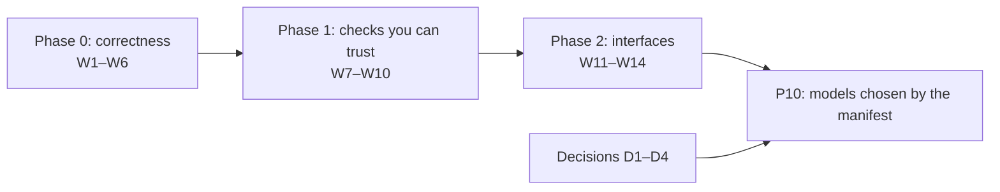

# Repository audit, 13 October 2026

**Scope:** the whole repository after P09: the three Python packages, the
browser viewer, the tests, the checks, the CI and the documents.
**Question asked:** what has to change for the repository to take a hundred
contributors, and to let someone add a model, a device or a scenario
without understanding the whole architecture, by hand or through an AI
assistant.
**Verdict:** keep the architecture's boundaries. The packages, the services
and the generated contracts are real, named and enforced, which is rare at
this age. Three things come before the work of scale, in this order:

1. **Defects inside two of those boundaries.** A run's numbers depend on
   the moments a client asked for before (`AUDIT.22`). The adapters' storage
   accepts bytes it never verified (`AUDIT.23`). The protocol admits a
   pydantic that writes observations differently (`AUDIT.24`). The first is
   in the climate integration, the others are what a user outside the
   repository meets. No scaling work reaches any of them.
2. **One design decision.** The model contracts a contributor is pointed at
   belong to the engine's daily path. The reference scenario takes the
   richer run, which has no contract for its air (`AUDIT.1`). This is
   design, not scale, and it comes before any registry.
3. **Then scale:** the same request written out twenty-two times, caches in
   module globals that stall each other, checks that take 11 to 22 minutes
   and pass by test order, and no recipes.

The findings are numbered `AUDIT.1` to `AUDIT.30`. The
[work plan](#work-plan) turns them into pull requests, each with the
findings it closes and what tells that it is done.

Part of the [audits](README.md). The earlier frontend audits of 6 and 11
October are recorded in the roadmap's
[frontend maintenance plan](../roadmap/frontend-maintenance.md).

## Using this audit to start work

- **Pick a work item** from the [work plan](#work-plan). The items of one
  phase are independent of each other; a phase's prerequisites are named.
  The decisions (D1 to D4) are the maintainer's, and nothing that depends
  on one starts before its record is accepted.
- **Write the "done when" test first.** Each item ends with a test or a
  check that fails today; the pull request makes it pass.
- **Cite the finding** in the pull request (`Fixes AUDIT.23`), and update
  the finding's status in the [table of findings](#findings-at-a-glance)
  in the same pull request. The text of a finding is not rewritten once its
  work begins (see [the audits' README](README.md)).
- **Follow the [don'ts](#what-not-to-do).** Some proposals in the first
  version of this audit were unsafe or unproven; they are listed there so
  that nobody revives them by accident.

## Provenance

- **Commit audited:** `1497c30` on `main` ("Merge pull request #145"),
  2026-10-13, with #141 to #146 merged: P09.9's one command, the demo
  walkthrough, the checkpoint hour, the browser lanes (decision 0032) and
  the Dependabot plan.
- **Reviewed:** by two independent reviews on
  [#148](https://github.com/AndreyBesedin/greenhouse-open/pull/148), on 13
  and 14 October. The
  [first](https://github.com/AndreyBesedin/greenhouse-open/pull/148#pullrequestreview-5510450237)
  checked `AUDIT.1` to `.21` one by one. The
  [second](https://github.com/AndreyBesedin/greenhouse-open/pull/148#pullrequestreview-5517320666)
  audited `main` at `b87f7c7` before reading this document, then compared
  them claim by claim. It also covered the protocol and the adapters, which
  the first version measured only by size. This version combines the three,
  and links each review comment where a finding rests on it.
- **Re-checked for this version** on `main` at `467821f`, 2026-10-14,
  after #147 and #149 to #158. The packages' source, the viewer's source
  and the simulator's tests are the same as at `1497c30`; what changed is
  Dependabot (decision 0033), the review acknowledgement of its pull
  requests (decision 0034), the workflows and the documents.
- **What was read:** every module docstring of the simulator, the core,
  the model contracts, the climate's house model and sources, the services'
  caches, the API's routes and server, the scenario configuration and the
  reference manifest, the viewer's `App`, scene source and loaders, every
  guardrail test and check script, the CI workflows, the risk gate, and
  the engineering, contributing and roadmap documents; on review, the
  protocol's records and checks, and the adapters' storage, command line
  and canonical tier.
- **What was measured:** sizes, the import graph between subpackages,
  function lengths and parameter counts, what stricter Ruff rule sets would
  flag, repeated helper names, the viewer's state and loaders, docstring
  coverage, the simulator's tests with per-test timings, alone and in the
  suite, a profile of the slowest one, and the repository checks' time over
  37 CI runs.
- **Run:** the simulator's full suite, locally (3,532 passed, 4 skipped);
  the reviewers ran the checks of `scripts/check.py` and the viewer's
  lint, typecheck, unit tests with coverage and build. The reproductions
  of `AUDIT.19`, `.22`, `.23` and `.24` were run again for this version.
  The [table of findings](#findings-at-a-glance) says how each finding
  was checked.
- **Not run:** the browser tests, the visual comparison, the CFD tests,
  the network downloads and any calibration against measurements; their CI
  results were read instead.

## The repository in numbers

At `467821f`:

| | Source | Tests |
| --- | --- | --- |
| `greenhouse_protocol` | 15 files, 1,076 lines | 7 files, 690 lines: 47 test functions, 50 cases |
| `greenhouse_sim` (package) | 153 files, 19,502 lines | 100 files, 17,033 lines: 845 test functions, 3,536 cases (4 skipped without OpenFOAM) |
| `greenhouse_adapters` | 28 files, 2,392 lines | 11 files, 1,038 lines: 54 cases (2 skipped offline) |
| viewer, hand-written | 204 files, 16,387 lines (generated files and tests apart) | 455 unit cases in 69 files; 119 browser cases in 50 files |
| documents | 34 decisions, 14 roadmap documents | |

601 commits on `main`, by one author, since 2026-09-24, and one tag,
`v0.1.0`. The last 150 commits touch a median of 1 file and, at the 90th
percentile, 13. The most changed files are `web/src/App.tsx` and
`web/README.md` (52 commits each), `api/routes.py` (36),
`web/src/styles.css` (34) and `services/fields.py` (32): the hubs this
audit comes back to.

## Assessment

What to keep, because it works:

- **Named boundaries, each with a test.** The protocol depends on nothing;
  a package imports only what it declares (`tests/test_dependencies.py`);
  the domain depends on nothing else and holds every shared kind
  (`test_domain.py`); only the plant model reads its own state
  (`test_model_state_boundary.py`); ground truth is imported only by
  evaluation and the sensors' service, though the API serves it
  (`AUDIT.26`); APIs reach their package through services only
  (`check_api_layers.py`); the public import paths are listed
  (`test_public_imports.py`).
- **Contracts generated, not copied.** The scene, the field and the CFD
  geometry are Pydantic models whose JSON Schemas are committed and turned
  into the viewer's types and validators, and tests fail when either side
  drifts. The scenario manifests and layouts are checked against schemas
  generated the same way.
- **Numbers carry names,** enforced on both sides (`check_named_constants.py`,
  Biome's `noMagicNumbers`). Strict mypy and strict TypeScript, with no
  `type: ignore`, no `noqa`, two `as unknown as` in the viewer, nine
  explained `biome-ignore`s and no TODO anywhere. `Any` appears at a few
  boundaries only: an event's parameters and the adapters' metadata
  (`AUDIT.27`).
- **Decisions and roadmap in the repository,** 34 records, each superseded
  rather than edited, and a roadmap that records what was built against
  what was planned.
- **The engine's models plug in through protocols** (decision 0006):
  `PlantModel`, `EnvironmentModel`, `SensorModel`, `AirflowModel`,
  `WeatherSource`, `Environment`, `CropLight`, `WorldCheckpoints`,
  `ActionExecutor`, each with a reference implementation and a contract
  test. The reference scenario's run uses some of them and not the others
  (`AUDIT.1`), and the protocol's own execution contracts have no
  implementation (`AUDIT.27`).
- **Seeded draws:** every draw is seeded from the scenario's seed, the
  process, the subject and the index, and the observations come out the
  same after a scrub. The integration of the air is the exception
  (`AUDIT.22`).

What the suites establish is behaviour and repeatability, not scientific
calibration. P09 records its approximations, in
[its document](../roadmap/p09-integrated-scenario.md): the crop's
transpiration and CO₂ uptake do not feed back into the air, its water
status stays at 1, and the house's shading takes the crop's first crowns.

Where it will not scale as it stands, or is not right yet: the sections
below.

## Findings at a glance

**Status:** *confirmed* as first written; *corrected* where the review
changed what it says or what to do; *new* where the review found it.
**Checked:** *run*, reproduced for this version; *read*, confirmed in the
code at `467821f`; *review*, reproduced by a review and not again here.
**Priority:** **now** (phase 0 of the work plan), **next** (phase 1),
**decide** (a decision record first), **P10**, or **when touched**.

| Finding | Status | Checked | Priority | Work |
| --- | --- | --- | --- | --- |
| `AUDIT.1` Two simulation paths, and the contracts belong to the older one | corrected | read | decide | D1 (decision 0035, #180), P10 as [P14](../roadmap/p14-models-by-manifest.md) |
| `AUDIT.2` Models are chosen by code, not by the manifest | corrected | read | P10 | P10 as [P14](../roadmap/p14-models-by-manifest.md) |
| `AUDIT.3` A new device touches ten files | corrected | read | P10 | P10 as [P14](../roadmap/p14-models-by-manifest.md) |
| `AUDIT.4` One model's parameters sit at the top of every scenario | confirmed | read | P10 | P10 as [P14](../roadmap/p14-models-by-manifest.md) |
| `AUDIT.5` There is no recipe, for a person or an assistant | corrected | read | now | W6 (#164), W14 (#263) |
| `AUDIT.6` The run request is written out 22 times | corrected | read | next | W11 (#280) |
| `AUDIT.7` Five caches, five locks, and what they share | corrected | read | next | W9 (#253) |
| `AUDIT.8` The viewer validates by hand what the simulator could publish | corrected | read | next | W12 (#264, #267, #281, #282, #293) |
| `AUDIT.9` Small Python toolboxes worth naming | corrected | read | when touched | W13 (#256, #257, #259) |
| `AUDIT.10` The layering between subpackages is not checked | corrected | read | decide | D3 (decision 0037 and its ratchet, #182) |
| `AUDIT.11` Ruff checks five rule families | confirmed | run | when touched | W15 (#292, #296, #324, #325, #327, #328) |
| `AUDIT.12` The checks take 11 to 22 minutes, in one job | corrected | run | next | W7 (#169), W8 (#184, #185, #186) |
| `AUDIT.13` Supply chain and the review gate | corrected | read | next | W7 (#169, #170, #171), D4 (decision 0038, #183) |
| `AUDIT.14` Nothing in the packages logs | corrected | read | when touched | W15 (#298) |
| `AUDIT.15` Module globals and threads make tests order-dependent | corrected | run | next | W8 (#184, #185), W5's follow-up (#191), W9 (#253), W15 (#299, #300, #309, #313, #318, #322) |
| `AUDIT.16` The prose is consistent, dense and tied to the roadmap | corrected | read | when touched | W14 (#263) |
| `AUDIT.17` Four hubs carry the weight | corrected | read | when touched | W11 (#280), W15 (#310, #312, #314, #315, #329) |
| `AUDIT.18` The test suite's shape | corrected | read | next | W8 (#184, #185, #186) |
| `AUDIT.19` What the benchmark and the profile point at | corrected | run | next | W10 (#193, #194) |
| `AUDIT.20` The viewer's global stylesheet and bundle | corrected | read | when touched | W15 (#316) |
| `AUDIT.21` The process is one developer's, and says so | corrected | read | decide | D4 (decision 0038, #183) |
| `AUDIT.22` A run's numbers depend on the moments asked for before | new | run | **now** | W1 (#162) |
| `AUDIT.23` The adapters' storage accepts bytes it never verified | new | run | **now** | W2 (#161) |
| `AUDIT.24` The packages admit a pydantic that writes observations differently | new | run | **now** | W3 (#160) |
| `AUDIT.25` What a client sends is checked for shape, not sense | new | review | now | W4 (#165, #166, #167, #192) |
| `AUDIT.26` Ground truth leaves by the API, which says it never does | new | read | decide | D2 (decision 0036, #181) |
| `AUDIT.27` The protocol's records are checked unevenly | new | read | next | W3 (#168, #174), decision 0046 and P13.1 for the rest (#323, #326) |
| `AUDIT.28` The adapters' command line and canonical tier | new | read | next | W2 (#161, the command line), #187, #188, #189, #190 |
| `AUDIT.29` The kept runs stall the server, and the openings go first | new | run | now | W5 (#163, #191) |
| `AUDIT.30` Documents that no longer describe the code | new | read | now | W6 (#164) |

## Work plan

Each item is one pull request or a short stack, and each leaves the
repository runnable. Item numbers are for reference, not order, within a
phase.



### Phase 0: correctness, now

Small, independent of each other and of any decision.

#### W1. Integrate on the lattice

`fix(sim)`. Fixes `AUDIT.22`.

- In `climate/house.py` (`_worked_to`) and `climate/run.py`
  (`_worked_to`), advance through the kept boundaries only: `STEP_S` or
  `KEEP_EVERY_S` multiples and the schedule's moments. Take the last
  sub-step to the moment asked for without keeping it, so that no later
  query starts from it.
- Bound `_steady` (`run.py:142,204`), which grows with every distinct
  level tuple: an LRU bound, or levels rounded to the schedule's
  resolution.

**Done when:** a test asks for t₁ then t₂ in one run, and for t₂ alone in
another, and finds the `HouseAir` and the grid's air bitwise equal; the
reference run's day-0 replay digest is the same after a query at 23:59:30
as fresh; three hundred distinct queries keep lattice moments only. The
kept replay digests stay as they are, or the pull request says why they
move.

#### W2. The adapters' storage layer, and its command line's errors

`fix(adapters)`. Fixes `AUDIT.23`, and the command line's part of
`AUDIT.28`.

- Verification describes the file it verified: drop the `.md5-verified`
  sidecar before every fetch, and tie it to the file's size and
  modification time, or drop it and always hash.
- `raise_for_status()` before the partial file is opened; a reply other
  than 206 to a Range request restarts the download explicitly; the size
  is checked, and the checksum verified, before `replace()`. A file that
  fails is moved aside, so that the next `resolve()` fetches again.
- Bounded retries with backoff for the upstream mirror.
- `cli.py` turns `ChecksumMismatch`, `httpx.HTTPError`,
  `zipfile.BadZipFile` and the parsers' `ValueError`s into one line and an
  exit code, as it does `ArtifactUnavailable`.

**Done when:** tests with `httpx.MockTransport` cover a 503 on a resume (the
partial file keeps its bytes), a truncated body (refused, moved aside,
fetched again), a replaced file and a re-fetch after a corrupt one (both
refused); a test runs the command line on each error and finds no
traceback.

#### W3. The protocol's floor and its records' checks

`fix(protocol)`. Fixes `AUDIT.24`, then `AUDIT.27`.

- `pydantic>=2.12.2` in the three `pyproject.toml` files. A CI job installs
  the lowest versions the packages' metadata allows
  (`uv pip install --resolution lowest-direct`) and runs the protocol's
  and the adapters' tests, so that the next bound like this one is tested
  rather than trusted.
- Then, in its own pull request, `AUDIT.27`: one timezone-aware datetime
  type for every record's timestamps; `check_media`'s scoping check; the
  dead `source.type.strip()` rule removed; structure models that check
  their edits (decided in review: a description stays editable, its parts
  are values it replaces; #174); a sorted `quality`; a decision on the
  unimplemented execution contracts.

**Done when:** the lowest-version job is green, and fails on a branch that
sets the bound back to 2.9; a naive timestamp is refused on every record.

#### W4. Check what clients send for sense

`fix(api)`. Fixes `AUDIT.25`.

- `json.loads(..., parse_constant=...)` refuses `NaN` and `Infinity`;
  finite, bounded floats on `HouseAir`, `LocalEnvironment` and
  `Checkpoint`; an uploaded checkpoint's plants pass `Plant.problems()`,
  and their thermal time agrees with its `day`.
- `forget_checkpoints()` also drops the moments it seeded, or seeded
  state is keyed by checkpoint, so that it leaves with it.
- A body-size cap on `POST /api/checkpoints`, a 400 for a bad
  `Content-Length`; bounds on the envelope's query numbers and
  `PositiveInt`/`PositiveFloat` on `ScenarioConfig`'s counts and
  intervals.

**Done when:** tests post a checkpoint with `NaN`, one relabelled to another
day and one with a malformed `Content-Length`, and get 400s; a scenario
with `water_capacity_ml=0` or `truss_interval_days=0` is refused by
validation, not by `ZeroDivisionError`.

#### W5. Release the services' lock, and keep the openings

`fix(services)`. Fixes `AUDIT.29`.

- In `services/fields.py` (`_climate_day`) and `services/crop.py`,
  create the run and insert it under `_KEEPING`, then release the lock
  before carrying on from another run.
- `ClimateDay.carry_on_from` (`climate/day.py:114`) carries on only the
  later grid windows that start before the two schedules first differ,
  instead of working the new run's house out to each of them.
- The opening-day checkpoints loaded at start are exempt from eviction,
  or counted outside `KEPT_CHECKPOINTS`.

**Done when:** with a six-day request on the reference run in flight, a test
gets an unrelated scenario's kept air in under a second; a branch made
after a query at day 80 takes as long as one made fresh (the replay test
takes about 6 s after `test_reference_qa.py`, against 136 s today);
sixteen saved checkpoints leave the openings kept.

#### W6. A minimal entry point, and the stale documents

`docs`. Starts `AUDIT.5`; fixes `AUDIT.30`.

- A root `AGENTS.md`, with a `CLAUDE.md` pointing at it: where the rules
  are, what to run before a commit, which files are generated, which
  simulation path to extend today (until D1 says otherwise), and this
  audit. The Copilot instructions become one reader of it.
- The README's "Write or compose a model" row says that the reference
  scenario takes the run, not the engine's contracts.
- The stale documents of `AUDIT.30`.

**Done when:** `test_publishable.py` checks the paths `AGENTS.md` names.

### Phase 1: checks you can trust

After W1 and W5, which remove the two known causes of order dependence.

#### W7. CI hygiene

`ci`. Parts of `AUDIT.12` and `AUDIT.13`.

- `concurrency` with `cancel-in-progress` on `ci.yml` for pull requests;
  `timeout-minutes` on every job; `permissions: contents: read` at the top
  of `ci.yml` and `cfd.yml`; actions and the OpenFOAM image pinned by
  digest, with the tag as a comment, as the auto-merge workflow already
  pins its metadata action.
- Playwright keeps a trace and a screenshot on failure
  (`trace: "retain-on-failure"`, `screenshot: "only-on-failure"`).
- The risk gate's `SENSITIVE_FILES` describes today's layout, with
  `scripts/` and the paths truth now passes through; `CODE_SUFFIXES`
  counts `.csv` and `.gz`; the acknowledgement is a ticked item on its own
  line, not a substring.
- `.gitattributes` marks the viewer's generated contracts as generated.

**Done when:** `actionlint` and the workflows' schema pass; a test of the gate
finds a change to `scripts/check_pr_risk.py` held for review.

#### W8. A suite that does not depend on its order

`test`. Fixes the measured parts of `AUDIT.12`, `AUDIT.15` and `AUDIT.18`.

- Measure first: each of the twenty slowest tests alone and in the suite;
  where they differ by more than a fifth, find why before moving anything.
- `tests/test_plant_population.py` builds its 400 plants in a
  module-scoped fixture, not at import.
- The repository checks as a matrix (`protocol`, `sim`, `adapters`,
  `root`), with `pip` and mypy's cache kept between runs.
- Season-long tests marked `slow`, run on `main` and nightly, with
  `--fast` the pull request's default, as the roadmap's CI-time note
  proposes; `pytest-xdist` declared in `requirements-dev.txt`, and the
  simulator's tests under `-n auto`, one process per worker.

**Done when:** the twenty slowest tests take the same time alone and in the
suite, within a fifth; a pull request's checks take under ten minutes at
the median of ten runs.

#### W9. The kept runs as one kind of store

`refactor(services)`. Fixes `AUDIT.7`; after W5.

One bounded, locked store type for the climate runs, the crops, the
checkpoints, the sunlight and the kept states, which keeps the
checkpoints' coordinated eviction, the carry-over and the lock order of
today; one `forget_everything()` for tests, and a fixture that forgets and
reloads the openings around any test that asks for a clean slate.

**Done when:** no test calls a store's own `forget_*`; the suite run in
reverse file order passes and takes as long.

#### W10. The profile's three costs

`perf(sim)`. Fixes `AUDIT.19`; after W1.

Equivalent calculations only (see [what not to do](#what-not-to-do)):
the glass's `cos_incidence` and `_within` over all surfaces at once;
`Schedule` indexed by moment, keeping same-time commands in order; the
run validated once per request (with W11).

**Done when:** the replay digests and the golden files are unchanged; the
benchmark's report shows the house's air at least twice as fast; the
report is compared on pull requests as a non-blocking comment.

### Phase 2: interfaces

#### W11. The run request

`refactor(services)`. Fixes `AUDIT.6`; shrinks `routes.py` (`AUDIT.17`).

A frozen `RunRequest` parsed once by the API and taken by every service
that takes a run, under the invariants of `AUDIT.6`. `Checkpoint` carries
one only with a format version and a migration.

**Done when:** `PLR0913` at six parameters passes; a test holds each
invariant of `AUDIT.6`.

#### W12. The contracts the viewer reads

`feat(viewer)`. Fixes `AUDIT.8`.

Every service result the viewer reads published as a schema from one list,
with the generated-files test covering them; one `loadJson` beside
`useLoad.ts`; a `charts/` toolbox. Adapters between the snake_case wire
and the viewer's camelCase models stay where they transform data.

**Done when:** no response is parsed by `isObject`; the generated-files test
lists every published contract.

#### W13. Toolboxes with one meaning each

`refactor(sim)`. Fixes `AUDIT.9`.

**Done when:** each shared helper has one definition and one meaning, and
the duplicated constants are one each.

#### W14. Recipes

`docs`. Fixes `AUDIT.5` and `AUDIT.16`; after D1, and grown with W11 and
P10.

**Done when:** each recipe names the files it touches and the test to run,
and `test_publishable.py` checks those paths exist.

### Decisions

Each is a decision record, and each needs the maintainer.

- **D1. Which path is the simulator** (`AUDIT.1`): the engine's models
  re-homed as rungs of the run, or the engine kept for batch runs and
  said to be so; and which contracts a contributor implements in each.
  It comes before P10 and before W14's model recipes.
- **D2. Where ground truth may leave** (`AUDIT.26`): a record that
  supersedes decision 0009's sentence and says truth leaves by
  `/climate/truth` only, or the truth routes behind a server flag
  (`--qa`).
- **D3. The layers** (`AUDIT.10`): the table, with type-only edges and
  the command lines' entry points as named exceptions, then a test that
  holds it.
- **D4. What merges by itself, and who reviews** (`AUDIT.13`,
  `AUDIT.21`): whether a `.pre-commit-config.yaml` hook's `rev` counts as
  a manifest that merges by itself; the ruleset's pull-request rule
  (`require_extra_approval_for_unattributed_changes` is on); and the
  policy when a second maintainer arrives.

### P10: models chosen by the manifest

Fixes `AUDIT.1` to `AUDIT.4`; after D1, W11 and W12.

1. One complete extension first: a model kind added through the manifest,
   run end to end, with its conformance test, its checkpoint state and the
   viewer showing it.
2. What that pilot shows a registry needs, recorded in the project's
   decision: a model's identity and version, its state in a checkpoint,
   reproducibility, how the viewer's build-time unions meet runtime
   plugins, and entry points (the adapters' command line already uses
   them).
3. Then the other kinds, devices by capability, and the simple model's
   numbers in its own section, by a versioned manifest migration with
   numerical equivalence tests.

### When touched

#### W15. As the files are touched

`AUDIT.11` (the Ruff families, a pull request each), `AUDIT.14`
(logging), `AUDIT.15`'s `Simulator` object, `AUDIT.17` (the hubs),
`AUDIT.20` (the stylesheet), each in its own pull request.

## What not to do

Proposals from the first version of this audit, or obvious next steps,
that the review showed to be unsafe or unproven:

- **Do not hold the sun's heat constant between weather changes.** It
  changes with the sun's direction, the shading and the glass at constant
  weather (`AUDIT.19`). Cache only an equivalent calculation keyed by all
  its inputs, or validate an approximation against the replay digests and
  conservation tests, in a decision.
- **Do not expect a cache refactor to fix the order dependence.** A
  `Kept` class, a `forget_everything()` or a `Simulator` object scopes the
  state but changes neither the integration (`AUDIT.22`) nor the eager
  carry-on (`AUDIT.29`). Fix those first.
- **Do not move tests out of the pull request's checks on a time read from
  one run.** The same commit has run in 10.2 and 20.7 minutes (`AUDIT.12`).
- **Do not write a test that a device kind may be named only by its owner
  and the registry.** It would refuse legitimate tests and migrations;
  test the capability contract instead (`AUDIT.3`).
- **Do not make line counts, hook counts or sentence lengths a trigger.**
  They describe the hubs and the prose; they are not a rule (`AUDIT.16`,
  `AUDIT.17`).
- **Do not put the run request inside `Checkpoint` as a refactor.** It
  changes the format saved and uploaded, and needs a version and a
  migration (`AUDIT.6`).
- **Do not claim that the past flaky tests share one cause.** Two causes
  are proven (`AUDIT.22`, `AUDIT.29`); the threads of `AUDIT.15` are not.

## Findings

### G. Correctness

Found on review, and listed first because the work begins with them.

#### AUDIT.22: A run's numbers depend on the moments asked for before

The random draws are deterministic, and the observations are the same
after a scrub. The integration is not. `WholeHouse._worked_to`
(`climate/house.py:255-274`) and `ClimateRun._worked_to`
(`climate/run.py:331-353`) build their stretches from the schedule's
changes, the steps and the moment asked for, and then keep the air at
that moment (`house.py:273`, `run.py:352`). The next query starts from
it, so the discretisation, and the numbers, follow the query history.

Reproduced at `467821f`, in a fresh process: the reference run's day-0
replay digest is `d38e07ee0d260af6` asked directly, and
`744adb10ead0dcf5` after one `house_air_at(t=86370)`. The review measured
the house's air at 120 s as 12.26118 °C asked directly and 12.26213 °C
after first asking for 90 s; 24 of 143 clean QA readings over ten minutes
differ in the fourth or fifth decimal. `services/replay.py` promises "the
same digests on every replay";
`test_the_reference_runs_first_days_replay_to_the_digests_kept` passes
because no earlier test in the process asks the module-global reference
run for an off-minute moment. Two viewer tabs scrubbing one run produce
two truths, and a checkpoint saved after a scrub holds different air than
a fresh run's.

The same lines let `_kept` grow with every distinct moment asked for
(300 slider positions: 410 entries, +36 MB), and `_steady` with every
distinct level tuple (200 heater levels: +65 MB).
[Review comment](https://github.com/AndreyBesedin/greenhouse-open/pull/148#discussion_r4270293358).
Work: W1.

#### AUDIT.23: The adapters' storage accepts bytes it never verified

`ArtifactResolver._verify` (`storage/resolver.py:124`) trusts a
`.md5-verified` sidecar that names the expected checksum, without knowing
that it describes the file now there. Reproduced: a verified file replaced
by other bytes of the same length is accepted; so is a corrupt file
fetched again after the original was deleted with its sidecar kept. The
provenance then names a checksum the input does not have.
[First review](https://github.com/AndreyBesedin/greenhouse-open/pull/148#pullrequestreview-5510450237),
with its script.

The upstream mirror's download (`resolver.py:53-76`) has three more
faults:

- It opens the partial file for writing (`"wb"`, truncating, unless the
  reply is 206) before `raise_for_status()`, so a 503 on a resume empties
  the partial file. The canopy archive is 31.4 GB, and there are no
  retries.
- It moves the partial file into place before `_verify`, so a truncated
  body lands at the final path. `ChecksumMismatch` fires, and every later
  `resolve()` fails until someone deletes the file by hand.
- It has no test: `test_storage.py` uses a recording mirror only.

[Review comment](https://github.com/AndreyBesedin/greenhouse-open/pull/148#discussion_r4270293321).
Work: W2.

#### AUDIT.24: The packages admit a pydantic that writes observations differently

`Observation` uses `Field(..., exclude_if=...)` (`observation.py:37-41`),
which pydantic added in 2.12: the source of 2.11.7 has no `exclude_if`,
2.12.0's names it 19 times. The three packages require `pydantic>=2.9`.
Under 2.11 the protocol imports, with a deprecation warning for the
unknown keyword, and writes `sensor_id`, `delivered_at` and `quality` that
2.12 leaves out. The canonical tier's byte-identical promise, and the test
that an observation naming none of them is written as before, then hold
only on versions the metadata does not require. On Python 3.14, `pip`
resolves 2.12 or later today, because 2.11's core has no wheels for it;
the bound is still wrong. Found while fixing it: 2.12.0 fails on Python
3.14 too, reading a validator's annotation that names its own model before
the model exists, and 2.12.1 was yanked, so the floor that works is
2.12.2.
[Review comment](https://github.com/AndreyBesedin/greenhouse-open/pull/148#discussion_r4270293336).
Work: W3.

#### AUDIT.25: What a client sends is checked for shape, not sense

Reproduced by the review against the running server:

- An uploaded checkpoint is checked for its format, digest, day, plant
  order and length, never for plausibility (`services/checkpoints.py:202-249`).
  It then seeds the shared climate and crop runs for every client. A
  day-80 reference checkpoint relabelled `day: 3` was accepted, and the
  crop then showed a 28-phytomer plant where a fresh process gives 8.
- `api/routes.py:454` parses bodies with `json.loads`, which accepts
  `NaN`. A checkpoint with `temperature_c: NaN` was accepted, the house's
  air answered `nan`, and the observations then failed with a 500.
  `forget_checkpoints()` leaves the seeded moments in place.
- `Content-Length: abc` raises in the handler thread and closes the
  connection without a response (`api/server.py:88`). A
  `Content-Length` larger than the body blocks the thread. There is no cap
  on the body's size.
- The query's numbers are unbounded: `?envelope=length:1e308` gives a 500
  by way of a `NaN`, `spans:20000` a 119 MB scene in 42 s, and
  `bays:200000` a `MemoryError`. In `ScenarioConfig`, `rows=-1` and
  `duration_days=-5` validate, `water_capacity_ml=0` and
  `truss_interval_days=0` end in `ZeroDivisionError`, and `random_seed=-1`
  in a `ValueError` from `SeedSequence`. Observation identifiers collide
  for cadences under a second (`cadence_s` is a `PositiveFloat`).

[Review comment](https://github.com/AndreyBesedin/greenhouse-open/pull/148#discussion_r4270293414).
Work: W4.

#### AUDIT.26: Ground truth leaves by the API, which says it never does

`GET /api/scenarios/{id}/climate/truth` (`api/routes.py:377-390`, by way
of `services/sensors.py`) answers any client with what the sensors truly
sampled; the viewer's `&qa=1` is a switch on the client side. Meanwhile
`api/__init__.py` says the API serves "never ground truth", and decision
0009 that it "serves no ground truth". The boundary the repository
actually keeps is that truth never travels inside an observation, and
leaves only by `/climate/truth`.
[Review comment](https://github.com/AndreyBesedin/greenhouse-open/pull/148#discussion_r4270293347).
Work: D2, then the risk gate's list (W7).

#### AUDIT.27: The protocol's records are checked unevenly

The package every producer and consumer depends on, read on review:

- Only `MediaCapture` refuses a naive timestamp (`media.py:46-51`).
  `Observation`, `Event`, `CameraFrame` and `GreenhouseDescription` accept
  one, and one naive record among aware ones makes
  `InMemoryObservations.list_for_greenhouse` raise from `sorted()`. The
  README says timestamps are "always timezone-aware";
  `check_observations` catches it only for a producer that runs it.
- `Event` and `Sensor` are `frozen=True` but unhashable: their
  `parameters: dict[str, Any]` and `intrinsics` are dictionaries.
- `check_media` lacks the scoping check the other three `check_*` share;
  `check_observations` tests a `StrEnum` for emptiness, a rule that cannot
  fail.
- The structure models (`GreenhouseDescription`, `Plant`, `Compartment`,
  `GreenhouseLayout`, the actions, `ActionOutcome`) are mutable, and
  their uniqueness is checked only at construction.
- `quality` is a `frozenset` written in set order: stable while the enum
  has one member, dependent on `PYTHONHASHSEED` once it has more.
- `contracts/execution.py` and `execution.py` have no implementation and
  no test; seven public names, in the protocol and the adapters, have no
  caller.

[Review comment](https://github.com/AndreyBesedin/greenhouse-open/pull/148#discussion_r4270293336).
Work: W3.

#### AUDIT.28: The adapters' command line and canonical tier

- The command line catches `ArtifactUnavailable` only (`cli.py:193-197`):
  `ChecksumMismatch`, whose message carries the remedy, HTTP and proxy
  errors, a bad zip and the parsers' errors all end in a traceback. No
  test imports `cli.py`.
- The builds stamp `datetime.now(UTC)` when there are no observations
  (`agc4_challenge_2024/build.py:135`, `agc4_pretrial_2023/build.py:81`),
  two lines under "a pure function of the source data".
- `excel_serial_to_utc` (`wur/common/time.py:32-37`) silently picks a side
  of a daylight-saving fold or gap, where `matlab_datenum_to_utc` refuses
  both, as the README promises. It is used by a test only.
- No build runs the protocol's `check_*`: `float(raw)` turns `NaN` and
  `inf` text into values, and duplicate rows give duplicate identifiers
  that the canonical tier writes.
- Smaller: an artifact's name is a path component without validation;
  text I/O without `encoding=`; `inventory --write` writes into
  `site-packages` for a wheel install; `GREENHOUSE_ONLINE_TESTS=1` is in
  no document; `destructive.py` and the 2024 `build_greenhouse` have no
  test.

[Review comment](https://github.com/AndreyBesedin/greenhouse-open/pull/148#discussion_r4270293321).
Work: W2 for the command line, the rest when touched.

#### AUDIT.29: The kept runs stall the server, and the openings go first

- **One lock for every request.** `_climate_day` (`services/fields.py:182-218`)
  holds the module-wide `_KEEPING` while it builds a new run and while
  `run.carry_on_from(other)` waits for the other run's `_working`, which
  `WholeHouse.air_at` holds for a whole multi-day computation;
  `services/crop.py` has the same shape. Measured on review: with a 6-day
  request on the reference run in flight, a new branch at t = 0 waited
  32.7 s, and an unrelated, already kept `climate_box` request 31.7 s.
  One deep scrub freezes every other panel and scenario; `docs/demo.md`
  puts this on the browser's six connections.
- **A new run works out the house to every day its siblings were asked
  about.** `ClimateDay.carry_on_from` (`climate/day.py:114-124`) starts,
  for each later grid window the other run has, a window of its own,
  which works the new run's house out to that window's start, even when
  the two schedules differ from the first day and nothing can be shared.
  Profiled: after `test_reference_qa.py`, which asks the reference run
  for days 21 and 80, those windows take 150 of the replay test's 160 s
  under the profiler (136 s without it); the test takes 6.4 s alone.
  All of it runs under the lock above.
- **The openings are the first evicted.** The checkpoints are kept
  oldest-out (`services/checkpoints.py:72,311-317`), and the opening-day
  checkpoints loaded at start (`api/server.py:65`) are the oldest, so the
  fifteenth save drops them, and the next fresh reference run works out
  80 days.

[Review comment](https://github.com/AndreyBesedin/greenhouse-open/pull/148#discussion_r4270293369).
Work: W5.

#### AUDIT.30: Documents that no longer describe the code

- `web/README.md` describes a 1 m grid and cube "being built out in P00".
- `docs/demo.md` names the scenario `reference-greenhouse-v1`; its id is
  `reference_greenhouse`.
- The README calls the 119-case browser suite "a Playwright smoke test",
  as decision 0010 did.
- `CONTRIBUTING.md` presents `npm ci` as for working on the viewer, where
  the Biome hook (`language: system`, `files: ^greenhouse_sim/web/`)
  needs it for any commit that touches `web/`, a README fix included.
- Decision 0008 says Node 24 is "required through `engines`", which only
  warns without `engine-strict`: Node 22 passes every viewer check.
- Three of the commits before this audit, and #146's title, lack a
  Conventional Commits type; decision 0002 provides for a check "if
  drift appears".

[Second review](https://github.com/AndreyBesedin/greenhouse-open/pull/148#pullrequestreview-5517320666).
Work: W6.

### A. Modularity: adding a model, a device or a scenario

#### AUDIT.1: Two simulation paths, and the contracts belong to the older one

The simulator has two ways of running a scenario:

- **The engine's day,** `core/engine.py`: `SimulationEngine` advances a
  `GreenhouseWorld` a day at a time through `EnvironmentModel`,
  `PlantModel` and `SensorModel`, defaulting to the simple tomato model, the
  simple environment and the simple sensor model. This is what
  `greenhouse_sim.engine` exports, what the examples run, what the live
  stream plays (`services/live.py` builds it directly), and what the
  README's "Write or compose a model" row points at.
- **The run,** built from P05 to P09: the house's air every minute
  (`climate/`), the sun (`solar/`), the organ-level crop living each day in
  that air and light (`core/crop.py`, built by `services/crop.py`),
  sensors sampling that run (`sensors/air.py`, `sensors/log.py`),
  checkpoints, branches and replay. This is what the reference scenario
  is, what the viewer draws, and what every service from `fields` to
  `run_state` serves.

The run path has its own protocols (`CropLight`, `Environment`,
`WeatherSource`, `AirflowModel`) but none for the air model: the
well-mixed house is a class, `WholeHouse`, built directly
(`climate/day.py:59`); the grid run, `ClimateRun`, likewise. The three
contracts the README advertises for model writers are the engine's, and
the reference scenario does not pass through them.

Someone arriving to "add an air-flow model" or "add a plant model" finds a
contract that the flagship scenario does not use, and a flagship path with
no contract. **Corrected on review:** the first version called the
remaining work "scale, not design"; this mismatch is design, and it is
decided before any registry.

Acceptance:

- D1 says which path is the simulator and what becomes of the other:
  either the engine's models are re-homed as rungs of the run (the simple
  daily model as a `CropModel` beside `organ`, the simple environment as
  the lowest rung of the air), or the engine is kept for batch runs and
  said to be so.
- The run's exchangeable parts have contracts in `contract.py` files, as
  the engine's do: the house's air, the cell-by-cell air, the plant's day,
  the sensor's sample, each with a conformance test parametrized over its
  implementations, as `test_model_contracts.py` is.
- Until then, the README says which contracts the reference scenario
  takes (W6).

#### AUDIT.2: Models are chosen by code, not by the manifest

A manifest chooses its weather (`kind: constant | synthetic | recorded`)
and its airflow by a discriminator, and the schema lists the kinds: that
is the right shape. But the crop model is a closed enum
(`CropModel.SIMPLE | ORGAN`), the house's air has no choice, the sensor
model none, the plant's responses none, and nothing outside the package
can add a kind. The engine takes models by constructor injection, which
only Python code can do. There is no registry of model kinds and no entry
point by which an installed package could register one in the simulator;
the adapters' command line already discovers commands by entry points
(`greenhouse_adapters/cli.py`).

Acceptance, through P10's pilot first (see the [work plan](#work-plan)):

- Every exchangeable model is a `kind`-discriminated section of the
  manifest (`air`, `crop`, `sensors`, `light`) with its own parameters
  inside, by a versioned migration (decision 0031 provides for it).
- A registry per contract maps a kind to its model, filled from the
  package's own kinds and from entry points. **Added on review:** a
  model's identity and version are recorded in the run's manifest and its
  checkpoints, its state is saved in a checkpoint, and the viewer's
  generated unions say what they do with a kind the build did not know.
- A contributed model is a folder with the model, its parameters, its
  contract test and one manifest that uses it.

#### AUDIT.3: A new device touches ten files

Adding a fourth piece of equipment (a CO₂ doser, a fogging line, a
screen) today means: a member of `domain.equipment.ActuatorKind`; a class
in `world/equipment.py`; an `isinstance` branch in `climate/sources.py`;
a member of `scene.snapshot.SceneEntityKind`; its entity in
`scene/snapshot.py`; its renderer in the viewer's `RENDERERS`, a category
in `debug/categories.ts`, its controls; and, where it changes the house,
`climate/house.py` and `climate/settings.py`. The dehumidifier is named in
eight source files beyond the two it qualifies.

Acceptance (P10):

- A device says what it does to the air through one protocol: its
  velocity added, heat added and water removed per cell at a level, and
  what it obstructs. `sources.py` dispatches on the protocol, not on the
  class.
- The scene publishes one `EQUIPMENT` kind with the device's kind as an
  attribute, so the viewer draws an unknown device as its box, and a
  renderer is an improvement, not a compile error.
- The layout schema's `equipment` items take their kinds from the device
  registry, so a layout can place a contributed device.
- **Corrected on review:** a conformance test of the capability protocol,
  not a test that a kind is named only by its owner and the registry.

#### AUDIT.4: One model's parameters sit at the top of every scenario

`ScenarioConfig` carries about 25 flat fields that belong to the simple
daily model and its sensor noise (`water_capacity_ml`,
`stem_growth_cm_per_day_base`, `truss_interval_days`,
`fruit_count_noise_probability`, ...), beside the nested sections the later
projects added (`climate`, `weather`, `airflow`, `cfd`, `site`,
`crop_work`). The reference scenario, which does not use that model,
carries them anyway, and a reader of its manifest cannot tell which numbers
act on its run.

Acceptance (P10): those fields move into the simple model's section under
`crop` and the sensor model's under `sensors`, by a versioned migration
whose test finds every scenario's numbers unchanged.

#### AUDIT.5: There is no recipe, for a person or an assistant

The documents explain the direction, the rules and the decisions. None of
them answers "how do I add a scenario, a layout, a weather day, a device,
a model?" in the order a contributor would do it, ending in the test that
proves it. `.github/copilot-instructions.md` holds the invariants for one
reviewer; no `AGENTS.md` at the root offers them to any other assistant.

Acceptance:

- **Now (W6), corrected on review:** a minimal `AGENTS.md`, rather than
  waiting for the refactors to settle; it grows with them.
- **With D1, W11 and P10 (W14):** a `guides` folder, one short recipe each,
  with the files touched and the test to run: a scenario from a manifest;
  a layout; a weather; a device; an air model; a plant model; a viewer
  panel with its loader; an API route with its service. A test checks that
  the files each recipe names exist.

### B. Repeated patterns, and the toolboxes they want

#### AUDIT.6: The run request is written out 22 times

A run is asked for by eight things: the scenario, its layout, its
equipment's levels, its openings, its commands, its daily commands, its
weather and the moment. The API reads them from the query in fourteen
`match` arms of `respond` (226 lines); 22 service functions take them as
positional parameters; 37 functions in the packages take six or more
parameters, nearly all these. `Checkpoint` names the same fields, and the
viewer already has the value object the Python side lacks: `ScenarioRun`
with `runParameters(run, parts)`.

Acceptance: a frozen `RunRequest` in `services/runs.py`, parsed once by the
API and taken by every service that takes a run. **Added on review:** it
keeps these invariants, each with a test:

- The run's identity is apart from the moment and the trace's window: the
  kept runs' keys leave out time on purpose.
- Commands keep their order, same-time commands included.
- `daily=None` stays apart from an empty daily schedule.
- Defaults resolve, and errors answer, as they do now.
- `Checkpoint` carries a request only with a format version and a
  migration, since uploads are in the old shape.

#### AUDIT.7: Five caches, five locks, and what they share

`services/fields.py` (8 climate runs), `services/crop.py` (4 crops),
`services/checkpoints.py` (16 checkpoints), `services/sunlight.py` (the
sunlight; missing from the first version) and `services/kept_states.py`
each hold a module-level store behind a module-level lock, with its own
eviction and a `forget_*` for tests. They are not independent: the kept
states' lifetime follows the checkpoints', the climate runs and the crops
carry on from each other, and the locks are taken in an order.

**Corrected on review:** the first version blamed the benchmark's fixture,
which forgets every store and the openings, for doubling the repository
checks at #140. The same commit has since run in 10.2 and 20.7 minutes
(`AUDIT.12`), so the spread is the runners', and the measured order
dependence has the two causes of `AUDIT.22` and `AUDIT.29`, which a cache
refactor does not change.

Acceptance (W9, after W5): one store type, which keeps the coordinated
eviction, the carry-over and the lock order; one `forget_everything()`;
a fixture that forgets and reloads the openings around any test that asks
for a clean slate. A `Simulator` object that owns them (`AUDIT.15`) is a
later step, not a prerequisite for `-n auto`.

#### AUDIT.8: The viewer validates by hand what the simulator could publish

Three API responses arrive as generated contracts; the other fifteen or
so (`loadHouseAir`, `loadWeather`, `loadWeatherDay`, `loadProbeCharts`,
`loadRunState`, `loadRunManifest`, `loadTimeline`, `loadSensorReadings`,
`loadCropPlant`, `loadPlantsLight`, `loadCheckpoints`, `loadScenarios`,
...) are parsed by hand with `isObject` (written five times) and
`isNumbers` (four times, with two different meanings), each in a
`try { fetch; ok; json; parse } catch` of the same ten lines. Each of
those responses is already a Pydantic model on the Python side. The chart
components repeat `WIDTH`, `HEIGHT` and `PERCENT` seven times,
`POINT_DECIMALS` four times and `polyline` three times.

Acceptance (W12): every service result the viewer reads published from one
list of contracts; one `loadJson(url, validate, fetchFn)`; a `charts/`
toolbox. **Corrected on review:** the generated validators replace the
checks of the wire's shape; adapters that turn the snake_case wire into
the viewer's camelCase models, and the error states the loaders show,
stay.

#### AUDIT.9: Small Python toolboxes worth naming

- **Short digests** name a manifest, a climate run, a checkpoint, a
  replay and a CFD result, each with its own
  `hashlib.sha256(...).hexdigest()[:N]`: one `short_digest(text, length)`.
- **Schema export and "the committed file equals the export"** is written
  for the scene, the field, the CFD geometry, the manifest and the layout:
  one `publish(model, path)` and one parametrized test.
- **"The latest kept before a moment"** is written with `bisect` in
  `climate/house.py`, `weather/recorded.py` and `weather/sources.py`.
  **Corrected on review:** `climate/openings.py` bisects pressure, not
  moments, and the weather's interpolation and the house's lookup have
  different contracts; share only what has the same meaning.
- `_between`, `_within`, `_vector`, `_unit`, `_rounded`, `_pairs`,
  `_checked` and `_every` are defined twice each, mostly with different
  meanings: rename towards what each does, or share the ones that are the
  same. **Added on review:** `SECONDS_PER_HOUR` four times (one an `int`),
  `HALF_TURN_DEG` four times, `AIR_DENSITY_KG_M3` in `cfd/setup.py` and
  `climate/transport.py`, `DAY_S` in `solar/plants.py` beside
  `core/clock.py`.

Keep new helpers out of `core` while `AUDIT.10` is trying to move it above
the models.

### C. Rules and guardrails missing

#### AUDIT.10: The layering between subpackages is not checked

The domain is kept at the bottom and the API at the top, and nothing in
between is checked. The import graph has ten mutually importing pairs:
`core`↔`biology`, `core`↔`climate`, `core`↔`scenarios`, `core`↔`sensors`,
`core`↔`environment`, `biology`↔`world`, `climate`↔`weather`,
`solar`↔`weather`, `cfd`↔`scenarios` and `cfd`↔`services`
(`cfd/__main__.py` imports the services). `core` imports `climate`,
`solar`, `scenarios`, `sensors` and `environment`: it is the engine and
the run's crop, which sit above the models. **Corrected on review:** these
are dependencies between packages in aggregate, not broken imports; some
are for types only, and some are command-line entry points.

Acceptance: D3 names the layers, for example `domain` < `world`, `fields`
< `weather`, `solar`, `airflow`, `biology` < `climate`, `sensors`, `cfd` <
`scenarios` < `core` (or `run`) < `scene`, `evaluation` < `services` <
`api`, with type-only edges and entry points as named exceptions; a test
or `import-linter` then holds the table.

#### AUDIT.11: Ruff checks five rule families

`select = ["E", "F", "I", "UP", "B"]`. A dry run of other families over the
three packages, reproduced on review: `PLR0913` too many arguments 37
(`AUDIT.6`), `C901` 5, `RUF` 41, `ARG` unused arguments 14, `N` naming 11,
`SIM` 2, `PERF` 1, `ERA` commented-out code 2, `D1` missing public
docstrings 298, `TRY` 174, nearly all long messages built in `raise`,
which this codebase does on purpose.

Acceptance (W15): a family at a time, each pull request fixing what it
finds, `PLR0913` after `AUDIT.6`; recorded in a decision beside 0010. More
findings from a rule are not more defects.

#### AUDIT.12: The checks take 11 to 22 minutes, in one job

The repository checks run ruff, mypy and pytest for three packages and the
root, serially, in one job. Over the 37 successful CI runs up to
2026-10-14 they took 10.8 to 21.7 minutes, 18.5 at the median. **Corrected
on review:** the first version read 10.2 and 20.6 minutes, either side of
#140, as a regression the benchmark's fixture caused. The same commit,
`1c3bedd`, has since run in 10.2 and 20.7 minutes, with every step about
twice as long in the slower run (the simulator's tests 564 s against
1,166 s, mypy 6 s against 12 s), and Dependabot's pull requests, with no
Python change, took 10.8 to 21.3. The spread is the runners'.

`ci.yml` has no `concurrency` group, so a stack of pull requests pushed
together runs every job of every push to the end; the browser lanes run in
parallel beside it, 6 to 8 minutes each.

The suite does depend on its order. Locally (3,532 tests, 9 min 3 s), the
two slowest tests take 182 s and 101 s:

| Test | Alone | In the suite | Marked `slow` |
| --- | --- | --- | --- |
| `test_opening_day.py::test_replayed_from_the_runs_start_the_opening_day_is_the_one_kept` | | 182 s | yes, run by CI's full pass |
| `test_replay.py::test_a_replay_gives_the_same_digests_and_a_branch_the_same_before_its_change` | 6.4 s | 101 s; 136 s right after `test_reference_qa.py` | no |
| `test_reference_qa.py::test_the_kept_views_are_what_the_simulator_gives` | | 19 s | yes |
| `test_reference_schedule.py::test_the_winds_direction_can_be_overridden_for_qa_and_an_open_door_follows_it` | | 13 s | no |

The replay test's difference is `AUDIT.29`'s eager carry-on, profiled.
Beyond it, the review measured the unmarked replay, checkpoint,
opening-day and schedule tests at 207 s of the fast pass, single tests at
up to 39 s; `test_plant_population.py` builds 400 plants at import, so
`-m "not slow"` deselects its five tests and still pays 25 s; collection
alone is 27 s.
[Review comment](https://github.com/AndreyBesedin/greenhouse-open/pull/148#discussion_r4270293381).

Acceptance: W7's `concurrency`, then W8: the order dependence gone, the
matrix, the season-long tests on `main` and nightly, `pytest-xdist`
declared and run one process per worker; a pull request's checks under
ten minutes at the median of ten runs.

#### AUDIT.13: Supply chain and the review gate

**Corrected on review**, after #147 and #158: Dependabot keeps the
dependencies and actions current, and merges minor and patch updates by
itself (decisions 0033, 0034); the repository's default workflow token is
read-only, and `pr-risk.yml`, `pr-risk-review.yml` and the auto-merge
workflow declare their permissions; the `main` ruleset requires nine
checks. What remains:

- `ci.yml` and `cfd.yml` declare no `permissions:`; no job has
  `timeout-minutes`, so a hung browser lane runs to GitHub's 360 minutes.
- Actions are pinned to major tags, except the auto-merge workflow's
  metadata action, and `cfd.yml` pulls `opencfd/openfoam-default:2412`,
  whose results the kept CFD results are compared with, by a mutable tag.
- No `pip-audit` or `npm audit` step; no `SECURITY.md` or issue templates;
  `CODEOWNERS` waits for a second owner.
- Playwright keeps no trace or screenshot of a failure
  (`playwright.config.ts`), so a failed lane uploads a report with nothing
  to diagnose a timing failure in.
- The risk gate's `SENSITIVE_FILES` (`scripts/check_pr_risk.py`) describes
  the layout before P06: not `services/sensors.py`, `api/routes.py` or
  `services/checkpoints.py`, through which truth and uploads now pass, nor
  `scripts/`, so a change to the gate itself is "normal". `CODE_SUFFIXES`
  lacks `.csv` and `.gz`, so replacing recorded weather or the shipped
  openings counts no line. The acknowledgement is matched as a substring.
- `scripts/dependabot_auto_merge.py` counts `.pre-commit-config.yaml` as
  a manifest, so a hook's `rev` bump merges by itself, while the workflows'
  bumps do not, "because an action's update changes code that CI runs".
  Whether a hook is the same is D4's.
- The viewer's generated contracts are not marked generated in
  `.gitattributes`.

[Review comment](https://github.com/AndreyBesedin/greenhouse-open/pull/148#discussion_r4270293394).
Work: W7, D4; the audit step and `SECURITY.md` with W7 or on their own.

#### AUDIT.14: Nothing in the packages logs

No module in the three packages imports `logging`, and the services say
nothing about what they computed, took over from a kept state, or evicted.
**Corrected on review:** the server is not silent; the standard library's
handler logs each request and its status, the wrapper logs failures with
their tracebacks, and each response carries `Server-Timing`.

Acceptance (W15): a logger per subpackage with a `NullHandler` at the
package root; the services log at `INFO` when a run is made, taken over or
evicted, with the run's digest, so that tests can assert on `caplog`
instead of on cache internals.

#### AUDIT.15: Module globals and threads make tests order-dependent

Besides the caches (`AUDIT.7`), `SCENARIO_REGISTRY` is read at import, the
live runs pace on daemon threads that are stopped and not joined, and the
API test's server runs on a daemon thread; ten modules import
`threading`. A test that leaves a thread or a cache behind changes what
the next test sees. **Corrected on review:** two order dependences are
proven (`AUDIT.22`, `AUDIT.29`); a failure caused by the threads has not
been reproduced.

Acceptance: fixtures that own and shut down what they start (W8); later, a
`Simulator` object that owns the registry, the caches and the live runs,
created by the server and by a test fixture (W15).

### D. Readability

#### AUDIT.16: The prose is consistent, dense and tied to the roadmap

The documents and docstrings have one voice, and it is a good one for a
reader who stays: 115 roadmap step tags (`P09.3`, `P07.1`) in 64 source
files, the API documented as a 156-line table in `routes.py`'s docstring
kept by hand beside 32 routes, and some lists written as single sentences.
A newcomer, or an assistant with a context window, pays for every word
before the first line of code.

Acceptance (W14): a docstring shape in `docs/engineering.md` (what the thing
is; its units, its contract and what it refuses; the project's history in
the roadmap), and the route table generated from the routes, by a test.
**Corrected on review:** the guidance a contributor needs first is which
path to extend and how a run's moments are worked out; sentence lengths
and docstring counts measure the prose, they are not a specification.

#### AUDIT.17: Four hubs carry the weight

`api/routes.py` 669 lines (`respond` 226), `services/fields.py` 630,
`web/src/App.tsx` 676 (18 `useState`s, 20 `useLoad`s, 17 props to
`ScenarioPanels`), `web/src/scene/source.ts` 630 (a `SceneSource` union
with 20 optional fields and its address codec). The two viewer files are
the most changed in the repository.

Acceptance: `AUDIT.6` shrinks `routes.py`; `fields.py` splits along its
sections; `App` keeps the source and the selection, and each feature owns
a hook that takes the run and returns its loads; `source.ts` splits the
type and its codec from the helpers that edit a source. **Corrected on
review:** a store or a reducer when the state's changes call for one, not
on a count of hooks.

#### AUDIT.18: The test suite's shape

100 test files in one folder, named by feature; golden files updated three
different ways; marks limited to `slow` and `cfd`; 17,033 lines of tests
for 19,502 of code, which is healthy. **Corrected on review:** the viewer
has 455 unit cases and 119 browser cases, not 387 and 118. Its coverage
(67.4% of statements, 59.8% of branches) is a little above its floors
(65, 57, 60, 66), with 26 files at 0%; decision 0030 says to raise the
floors as tests arrive. `test_live.py` expects a frame within 0.6 s of the
wall clock; `test_benchmark.py` never compares the kept report's manifest
version with the manifest's.

Acceptance: W8's isolation first; then `tests/<area>/` mirroring the
subpackages, one `--update-golden` option, marks for `season`,
`contract`, `golden`. **Corrected on review:** the browser tests'
`timeout: 20_000` already wait on state, and the demo's and the
benchmark's pauses are deliberate; replace only waits on time that stand
in for a state.

### E. Inefficiencies

#### AUDIT.19: What the benchmark and the profile point at

P09.8's benchmark found the sun's heat through the glass to be about 70%
of the house's air. Profiled for this version (the replay test after the
QA test, 220 s under the profiler): of 190 s in the house's integration,
the sun's heat takes 131 s, mostly the glass's `cos_incidence` and
`_within` (`solar/glass.py`, 628,520 calls) and the shadows' `lit`; the
equipment's and openings' levels (`levels_at`, `opening_levels_at`),
which scan the whole schedule through `applied`, take 41 s. Every change
of the viewer's run fires about twelve requests that each validate the
same run again.

**Corrected on review:** the first version proposed keeping the sun's heat
per stretch between weather changes. That changes the model: at constant
weather and 600 W/m², the solar lab's heat is 21,423 W at 10:00, 21,300 W
at noon and 21,339 W at 14:00, because it follows the sun's direction,
the shading and the glass.

Acceptance (W10): equivalent calculations only (the glass over all
surfaces at once, the schedule indexed by moment with same-time commands
in order, the run validated once); the replay digests and golden files
unchanged; the benchmark's report compared on pull requests as a
non-blocking comment. An approximation is a decision of its own, validated
against the digests and conservation tests.

#### AUDIT.20: The viewer's global stylesheet and bundle

`styles.css` is 963 lines and 162 selectors in one global namespace,
changed by 34 commits, with no `:focus-visible` rule, an 8 px font size
and one breakpoint. **Corrected on review:** the bundle is 1,494 kB
minified, 417 kB gzipped, 6 kB under Vite's 1,500 kB warning, which is a
warning, not a budget.

Acceptance (W15): a naming convention (`panel-`, `hud-`, `chart-`) with a
lint rule before any move to CSS modules; a report of unused selectors from
the browser tests; a bundle budget that fails the build, set above
today's size.

### F. Collaboration

#### AUDIT.21: The process is one developer's, and says so

Stacked pull requests merged with merge commits; a review policy that
requires no approval; a gate that asks the author to tick a box, and
Dependabot's pull requests to be approved (decision 0034); a changelog
without a release since `v0.1.0`. All of it documented and deliberate
(`docs/engineering.md`, "Solo-developer review policy"). **Corrected on
review:** `main` now requires nine checks; it requires no approval, no
resolved threads and no up-to-date branch.

Acceptance, when a second contributor arrives (D4): one approval and
resolved threads on `main`; `CODEOWNERS` by subpackage; a label taxonomy
(`model`, `device`, `scenario`, `viewer`, `good first issue`) seeded from
this audit; a release every roadmap project. How to merge and where to
name owners are the contributors' to agree, not this audit's.

## Measurements and reproductions

- **The replay digest after a scrub** (`AUDIT.22`), at `467821f`:

  ```python
  from greenhouse_sim.services import crop, fields, replay

  fields.forget_climate_runs(); crop.forget_crops()
  fresh = replay.day_probes("reference_greenhouse", 1)
  fields.forget_climate_runs(); crop.forget_crops()
  fields.house_air_at("reference_greenhouse", time_s=86400.0 - 30.0)
  scrubbed = replay.day_probes("reference_greenhouse", 1)
  print(fresh[0].digest, scrubbed[0].digest)  # d38e07ee0d260af6 744adb10ead0dcf5
  ```

- **The checksum** (`AUDIT.23`) and **the sun's heat at constant weather**
  (`AUDIT.19`): the scripts in the
  [first review](https://github.com/AndreyBesedin/greenhouse-open/pull/148#pullrequestreview-5510450237),
  run again for this version with the same output.
- **`exclude_if`** (`AUDIT.24`): `pydantic/fields.py` names it 0 times in
  2.11.7's source and 19 times in 2.12.0's.
- **The replay test's order dependence** (`AUDIT.12`, `AUDIT.29`):
  6.4 s alone; 6.5 s after `test_benchmark.py`; 100.9 s in the full suite;
  136 s, and 160 s under the profiler, right after `test_reference_qa.py`,
  where `ClimateDay.carry_on_from` → `_started` takes 150 s of it:

  ```sh
  cd greenhouse_sim
  python -m cProfile -o replay.prof -m pytest -p no:cacheprovider \
    "tests/test_reference_qa.py::test_the_kept_views_are_what_the_simulator_gives" \
    "tests/test_replay.py::test_a_replay_gives_the_same_digests_and_a_branch_the_same_before_its_change"
  ```

- **The repository checks' time** (`AUDIT.12`): the `repository checks`
  job of the 37 successful `ci.yml` runs up to 2026-10-14, from
  `gh run list --workflow ci.yml` and each run's jobs: 10.8, 10.8, 11.0,
  11.0, 11.0, 11.2, 12.7, 12.7, 12.7, 12.9, 15.1, 15.4, 15.8, 16.0, 16.1,
  17.3, 17.4, 17.8, 18.5, 18.7, 18.9, 19.3, 19.6, 19.7, 19.7, 19.9, 20.5,
  20.7, 21.0, 21.0, 21.1, 21.2, 21.3, 21.3, 21.3, 21.7 and 21.7 minutes.
- **The lock and the uploads** (`AUDIT.25`, `AUDIT.29`): the review's
  measurements, in its comments
  [on the caches](https://github.com/AndreyBesedin/greenhouse-open/pull/148#discussion_r4270293369)
  and [on the uploads](https://github.com/AndreyBesedin/greenhouse-open/pull/148#discussion_r4270293414).
