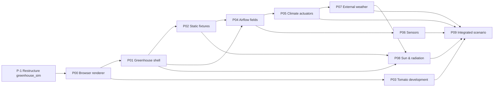

# Simulator roadmap

`greenhouse_sim` is growing from a small daily simulator into a modular,
visual and physical greenhouse simulation environment. This folder is the
public record of that work: one document per project, kept up to date by the
pull requests that implement it. How the folder is maintained is described in
[docs/engineering.md](../engineering.md#roadmap-and-decision-records).

## What the simulator is for

A permanent environment for synthetic data generation, counterfactual
testing, policy evaluation, digital-twin research, robot development and
reinforcement-learning or planning experiments. It should be useful on its
own, runnable without any hosted service, and expose contracts stable enough
for plant models, environment models, sensors, robots, actions and policies
to be developed against it.

Over time it should support:

- individual plants with persistent identity and organ-level structure
  (stems, internodes, leaves, trusses, flowers, fruits);
- stochastic longitudinal development that responds to temperature,
  radiation, CO₂, humidity, water and management actions;
- explicit 3D geometry for plants, greenhouse structures and equipment;
- spatially varying climate behind interchangeable models of different
  fidelity;
- virtual cameras and environmental sensors with realistic imperfections;
- robots, rails and actuators, and crop work such as pruning, harvesting and
  lowering;
- perfect ground truth for evaluation, while policies see only realistic
  observations;
- deterministic replay from fixed seeds, and batch simulation at scale.

The guiding hypothesis: **own the simulation world, its contracts, time,
state and orchestration; reuse or adapt specialist engines for biology,
rendering, physics, CFD and numerical acceleration.**

## Principles

- **Modular fidelity.** Every expensive or scientifically difficult
  subsystem sits behind an interface that admits several implementations,
  from a simple baseline to a high-fidelity backend. A simple backend that is
  explicit about its limits beats an impressive but inseparable monolith.
- **The canonical world state is ours.** External engines update or derive
  parts of it through adapters. They never become the global source of
  truth.
- **Ground truth is not observation.** The world state is what is true; an
  observation is what a particular sensor would report, with noise, occlusion,
  latency and gaps. Policies run on observations; evaluation compares them
  with the truth.
- **Data-oriented hot paths.** The domain API can expose plants and fruits as
  objects, but large populations are stored so that biological kernels can be
  vectorized and later moved to faster backends without a redesign.
- **Multi-rate simulation.** Robot physics, cameras, climate, physiology,
  development and crop work each advance at their natural timescale, and the
  orchestrator owns simulated time.
- **Deterministic stochasticity.** Every run is reproducible from a seed
  hierarchy (simulation, scenario, plant, organ or process), independent of
  batching or worker count where practical.
- **Sensor equivalence over visual beauty.** Rendering is judged by how well
  its output transfers to real sensor data, not by how it looks.

## Not goals for the first versions

Cell-level plant models, continuous full Navier-Stokes for a whole
greenhouse, botanically accurate deformable mechanics, cinematic realism for
its own sake, every crop or greenhouse technology, differentiable backends
throughout, a hectare at full fidelity in real time, or a viewer made for phones.

## Current technical choices

- Stay in this repository. `greenhouse_sim` is restructured and expanded;
  `greenhouse_protocol` and `greenhouse_adapters` keep their roles.
  Downstream applications may depend on these packages, never the reverse.
- Python for simulation and orchestration
  ([0003](../decisions/0003-require-python-3-14.md): Python 3.14).
- A browser viewer in React and TypeScript with Three.js through React Three
  Fiber, on WebGL first, with a renderer boundary that leaves room for WebGPU.
  The viewer and a thin local API are adapters around the headless core.
- Our own stochastic, organ-level tomato model. Existing functional-structural
  plant modelling work (GroIMP and the Virtual Tomato Crop, OpenAlea and
  PlantGL, CPlantBox) informs it as a scientific reference, not as a runtime
  foundation.
- One canonical environment-field interface with lightweight backends, and
  OpenFOAM as an optional external high-fidelity backend.
- Visual QA through deterministic scenario and seed URLs, Playwright
  screenshot regression and numerical probes.

Deliberately not decided yet: the acceleration path (Rust or JAX), the final
CFD engine and renderer, and a differentiability strategy. Those follow evidence
from the local simulator. Deployment beyond one machine is not built either;
[decision 0067](../decisions/0067-a-runs-resources-are-counted-and-limited-and-all-it-needs-is-in-the-store.md)
keeps the rules that leave it possible.

## Projects

Every project ends with a named browser QA scenario and an explicit
checklist. Every commit keeps the simulator runnable and, where practical,
adds a visible or measurable result. A project's document is added when its first
pull request lands, and holds the state of each of its steps. When the project
closes, its document moves to [the archive](archive/README.md) and its row here
links there.

| Project | Goal | Status |
| --- | --- | --- |
| [P-1](archive/p-1-restructure-greenhouse-sim.md) | Restructure `greenhouse_sim` into a modular foundation, without changing behavior | Done |
| [P00](archive/p00-browser-renderer.md) | Browser renderer and visual QA foundation | Done |
| [P01](archive/p01-greenhouse-envelope.md) | Greenhouse envelope and world geometry | Done |
| [P02](archive/p02-greenhouse-layout.md) | Static greenhouse fixtures and layout | Done |
| [P03](archive/p03-tomato-development.md) | Stochastic tomato development and procedural plant geometry | Done |
| [P04](archive/p04-environment-fields.md) | Environmental fields and airflow foundation | Done |
| [P05](archive/p05-climate-actuators.md) | Climate actuators: fans, heaters, dehumidification and vents | Done |
| [P06](archive/p06-virtual-sensors.md) | Virtual sensors and the observation layer | Done |
| [P07](archive/p07-external-weather.md) | External weather and greenhouse boundary coupling | Done |
| [P08](archive/p08-sun-and-radiation.md) | Sun position, glazing and radiation propagation | Done |
| [P09](archive/p09-integrated-scenario.md) | Integrated greenhouse scenario, replay and release QA | Done |
| [P10](archive/p10-consumer-interface.md) | A consumer's interface to a running simulation | Done |
| [P11](archive/p11-climate-setpoints.md) | Climate setpoints: targets that run the house's equipment | Done for what it delivered: P11.1, P11.2 and P11.3 for the heating loop's targets; the rest moved to [future work](future-work.md#climate-setpoints) |
| [P12](archive/p12-setup-builder.md) | The setup builder: greenhouse installations authored, assessed and exchanged | Done: P12.0 to P12.3 and their QA; the rest moved to P20 and P21 |
| [P13](archive/p13-actions.md) | One action format, and a plan a run's gateway carries out | Done: P13.1 to P13.10, its final QA recorded |
| [P14](archive/p14-models-by-manifest.md) | Models chosen by the manifest, from a registry | Done: P14.1 to P14.9 and P14.10 for Reduced-State TOMGRO; Vanthoor's registration moved to the research priorities |
| [P15](archive/p15-policy-port.md) | A policy's port, and an experiment that steps a run | Done: final QA passed on 2026-11-01 |
| [P16](archive/p16-crop-at-its-models-step.md) | A run's crop at its model's step, not the run's day | Done, but for P16.4, deferred until a model takes crop work within its day |
| [P17](archive/p17-runs-and-playbacks.md) | Runs kept in a store, playbacks as positions, and a place to choose | Done: P17.1 to P17.11, its QA run for what is delivered and its clean-up closed; steering a running epoch moved to P22.1, the rest to [future work](future-work.md#runs-and-playbacks-after-p17) |
| [P18](p18-resources-and-deployment.md) | Resources counted and limited, and a run that can move | In progress: P18.1 to P18.5 done |
| [P19](p19-design-system.md) | The viewer's design system: its own tokens and components, with a guard against drift | In progress: P19.1 to P19.7 done |
| [P20](p20-crop-parameter-assets.md) | Crop parameters as versioned assets, edited by forms and reproduced from their versions | Proposed |
| [P21](p21-rows-of-different-crops.md) | Rows of different crops in one house | Proposed |
| [P22](p22-watching-and-starting-a-run.md) | Watching and starting a run: one *Play*, steering from the replay, a new run's form | Proposed |

## After a QA

A project's QA and a manual walk end the same way, in this order:

1. **List what it found,** with what was seen and what was only said, in a report in this
   folder.
2. **Fix what blocks,** and only that.
3. **Plan the rest,** in the report, the project's clean-up or a project of its own.
4. **Release.** Work that adds a feature starts again after it.

The last QA is [the walk of 2026-11-04](qa-2026-11-04.md), closed: what it found to fix is
fixed, and what it planned is in [P22](p22-watching-and-starting-a-run.md) and P19, as its
report says.

## Order of work

1. **P18:** its QA (P18.6), runs within their limits.
2. **P19:** the design system's remaining steps (P19.8 on), and beside it
   [P22](p22-watching-and-starting-a-run.md), what the QA of 2026-11-04 planned, whose
   start page and panels line up with P19.8, P19.10 and P19.11.
3. **The [research priorities](research-validation-priorities.md)**
   ([decision 0057](../decisions/0057-a-published-model-is-reproduced-and-validated-before-the-crops-grow.md),
   proposed): two published tomato models reproduced and made P14 models, a validation
   on measured data, a bounded Modelica comparison, and the evaluation of policies.
   The projects' own documents keep their scope.
4. **[P20](p20-crop-parameter-assets.md), then [P21](p21-rows-of-different-crops.md):** crop
   parameters as versioned assets are the research priorities' last item, and rows of
   different crops come after them.

## Elsewhere

- **[Future work](future-work.md):** the plans with no project of their own yet.
  Camera imperfections, climate setpoints beyond heating (P11's rest), crop work within
  the day, actions and plans after P13, CO₂ and light targets, intelligence components
  beyond control policies, crop models from plant research beyond the tomato's two, models
  and devices after P14, runs and playbacks after P17, a Modelica comparison, the test
  suite and CI time, a second repository audit, and an assistant in the viewer.
- **[QA of 2026-11-04](qa-2026-11-04.md):** what a manual walk of the viewer found, and what follows from it.
- **[The archive](archive/README.md):** the documents of finished projects, read
  when a task cites their steps: P-1 to P17, the clean-ups of
  [P03](archive/p03-cleanup.md), [P14](archive/p14-cleanup.md) and
  [P17](archive/p17-cleanup.md), and
  [the frontend maintenance](archive/frontend-maintenance.md) that followed the
  frontend audits of 6 and 11 October.
- **[Audits](../audits/README.md):** a periodic look at the repository as a whole,
  from the [audit of 2026-10-13](../audits/2026-10-13-repository-audit.md), which led
  to [P14](archive/p14-models-by-manifest.md).
- **[Dependency updates](../dependency-updates.md):** how Dependabot is set up, and
  what moves by hand.
- **[Decisions](../decisions/README.md):** what was decided, and why.

## How the first projects fit together

P03 is a biology track that can progress alongside P01 to P05 once the
renderer foundation exists.
