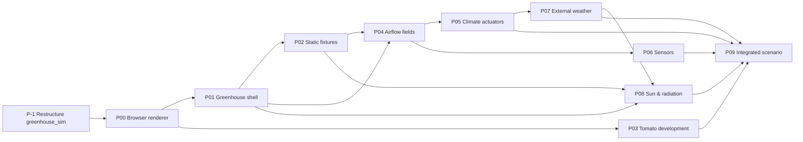

# Simulator roadmap

`greenhouse_sim` is growing from a small daily simulator into a modular,
visual and physical greenhouse simulation environment. This folder is the
public record of that work: one document per project, kept up to date by the
pull requests that implement it. How the folder is maintained is described in
[docs/engineering.md](../engineering.md#roadmap-and-decision-records).

## What the simulator is for

A permanent environment for synthetic data generation, counterfactual
testing, policy evaluation, digital-twin research, robot development and
reinforcement-learning or planning experiments. It should be useful on its
own, runnable without any hosted service, and expose contracts stable enough
for plant models, environment models, sensors, robots, actions and policies
to be developed against it.

Over time it should support:

- individual plants with persistent identity and organ-level structure
  (stems, internodes, leaves, trusses, flowers, fruits);
- stochastic longitudinal development that responds to temperature,
  radiation, CO₂, humidity, water and management actions;
- explicit 3D geometry for plants, greenhouse structures and equipment;
- spatially varying climate behind interchangeable models of different
  fidelity;
- virtual cameras and environmental sensors with realistic imperfections;
- robots, rails and actuators, and crop work such as pruning, harvesting and
  lowering;
- perfect ground truth for evaluation, while policies see only realistic
  observations;
- deterministic replay from fixed seeds, and batch simulation at scale.

The guiding hypothesis: **own the simulation world, its contracts, time,
state and orchestration; reuse or adapt specialist engines for biology,
rendering, physics, CFD and numerical acceleration.**

## Principles

- **Modular fidelity.** Every expensive or scientifically difficult
  subsystem sits behind an interface that admits several implementations,
  from a simple baseline to a high-fidelity backend. A simple backend that is
  explicit about its limits beats an impressive but inseparable monolith.
- **The canonical world state is ours.** External engines update or derive
  parts of it through adapters. They never become the global source of
  truth.
- **Ground truth is not observation.** The world state is what is true; an
  observation is what a particular sensor would report, with noise, occlusion,
  latency and gaps. Policies run on observations; evaluation compares them
  with the truth.
- **Data-oriented hot paths.** The domain API can expose plants and fruits as
  objects, but large populations are stored so that biological kernels can be
  vectorized and later moved to faster backends without a redesign.
- **Multi-rate simulation.** Robot physics, cameras, climate, physiology,
  development and crop work each advance at their natural timescale, and the
  orchestrator owns simulated time.
- **Deterministic stochasticity.** Every run is reproducible from a seed
  hierarchy (simulation, scenario, plant, organ or process), independent of
  batching or worker count where practical.
- **Sensor equivalence over visual beauty.** Rendering is judged by how well
  its output transfers to real sensor data, not by how it looks.

## Not goals for the first versions

Cell-level plant models, continuous full Navier-Stokes for a whole
greenhouse, botanically accurate deformable mechanics, cinematic realism for
its own sake, every crop or greenhouse technology, differentiable backends
throughout, or a hectare at full fidelity in real time.

## Current technical choices

- Stay in this repository. `greenhouse_sim` is restructured and expanded;
  `greenhouse_protocol` and `greenhouse_adapters` keep their roles.
  Downstream applications may depend on these packages, never the reverse.
- Python for simulation and orchestration
  ([0003](../decisions/0003-require-python-3-14.md): Python 3.14).
- A browser viewer in React and TypeScript with Three.js through React Three
  Fiber, on WebGL first, with a renderer boundary that leaves room for WebGPU.
  The viewer and a thin local API are adapters around the headless core.
- Our own stochastic, organ-level tomato model. Existing functional-structural
  plant modelling work (GroIMP and the Virtual Tomato Crop, OpenAlea and
  PlantGL, CPlantBox) informs it as a scientific reference, not as a runtime
  foundation.
- One canonical environment-field interface with lightweight backends, and
  OpenFOAM as an optional external high-fidelity backend.
- Visual QA through deterministic scenario and seed URLs, Playwright
  screenshot regression and numerical probes.

Deliberately not decided yet: the acceleration path (Rust or JAX), the final
CFD engine and renderer, a differentiability strategy, and distributed or
cloud execution. Those follow evidence from the local simulator.

## Projects

Every project ends with a named browser QA scenario and an explicit
checklist. Every commit keeps the simulator runnable and, where practical,
adds a visible or measurable result.

| Project | Goal | Status |
| --- | --- | --- |
| [P-1](p-1-restructure-greenhouse-sim.md) | Restructure `greenhouse_sim` into a modular foundation, without changing behavior | Done |
| [P00](p00-browser-renderer.md) | Browser renderer and visual QA foundation | Done |
| [P01](p01-greenhouse-envelope.md) | Greenhouse envelope and world geometry | Done |
| [P02](p02-greenhouse-layout.md) | Static greenhouse fixtures and layout | Done |
| [P03](p03-tomato-development.md) | Stochastic tomato development and procedural plant geometry | Done |
| [P04](p04-environment-fields.md) | Environmental fields and airflow foundation | Done |
| [P05](p05-climate-actuators.md) | Climate actuators: fans, heaters, dehumidification and vents | Done |
| [P06](p06-virtual-sensors.md) | Virtual sensors and the observation layer | Done |
| [P07](p07-external-weather.md) | External weather and greenhouse boundary coupling | Done |
| [P08](p08-sun-and-radiation.md) | Sun position, glazing and radiation propagation | Done |
| [P09](p09-integrated-scenario.md) | Integrated greenhouse scenario, replay and release QA | In progress |
| [P10](p10-consumer-interface.md) | A consumer's interface to a running simulation | Done |
| [P11](p11-climate-setpoints.md) | Climate setpoints: targets that run the house's equipment | In progress |
| [P13](p13-actions.md) | One action format, and a plan that carries it out | Proposed |

A project's document is added when its first pull request lands.

**Dependabot** (recorded 2026-10-13, first after P09, before the CI time
and camera work below; configured the same day, decision 0033).
`.github/dependabot.yml` checks every weekday (Dependabot's `daily`), and
opens pull requests for the updates found, in:

- **npm:** the viewer's `greenhouse_sim/web/package.json` and its lockfile;
- **uv:** the development tools pinned in the root `pyproject.toml`'s
  `dev` group, and uv and `poetry-core` in its `toolchain` group, all locked
  in `uv.lock` (decision 0039), and nothing else of the workspace:
  its uv support still mistakes a workspace's own packages for PyPI's
  ([dependabot-core#14004](https://github.com/dependabot/dependabot-core/issues/14004))
  and can rewrite a member's requirements in a grouped update
  ([#15786](https://github.com/dependabot/dependabot-core/issues/15786));
- **pip:** the three packages' `pyproject.toml`, whose ranges move only
  when a release falls outside them; `uv lock` on the pull request's branch
  then brings `uv.lock` along, which CI's `uv sync --locked` asks for;
- **GitHub Actions:** the actions `.github/workflows/` uses;
- **pre-commit:** the hooks' `rev`s in `.pre-commit-config.yaml`.

A pull request overtaken by a newer release is closed by Dependabot for the
newer one. One that needs more than its version change is completed by
hand on its branch.

**What merges by itself:** a minor or patch update that changes no code
and passes every check, that is a pull request

- whose commits are all Dependabot's, the last push its own too,
  changing only dependency manifests and lockfiles, and none of whose
  dependencies' maintainers changed;
- whose update Dependabot's metadata calls minor or patch; below 1.0, patch
  only, since there a minor release may break, as `three`'s do (0.186 to
  0.187);
- whose required checks have all passed: CI's jobs, the visual checks and
  the risk gate.

A workflow on Dependabot's pull requests (`dependabot-auto-merge.yml`)
reads the update (`dependabot/fetch-metadata`), decides with
`scripts/dependabot_auto_merge.py` and, when the first two hold, turns on
GitHub's auto-merge, which merges once the third holds too; a later push
that breaks the first two turns it off again. Everything else waits for a
review: majors, minor updates below 1.0, and whatever was completed by
hand. As the risk gate stands, only npm's updates can merge by themselves:
it holds every Actions and `pyproject.toml` change for a review, which on
Dependabot's pull requests is an approval of the latest commit (decision
0034). Dependabot proposes a release only once it is three days old (its
`cooldown`), so that one found compromised is usually withdrawn first.

The repository's settings changed for it. Auto-merge is allowed. The
`main protection` ruleset lists CI's checks as required: auto-merge waits
on required checks only, and with none it would merge at once. Its
"Restrict updates", which let only admins update `main`, gave way to those
checks, since a merge turned on with the workflow's token is not an
admin's. Admins bypass the ruleset as before.

What the repository already ties together:

- **Vitest and `@vitest/coverage-v8`** run only at the same version: one
  group. So do `three` and `@types/three`.
- **Playwright:** `@playwright/test` and the visual checks' container image
  in `ci.yml`, `mcr.microsoft.com/playwright:v<version>-noble-amd64`, are
  the same version. Dependabot does not move the image: `@playwright/test`
  comes in a pull request of its own, which fails the visual checks, and a
  root test that names the image to move to (`tests/test_pins.py`), until
  the image is moved by hand; screenshots that then differ get new
  baselines from CI, as any do.
- **ruff** is pinned twice, in the root `pyproject.toml` and as the
  pre-commit hook's `rev`. The two come in two pull requests, ruff's alone
  in its ecosystem's, and are merged together.
- **uv** comes in a pull request of its own. Every CI job installs the uv
  `uv.lock` records (setup-uv's `version-file`), and that uv builds the root
  project itself while its version is inside the root's `uv_build` range: a
  release outside it fails a root test until the range is widened by hand.
- **`poetry-core`**, which builds the three packages, comes in a pull
  request of its own too. The workspace's build pin, the root
  `pyproject.toml`'s `build-constraint-dependencies`, follows it by hand:
  a root test fails until it does, naming the version to move to.
- **`@types/node`** stays on the major of the viewer's Node, 24.
- **The packages' runtime dependencies** are ranges, what a user may install
  them with (`pydantic>=2.9`, `numpy>=2.0`, `openpyxl>=3.1.5,<4.0.0`), not
  pins. A range changes only when a release falls outside it
  (`increase-if-necessary`, which pip supports), as a major, reviewed; a
  lower bound is not raised for its own sake. Their bound on each other,
  `greenhouse-protocol`, is left to their own releases.

The checks as they stand:

- **Sign-off:** Dependabot's commits carry `Signed-off-by: dependabot[bot]`,
  so `commits are signed off` passes them as it is; a commit pushed onto a
  bot's branch by hand is signed off as any other.
- **The risk gate:** a bot's description has no checkbox, so for an update
  the gate holds, a maintainer's approval of its latest commit is the
  acknowledgement (decision 0034). The lockfile is not counted against the
  gate's thresholds.
- **CI time:** each update runs the full checks, the repository checks the
  longest at about 20 minutes. Minor and patch updates are grouped by
  ecosystem, which keeps the day's runs few; majors come one pull request
  each.

**Done when** each ecosystem's first pull request has passed its checks and
been merged, a minor npm update has merged by itself and a major one has
waited, and the couplings above are in the configuration's groups or
written beside it.

The [frontend audit follow-up and maintenance plan](frontend-maintenance.md)
records the 2026-10-06 findings from P01.3, their commit provenance, and the
two immediate fixes. The remaining findings have medium priority: after P07,
before P09's release QA, a second frontend audit is followed by those
findings and general clean-up together. They do not block the simulator's
P02–P07 project steps. The second audit was made on 2026-10-11, after P08;
its findings and the order of work come before P09.

The [repository audit of 2026-10-13](../audits/2026-10-13-repository-audit.md),
after P09 and reviewed on 2026-10-14, looks at the whole repository for a
hundred contributors and for models, devices and scenarios added without
the whole architecture in mind. Its work plan starts with defects that no
scaling work reaches: a run's numbers that depend on the moments asked for
before, the adapters' storage, the protocol's pydantic floor, the
services' lock. Then come checks that do not depend on the tests' order,
the run request and the viewer's contracts, four decisions, and one
roadmap project, P10, for models chosen by the manifest. The
[audits](../audits/README.md) folder indexes them all.

**Test suite and CI time** (recorded 2026-10-08, scheduled after P09). A
pull request's checks then took 7 to 9 minutes:

- **The viewer's browser tests** take 5.6 minutes on CI's two workers.
  Locally, on one worker, they take 275 s, of which the plant lab's
  journeys are 75 s and the renderer's end-to-end check 24 s.
- **The simulator's tests** take 2.7 minutes, about twice their local time.
  The rest of the repository checks take under a minute, mypy without a
  cache 34 s of it.

The options to weigh then:

- a pull request subset of browser tests, one quick check per area, with
  the full suite run nightly on a schedule and on demand;
- the simulator's tests run in parallel (pytest-xdist);
- mypy's cache, and the browser install, kept between runs.

By P09's end the browser tests took about 14 minutes, and the `viewer
checks` job 9 to 21 minutes. About 9 of the 14 went to stages that run
alone, on one worker of two. Since 2026-10-13 they run in four lanes at
once on CI, each on a machine of its own with a simulator of its own
(decision 0032). They took 6.0 minutes on the first run, the longest
lane, against 15.2 before.

The repository checks are now a pull request's longest: 10.8 to 21.7
minutes, 18.5 at the median, over the 37 successful runs up to
2026-10-14. They went from 10.2 to 20.6 minutes at P09.8's benchmark,
which was first put on the benchmark forgetting every run and checkpoint
kept; but the same commit has since run in 10.2 and 20.7 minutes, every
step about twice as long, so the spread is the runners'. The suite does
depend on its order, for reasons the
[repository audit](../audits/2026-10-13-repository-audit.md) measures
(`AUDIT.12`, `AUDIT.29`), and its work plan takes up the options above.

**Camera imperfections** (recorded 2026-10-08, with the headless renderer
for datasets, after P09 unless a policy needs them sooner). P06's cameras
take every frame on time, and draw perfect images. Planned then:

- frames that come late, or not at all, seeded as point sensors' readings
  are, using the protocol's `CameraFrame.delivered_at`;
- images as cameras make them: exposure, noise, motion blur and lens
  distortion, with the distortion in the camera's intrinsics.

**Climate setpoints** (recorded 2026-10-20, after P10; proposed as
[P11](p11-climate-setpoints.md)). A target, set by
a person, for the air's temperature and humidity, which runs the house's
equipment as a climate computer would. Today the reference greenhouse heats
to a setpoint (decision 0042) and runs the rest of its equipment by the
clock. Planned then:

- **air temperature:** the heater's thermostat with its setpoints set from
  the viewer, and vents and fans opened above a venting setpoint, in place
  of their daily commands, which waste heat on a cold day and let a bright
  June morning pass 30 °C;
- **humidity:** the dehumidifier, and the vents opened, above a target.

Each target is a run's input: changed, it makes another run, as a command
does. Targets set from outside the simulator, by a consumer, wait for an
actuation interface, which P10 leaves out.

**CO₂ and light targets** (recorded 2026-10-20, future work, after the
climate setpoints). Each needs equipment the simulator does not have yet:

- **CO₂:** a CO₂ doser, adding CO₂ to the air below a target while the
  vents are shut;
- **PAR** (the light in the 400 to 700 nm band plants use, in µmol/m²/s):
  grow lamps, lighting the crop below a target by day length or by the
  light the sun gives, their light reaching the crop as the sun's does
  (P08) and their heat the air. The reference greenhouse's PAR is the
  sun's alone, so it falls to 0 every night.

P03 is a biology track that can progress alongside P01 to P05 once the
renderer foundation exists.
