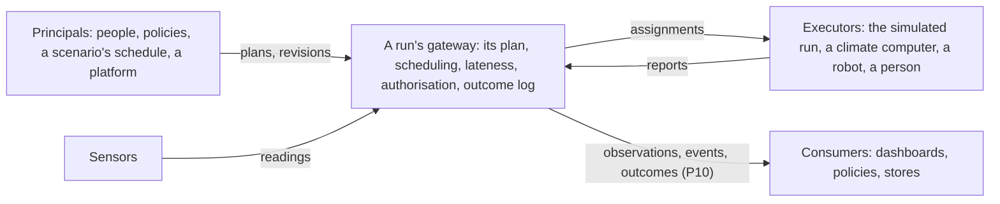

# P13: One action format, and a plan a run's gateway carries out

**Status:** in progress. The design is accepted (decision 0046), its
questions [decided](#decided); P13.1 to P13.4 are done. Part of the
[simulator roadmap](README.md).

## Goal

Whoever acts on a greenhouse, a person in the viewer, a control policy, an
agent being trained, a scenario's own schedule, does so in one format, and
whatever carries the action out, the simulator's run today, a climate
computer, a robot or a person on a physical installation later, reports
what became of it in one record. Some actions are due at an hour; others
wait for one another, run side by side as soon as they can, or within a
while; each says what to do if it is late, and a critical one that is late
is missed rather than done at the wrong moment. Who may do what is checked
by design, in one place, for a simulated run and a physical one alike.

Today there are nine ways of acting in five shapes, and the protocol's own
execution contract is used by none of them (`AUDIT.27`); decision 0046
lists them. This project folds them into one, and removes the rest.

## Dependencies

- P10, the consumer interface (decision 0040): its runs, epochs and clock,
  which this project makes the protocol's for every greenhouse, and its
  cursor rules, which the outcome log keeps; decision 0036: what a consumer
  reads stays observed.
- P11 and decisions 0042 and 0043: the climate controller, its targets, a
  command taking a device out of a loop's hands, and steering a playing run
  from then on, in the same run and epoch.
- Decision 0035: one simulator, the run; the engine's actions move to it.
- Decision 0041: the playback, its one clock and its epochs.
- The `Simulator` object (decision 0048, `AUDIT.15`), which owns the runs
  and so their gateways, before the API takes plans (P13.7).
- The installation editor (P12, #295) is not a dependency: moving equipment
  edits the installation, which is not an action.

## Design

### Who does what



- **A run** is the protocol's: a run id, its epoch and its clock, as the
  consumer interface has them (decision 0040). A simulated run is one, as
  today. A physical installation serves one run for each configuration of
  its equipment, changed equipment making a new run as it does in the
  simulator; its epoch rises each time its gateway starts again; its clock
  is the wall clock. A run that has finished, and a recorded one, cannot
  be acted on: its gateway raises `ActionNotExecutable`.
- **A plan belongs to a run.** A scenario's own standing plan, its daily
  commands and crop work, comes with each run of it, under the plans given
  to the run.
- **What is still to come goes on with the clock, or is dropped with
  it.** When a run ends and the next run or epoch of the same installation
  begins, its gateway, which starts it, says whether its clock continues
  the previous one's: the new run's or epoch's descriptor names the run
  and epoch it continues (`continues_from`, in the gateway contract
  below), or nothing when it starts over. Timestamps are not compared:
  - **It continues,** starting where the previous clock had reached: a
    physical installation's gateway started again into a new epoch, or
    its equipment changed into a new run, the wall clock going on. The
    gateway carries the actions not yet resolved into it. Each is checked
    again as it is carried: its targets must exist in the new
    configuration, an executor must still honour its kind and instant,
    and the authorisation in force must still allow it. One that no longer
    applies is `refused`, with that reason; the others keep their ids,
    principals and dependencies, and what waits for a refused one follows
    its plan's rule for a failed prerequisite. An action already assigned
    keeps its assignment: the new run restores its assignment id and asks
    its executor's status before scheduling anything. One that had not
    started is revoked, then carried and assigned again; one that had
    started is not assigned again, and its outcome follows its report.
  - **It starts over,** from the run's start: the simulator's playback
    restarted, a new epoch of the same deterministic run from day 0, or
    restarted with another layout, a new run from day 0. The actions not
    yet resolved are `cancelled`, each with the reason that the run
    started over.

  A run that ends for good, finished or recorded, leaves nothing to carry:
  its pending actions are `cancelled`, with that reason. Reviewing what
  was carried is a consumer's or a platform's matter, not the gateway's.
- **The gateway** is a run's local endpoint, and the only one that decides:
  it holds the plan and its revisions, schedules the actions, applies the
  lateness rules, authorises, and writes the outcome log. It serves the
  run's read side, the consumer interface, with outcomes beside
  observations and events, and the actions as they stand; and its write
  side, plans given and revised, and actions cancelled, a whole plan or
  those chosen.
- **An executor** carries out one action it is assigned, at an instant,
  and reports when it started and finished and whether it was done,
  failed, or refused because the greenhouse was not as the action needed.
  It decides nothing else, and holds no rights. The simulated run is one;
  so are a climate computer, a robot, and a person with a task list.
- **Sensors** report to the gateway, and hold no rights either.
- **The channel** between a gateway and its executors and sensors must be
  authenticated, each end sure of the other. How is a deployment's
  transport, not this project's.

The simulator ships a gateway in process, its playback, with the
simulated run as its executor; a physical site runs a gateway of its own,
with real executors behind it, through the same two contracts.

### The action

One discriminated union in the protocol, `Action`, by `kind`. Sketched as
fields:

| Kind | Fields | Today |
| --- | --- | --- |
| `set_level` | `device_id`, `level`: 0 to 1, or `auto` to hand the device back to its control loop | `Command`, `DailyCommand`, `&set=`, `&open=`, `&schedule=`, `&daily=`: equipment and openings |
| `set_target` | a union by `target`, each with its own unit and range: `heating_day` and `heating_night` in °C, from 0 to 40 (today's `SETPOINT_RANGE_C`); venting and humidity targets with P11 | `TargetChange`, `&targets=`, the playback's targets route |
| `water` | `plant_id`, `amount_ml`, at most `MAX_WATER_AMOUNT_ML` | `WaterPlantAction` |
| `harvest` | `plant_id`, `scope`: `ripe` (every ripe fruit), `fruit` or `truss`, with its organ's id | `HarvestPlantAction`, the lab's `harvest_fruit` and `harvest_truss`, crop work's harvest round |
| `lower` | `plant_id`, one of `by_cm`, `by_internodes`, `to_head_room_m` | `LowerPlantAction`, the lab's `lower_stem`, crop work's lowering round |
| `remove_leaf` | `plant_id`, `leaf_id` | the lab's `remove_leaf` |
| `inspect` | `plant_id`, `reason` | `ScheduleInspectionAction` |

`auto` is new: today a command takes a device out of its loops' hands for
the rest of the run (decision 0042, P11), and nothing gives it back.

An action names no time, no executor and no principal: those belong to the
planned action.

### The plan

```
PlannedAction
  action_id: ActionId               unique in its plan
  action: Action
  timing: At(at) | Window(not_before, not_after) | Asap(deadline: optional)
  every: Recurrence(period > 0, count >= 1 | until) | None   applied to the timing, below
  after: tuple[ActionId, ...]       planned actions that must be done first
  if_prerequisite_fails: cancel | proceed          cancel by default
  lateness: Lateness
  expected_duration_s: optional     what the planner expects; the executor reports what it took
  executed_by: tuple[ExecutorRef, ...] | None      who may carry it out; anyone if None
  proposed_by: Principal            who asked for it

Principal
  kind: person | policy | schedule | scenario | platform
  id: str

ExecutorRef
  kind: ExecutorKind                the simulated run, a person, a robot, a climate computer
  id: str | None                    which one; None allows any of the kind

ActionId                          the protocol's own: letters, digits, '_', '.', '-'

ActionRef                           how an outcome or an assignment names what it is about
  action_id: ActionId
  occurrence: int | None            which occurrence of a recurring action, from 0
  fallback: bool                    the action's fallback rather than the action

Lateness
  tolerance_s: 0                    how late still counts as on time
  on_late: run_late | skip | critical | fallback | abort_plan     run_late by default
  fallback: Action | None           carried out instead, when on_late is fallback,
                                    as the planned action `{action_id}/fallback`;
                                    given only then

Plan
  plan_id, run_id, epoch, revision: int     the epoch it is given in: a write
                                            naming an epoch that has ended is stale
  actions: tuple[PlannedAction, ...]
```

- **Timing.** Any instant: the format bakes in no resolution. `At` is due
  at its instant. `Window` starts at the earliest instant between its two
  that an executor can honour, and is free to take it; `Asap` at the
  earliest such instant after what it waits for is done, before its
  deadline if it has one. No other choice is left to a gateway, so the
  same plan starts each action at the same instant, run after run.
- **What executors honour.** Each executor says, for each kind, at which
  instants it can carry it out. Today's simulated run takes a level at any
  second, a target on the minute (`TARGET_EVERY_S`), and crop work at a
  day's start, where its organ crop steps. An `At` at an instant no
  executor can honour is refused when the plan is given, as a target off
  the minute is today; a `Window` or `Asap` with no such instant in it is
  refused too. Crop work within the day is
  [recorded on the roadmap](#crop-work-within-the-day).
- **Recurrence** has one anchor, the planned action's timing: occurrence
  `n`, from 0, is that timing moved by `n` periods (its instant, its
  window, its deadline), until `count` occurrences or the instant `until`.
  Each occurrence is a planned action with its own outcome, named
  `ActionRef(action_id, occurrence=n)`, as `DailyCommand.through` expands
  today. `{action_id}@{n}` and `{action_id}/fallback` spell them for
  people; the records keep the structure.
- **The graph.** `after` makes the plan a directed graph without cycles,
  checked when a plan is given, with its ids unique and every prerequisite
  in it. Actions with no path between them may run side by side. Edges
  between recurring actions expand with them: between two of the same
  period, occurrence `n` waits for occurrence `n` (`lower@3` for
  `harvest@3`); a recurring action may wait for a one-off one, each
  occurrence for it. A one-off action waiting for a recurring one, and
  recurring ones of different periods waiting for each other, are refused,
  since which occurrence is meant is not said. With these rules the
  expanded graph has a cycle only if the plan as given has one, so the
  graph is checked as given, without expanding every occurrence. A
  recurrence's period is positive, its count at least one or its `until`
  after its first occurrence, and a gateway states how many occurrences
  and actions a plan may have (`limits()`), refusing one beyond them
  whole.
- **A fallback** is a planned action of its own, derived as occurrences
  are: `ActionRef(action_id, fallback=True)`, due at once when its action
  is missed, with no fallback of its own. It has its own outcome, which
  the missed one names.
- **One order at one instant,** across every plan the run has: a stable
  topological order, so that a prerequisite always comes before what
  waits for it, whatever their places. Among actions with no order
  between them: recurring ones first (as daily commands come first
  today); then by the order in which the gateway accepted the revisions
  that gave them, each accepted revision taking the gateway's next
  sequence number (for a simulated run, plans given before it starts in
  the order its request lists them); then by place in the plan. A later
  `set_level` to one device at one instant wins, as a later command
  does.
- **Revisions.** A plan given again with its `plan_id` and a higher
  revision replaces, from an instant on, the actions not yet started: one
  dropped is superseded, one started or done keeps its outcome (below).

### Authorisation

```
Grant
  kinds: frozenset[ActionKind]
  targets: TargetSelector | None    devices, plants or rows, a controller's targets; all if None
  on_behalf_of: tuple[Principal, ...] = ()   principals it may propose actions for
  manage_plans: bool = False        may revise or cancel plans other principals gave

AuthorisationGroup
  group_id
  principals: tuple[Principal, ...]
  grants: tuple[Grant, ...]

AuthorisationConfig
  version: int
  groups: tuple[AuthorisationGroup, ...]
```

- Every planned action carries its principal, and a principal may carry
  out what any of its groups grants it: an action's kind, on its targets.
- **The submitter is bound.** `submit(plan, by=...)` takes the caller's
  principal as its channel or the API authenticated it, never as the plan
  says. Each planned action's `proposed_by` is `by`, unless `by` holds a
  grant `on_behalf_of` that principal, as a platform proposing for its
  users would; otherwise the plan is refused whole. A plan's revisions and
  cancellations come from its owner, the principal that gave its first
  revision, or from one with `manage_plans`. A manager's revision keeps
  the owner's actions it leaves unchanged, with their principals; only
  the actions it adds or changes are bound to the manager, and checked
  against the manager's rights.
- **Authorisation is an input of the run.** The configuration has a
  version. The one in force when a simulated run starts is part of its
  request, and so of its identity; a change while a run plays takes
  effect from an instant, as a revision does, and the gateway records its
  version and instant beside the plan's revisions, in its state and in
  checkpoints. So a replay makes the same decisions, and a physical
  gateway keeps the same record for whoever audits it.
- **The gateway is the one enforcement point.** It checks when a plan is
  given, and again when each action falls due, since rights may have
  changed in between; either refusal is an outcome, `refused`, with its
  reason and the instant it was decided. An executor or a sensor holds no
  rights logic: it trusts what reaches it over the gateway's
  authenticated channel.
- **The groups are the deployment's.** A platform may manage them and
  hand them to its gateway; a site may keep them in its gateway's
  configuration. The protocol says what a group is, not where it lives.
- **Grants are by kind and target, and no more.** Limits by time or by
  quantity, such as how much a group may water in a day, are a business's
  rules, not the gateway's: a platform enforces them before it submits.
- **The simulator's gateway** has one group, the local operator, with
  every principal it serves and every kind on every target, so the
  mechanism is there, and tested, from the start. The local API has no
  users (decision 0009).

### Lateness

An action is late when it cannot start by its due instant plus its
tolerance: its `At` has passed, its window has closed, its deadline has
gone, or what it waits for finished too late. The gateway, which knows
what was due when, decides; the executor only reports times. Then:

| `on_late` | What the gateway does | Its outcome | What waits for it |
| --- | --- | --- | --- |
| `run_late` | assigns it as soon as it can | `late`, with the delay | waits, then goes on |
| `skip` | nothing | `missed` | as `if_prerequisite_fails` says |
| `critical` | nothing | `missed` | cancelled, whatever `if_prerequisite_fails` says |
| `fallback` | assigns `{action_id}/fallback` instead | `missed`, naming the fallback, which has its own outcome | as `if_prerequisite_fails` says |
| `abort_plan` | nothing, and assigns nothing else of the plan | `missed` | every action not started: `cancelled` |

`critical` is one choice among the others, not a flag beside them, so an
action cannot be critical and run late at once. A robot to pick a fruit on
a moving line within two seconds of its pass is `At(pass)`, tolerance
2 s, `on_late: critical`: past that it is missed, and the placing that
waits for it is cancelled rather than done on nothing.

The simulated run carries every action out at once, so on its own an
action is late only when its instant has passed as the plan is given. A
simulated executor whose actions take time and which has a number of
hands (P13.6) lets lateness happen, deterministically, before any real
executor exists.

### The outcome

```
ActionOutcome                       a record, frozen
  outcome_id, greenhouse_id, run_id, epoch, plan_id, revision
  ref: ActionRef                    the action, occurrence or fallback it is about
  action: Action                    what was asked, as it was asked
  timing: At | Window | Asap        when it was asked for, as it was asked
  principal: Principal              who asked for it
  status: executed | late | missed | refused | failed | cancelled | superseded | unconfirmed
  due: Instant | Window | None      when it fell due; None for an as-soon-as-possible
                                    action cancelled or superseded before it could start
  started_at, finished_at: Instant | None    when it ran, if it ran
  resolved_at: Instant              when its outcome was decided: always set
  delivered_at: Instant | None      when it reached the log, if later
  executor: ExecutorRef | None      who carried it out
  reason: str | None                why it was refused, failed, missed or cancelled
  cancelled_by: Principal | None    who cancelled or superseded it, if someone did
  fallback: ActionRef | None        the fallback carried out instead, if any
  effect: ActionEffect | None       what it did, typed by its action's kind
  event_id: str | None              the event it produced, if any

ActionEffect, one per kind, by `kind`:
  level_set(device_id, level)               target_set(target, value, unit)
  harvested(fruit_count, fresh_mass_g)      lowered(by_cm)
  leaf_removed(leaf_id)                     watered(amount_ml)
  inspected()
```

`resolved_at` orders the log, as `delivered_at`, or the timestamp, orders
observations and events: an action missed, refused or superseded before
it ran has no `started_at`, but has the instant its outcome was decided,
and none is delivered after the clock.

An outcome carries the action it is about, as it was asked: a consumer
that did not give the plan, reading a `superseded` or `refused` outcome,
knows what was not done without asking for the revision that dropped it.

Every planned action, every occurrence and every fallback ends in exactly
one outcome. Outcomes are a third log beside observations and events, with
the consumer interface's rules: delivery order, dense cursors, nothing
delivered after the clock, an epoch never going back. An executed harvest
still produces its `HARVEST` event, which names its action, so a consumer
reading events today reads the same events. `refused` replaces
`ActionResult`: a check before carrying out is an outcome too.

### The two contracts

```
RunGateway (Protocol)               greenhouse_protocol.contracts.gateway
  run() -> RunDescriptor            the run it serves, as the consumer interface has it
  submit(plan, *, by: Principal) -> Receipt
      a plan, or its next revision, from the next instant its executors
      can honour. A malformed plan is refused whole: the receipt lists its
      errors, nothing of it is accepted, and no outcome is written. A
      well-formed plan is accepted, with its sequence number; those of
      its actions refused at once are listed and written as outcomes
  cancel(keys: tuple[ActionKey, ...], *, by: Principal) -> Receipt
      the chosen actions, from any of the run's plans: an occurrence, or
      every occurrence still to come of a recurring action
  cancel_plan(plan_id, revision, epoch, *, by: Principal) -> Receipt
      every action of a plan not yet resolved, if its revision and epoch
      are still the ones in force; otherwise stale, refused, nothing
      cancelled
  limits() -> GatewayLimits         occurrences and actions a plan may have
  actions(*, states=None, kinds=None, targets=None, plan_id=None)
      -> tuple[ActionState, ...]
      every action not yet resolved, as it stands, filtered; the outcome
      log stays the history
  plan(plan_id, revision=None) -> PlanState
      a revision, the latest by default, with each action: waiting,
      assigned, started, or its outcome; every revision is kept
  outcomes(after) -> OutcomeBatch   the outcome log, with the consumer interface's cursor
  raises ActionNotExecutable        a finished or recorded run

RunDescriptor.continues_from: (run_id, epoch) | None
    set by the gateway that starts a run or epoch: the run and epoch whose
    clock it continues, into which the actions not yet resolved are
    carried; None when it starts its clock over from the run's start, and
    they are cancelled. Added to the consumer interface's descriptor, which
    a consumer reads to know the same

ActionKey
  plan_id
  epoch: int                        the epoch the caller saw the action in
  revision: int                     the revision the caller saw the action in
  ref: ActionRef                    occurrence None: every occurrence still to come
                                    a key whose action a later revision replaced is
                                    stale: refused in the receipt, nothing cancelled

ActionState                         an action not yet resolved, as it stands
  plan_id, revision, ref: ActionRef
  action: Action                    its kind and targets, as asked
  timing: At | Window | Asap        as asked
  due: Instant | Window | None      when it falls due, where that is known yet
  principal: Principal
  state: waiting | due | assigned | started
  waiting_for: tuple[ActionRef, ...]   its prerequisites not yet done
  waited_on_by: tuple[ActionRef, ...]  the actions that wait for it
  carried_from: tuple[str, int] | None   the run and epoch it was carried from, if it was

ActionExecutor (Protocol)           greenhouse_protocol.contracts.execution
  kinds() -> frozenset[ActionKind]  the kinds it carries out
  honours(kind, instant) -> bool    the instants it can carry a kind out at
  capacity() -> int                 how many actions at once
  longest_duration_s(kind) -> float how long a kind may take, at most
  lead_time_s(kind) -> float        how long before its instant it wants an assignment
  perform(assignment) -> None       start this action at its instant; idempotent
  revoke(assignment_id) -> Revocation   revoked (not started), or started, or finished
  status(assignment_id) -> AssignmentStatus  received, started, finished, or unknown
  reports(after) -> tuple[ExecutionReport, ...]

Assignment
  assignment_id, run_id, ref: ActionRef, action: Action, at: Instant, deadline: Instant | None

ExecutionReport
  assignment_id
  status: done | failed | refused   refused: the greenhouse was not as the action needed
  started_at, finished_at: Instant | None
  effect: ActionEffect | None
  reason: str | None
```

**Cancelling chosen actions** is authorised as every write is: an action
may be cancelled by its plan's owner, or by a principal with
`manage_plans`; one the caller may not cancel is listed in the receipt,
and left as it was. Each cancelled action's outcome is `cancelled`, naming
who cancelled it; one already assigned is revoked, by the rule below; and
what waits for it follows its plan's rule for a failed prerequisite:
cancelled with it, unless the plan says `proceed`.

An assignment carries no principal: authorisation is behind it, at the
gateway. Outcomes are not returned by `submit`: they are written as the
clock passes and read from the log, by a consumer or by a training loop
alike.

Between a gateway and an executor that may lose a message, as a physical
one may:

- **An assignment is carried out at most once.** An executor that receives
  an assignment id again answers as before and never performs it twice,
  so a gateway may send it again when unsure it arrived.
- **A gateway sends an assignment shortly before its instant,** by the
  lead time its executor states for its kind (`lead_time_s`), so that what
  is cancelled or superseded is rarely already in an executor's hands.
- **Revocation decides the race.** Cancelling or superseding an action
  already assigned revokes the assignment, and so does refusing it after
  it was sent, its authorisation withdrawn. If the executor answers that it
  had not started, the outcome is `cancelled`, `superseded` or `refused`;
  if it had, the outcome follows its report, and the plan's state notes
  that the cancellation or the refusal came too late.
- **A lost report is resolved, not waited for.** An assignment's report is
  due by its deadline, or its instant, plus the executor's longest
  duration for its kind. Past that, the gateway asks for its status; if
  the executor cannot be reached, the outcome is `unconfirmed`, which what
  waits for it treats as failed. A report that arrives later is kept in the
  plan's state, not written as a second outcome.

The simulated run loses nothing, so it never needs these; the contract's
conformance tests exercise them with an executor that drops messages.

**Checks happen at two moments.** When a plan is given, the gateway
refuses it whole, by its receipt, if it is malformed: its schema,
duplicate ids, a prerequisite not in it, a cycle as given or as expanded,
a window that closes before it opens, an action proposed for another
principal without a grant to. It then refuses, as outcomes, each
well-formed action that cannot be carried out: what its principal may not
do, a kind no executor carries out, a device, plant or target the run does
not have, an instant no executor honours. Its authorisation is checked
again when its assignment is sent and when it falls due; a refusal after
the assignment was sent revokes it, by the rule above. When it falls due,
the executor checks the
greenhouse, as `actions/validation.py` checks today: a fruit or truss to
harvest, a leaf to remove, room to lower a stem into; what fails is
refused then, with `resolved_at` its due instant. A plan may name a truss
that will have grown by the time it is due.

### The simulator's gateway, and its run as the executor

- **Before the run:** a plan given before a simulated run starts is part
  of the run's request (`RunRequest`), beside its scenario, layout and
  weather, and part of its identity: the same plan, the same run.
- **Identities stay.** A plan made only of what today's schedule says, a
  device's levels and openings at instants, daily commands, target changes
  and the manifest's crop work, is identified as today's schedule is, so
  every run id, replay digest, kept opening day and reference view stays.
  The manifest's `crop_work` and daily commands stay its spelling of a
  standing plan until the reference run is next written again (P11.5).
- **Steering is the gateway's rule.** A revision takes effect from the
  next instant its executors can honour; what was started or done keeps
  its outcome. For the playback this is decision 0043 for every kind: the
  same run id and epoch; records before the change stand; the clock waits
  until the rest of the day is worked out again under it. A physical
  gateway does the same on the wall clock: from then on is from now.
- **A restart starts over.** A restart is a new epoch of the run's own
  plan from its start, its clock at day 0 again: the actions not yet
  resolved are cancelled, each with the reason that the run started over,
  and nothing given in the epoch before applies, as decision 0043 has it.
  A playback restarted with another layout begins a new run from day 0
  (#278), and drops them the same way. A playback played to its end has
  finished: its pending actions are cancelled.
- **Checkpoints** keep the plan in force and the outcomes so far, in a new
  checkpoint format; format 3, with commands and target changes, is read
  as a plan of them.
- **The organ crop** takes `harvest`, `lower` and `remove_leaf` at a day's
  start. It turns each into its own operation on a plant, which is the
  crop rung's inner step, not an action: no one proposes or plans it, and
  it reports no outcome. P13.5 renames the organ model's `PlantAction` to
  `PlantOperation` so that the code says so. The plant lab gives the same
  actions.
- **Watering** is refused, with the reason: the run's organ crop has no
  water in its root zone, and its plants' water status is always full
  (`biology/plant/environment.py`). It becomes a kind the run carries out
  when a rung of the crop models the root zone.
- **The controller** keeps its loops (P11). `set_target` changes their
  targets; `set_level` takes a device out of their hands, and `auto` gives
  it back.

### A policy, and a training loop

A policy does what a person in the viewer does, through the same gateway:
it reads observations and outcomes up to the clock, gives a revision of its
plan, and the clock moves on. In a simulation the loop also moves the
clock:

```
observe(up_to=t) -> observations, outcomes
plan = policy(observations, outcomes)
gateway.submit(plan, by=policy_principal)
run.advance(until=t + step)
```

Nothing in it is particular to training: a dashboard proposing a plan to a
grower, and an agent learning one, give the same plans and read the same
outcomes, and are authorised the same way. The engine's day interface
(`examples/03_close_the_loop.py`) becomes this loop on the run.

### Acting through the API

The consumer interface stays read-only, its routes `GET` (decision 0040),
and what it reaches observed (decision 0036); outcomes join it as a third
log. The gateway's write side is an actuation interface of its own,
whose routes its contract defines (`contracts/gateway.py`), as the
consumer interface's contract defines its own (`contracts/consumer.py`).
Sketched:

    POST /actuation/v1/runs/{run_id}/plans              a plan, or a revision
    POST /actuation/v1/runs/{run_id}/plans/{plan_id}/cancel   a whole plan
    GET  /actuation/v1/runs/{run_id}/plans/{plan_id}?revision=
    GET  /actuation/v1/runs/{run_id}/actions?state=&kind=&target=&plan=
                                                        the actions as they stand
    POST /actuation/v1/runs/{run_id}/actions/cancel     chosen actions, by key

The simulator's API serves both for its runs.

### Crop work within the day

The simulated run carries out crop work at a day's start only, because its
organ crop steps a day at a time; it refuses a crop action due at any
other instant when the plan is given. Automation plans and stacks crop
work through the day, so the crop is to step within a day. That is a
project of its own, recorded on the [roadmap](README.md) as crop work
within the day; the action format needs no change for it.

### What becomes of today's paths

| Today | Becomes | Removed in |
| --- | --- | --- |
| `RequestedAction` and its four types, `ActionResult` | `Action`; a refusal is a `refused` outcome | deprecated in P13.1, removed in P13.9 |
| `ActionExecutionAdapter`, `ActionOutcome`, `ExecutionStatus` | the gateway and executor contracts and the outcome record above | deprecated in P13.1, removed in P13.9 |
| `greenhouse_sim.executor` (`ActionExecutor`, `SimulatedOperatorExecutor`, `executor_for`), `SimulationEngine.apply_actions` | the simulator's gateway, with the run as its executor | P13.9 |
| `Command`, `&schedule=` | `set_level` at an instant | P13.2; the spelling stays |
| `&set=`, `&open=` | where a run starts from, beside its plan, as its layout and weather are | settled in P13.2: unchanged |
| `DailyCommand`, `&daily=` | `set_level` every day at a time | P13.2 |
| `TargetChange`, `&targets=` | `set_target` at an instant, on the minute | P13.2 |
| `POST /api/scenarios/{id}/playback/targets` | a plan revision given to the playback's gateway | P13.7, an alias for one release |
| `LabAction`, `&act=` | `harvest`, `lower`, `remove_leaf` at a day's start | P13.5 |
| The organ model's `PlantAction` | the crop rung's inner operation, `PlantOperation` | renamed in P13.5 |
| `CropWork` | a standing plan's recurring `harvest` (`ripe`) and `lower` (`to_head_room_m`) on every plant | P13.5; its manifest spelling with P11.5 |

## Steps

| Step | What | Commit title | Status |
| --- | --- | --- | --- |
| P13.1 | The protocol's types and contracts: `Action`, `ActionId`, `ActionRef`, `PlannedAction`, `Plan`, `Principal`, `Grant`, `AuthorisationGroup`, `AuthorisationConfig`, `ActionOutcome`, `ActionEffect`, `ExecutorRef`, `Assignment`, `ExecutionReport`, the gateway and executor contracts (revocation, status, at most once; listing the actions as they stand, `ActionKey`, `ActionState`; cancelling chosen actions; the epoch on every write; the gateway's limits; carrying actions into a run that continues the clock, as `RunDescriptor.continues_from` says, and dropping them from one that starts over) and `ActionNotExecutable`; checks (a malformed or stale plan refused whole, the graph checked as given, recurrences bounded, grants and delegation, the order across plans, one outcome per action) as conformance functions and their tests, the executor's with one that drops messages, and the gateway's with an in-memory gateway on a clock that continues; the published JSON Schemas. The old names stay, deprecated; the changelog says what each became, and the version moves at the next release (decision 0045). | `feat(protocol): one action, plan, gateway and executor format` | Done: the records (#323) and the contracts |
| P13.2 | The run carries out a plan of today's kinds: levels, openings, daily commands and targets become a plan internally; `RunRequest` holds it; the address's spellings are read into it. Every run id, replay digest and kept opening day unchanged. Checkpoints in a new format, format 3 read. | `refactor(sim): the run carries out its schedule as a plan` | Done |
| P13.3 | The simulator's gateway: the playback holds its run's plan and revisions, schedules them onto the run as its executor, writes the outcome log and serves it on the consumer interface; steering as the gateway's rule; the actions as they stand, cancelling chosen ones, and dropping them when the playback starts over. The gateway contract's conformance tests run against it. | `feat(sim): the playback as its run's gateway` | Done |
| P13.4 | Authorisation in the gateway: principals on every planned action, bound to the authenticated submitter or granted on its behalf; plan ownership; groups and grants in a versioned configuration, an input of the run, its changes recorded; checked when a plan is given and when each action falls due, refusals as outcomes; the local operator group. | `feat(sim): the gateway authorises every action` | Done |
| P13.5 | Crop actions on the run: `harvest`, `lower`, `remove_leaf`, `inspect` at a day's start, refused at other instants and `water` refused, with their reasons; the organ model's `PlantAction` renamed `PlantOperation`; the plant lab and crop work give them; events name their actions. | `feat(sim): crop actions and their outcomes on the run` | Done: the organ crop's operations (#351), the protocol's reasons and events (#353), a run's plan on its crop (#354), and its playback's outcomes (#356) |
| P13.6 | The graph, windows and lateness, with a simulated executor whose actions take time and which has a number of hands, so that `late`, `missed`, fallbacks and cancelled dependents happen, deterministically. | `feat(sim): plans with order, windows and lateness` | Done: the gateway's start and hands (#363), and the run's crew (#365) |
| P13.7 | The gateway's write side and its routes: give a plan before a run, steer a playing one, list the actions as they stand, cancel a plan or chosen actions, read the plan in force; the playback's targets route becomes an alias. | `feat(api): give, steer and read a run's plan` | Planned |
| P13.8 | The viewer: the Equipment, Openings and Targets panels and the plant lab write one plan; a plan lane in the timeline shows what was due, what happened and why. | `feat(viewer): one plan, and its outcomes in the timeline` | Planned |
| P13.9 | The old paths removed: the engine's actions, `greenhouse_sim.executor`, the deprecated aliases (`RequestedAction`, `ActionResult` and the old execution names), `LabAction`; the close-the-loop example as a policy loop on the run; the protocol's minor version moves again, and the changelog says so. | `refactor: one way to act on a greenhouse` | Planned |
| P13.10 | The QA scenario below, run and recorded. | `test(e2e): a plan carried out, late, on time and refused` | Planned |

## Acceptance criteria

- [ ] The protocol has one action type, one plan, one outcome record, one
  authorisation model, and one gateway and one executor contract, each
  with conformance checks and a published schema.
- [ ] Every way of acting in decision 0046's table goes through them, and
  none of the old types or routes is left (a test lists the names that
  may not come back).
- [ ] The simulator's gateway passes the gateway contract's conformance
  tests, the ones a physical site's gateway would be held to.
- [ ] A plan of today's kinds gives today's run: every run id, replay
  digest, kept opening day and reference view unchanged.
- [ ] The same plan gives the same records and outcomes, run after run;
  simultaneous actions in the documented order.
- [ ] Each lateness policy gives the documented outcomes, its dependents
  included, on the simulated executor with durations.
- [ ] Every planned action, every occurrence and every fallback ends in
  exactly one outcome with its `resolved_at`, and the outcome log keeps the
  consumer interface's rules (`check_polls`).
- [ ] An action its principal may not carry out is refused when the plan is
  given; one whose rights are withdrawn before it falls due is refused
  then, and a replay from a checkpoint refuses it again. No executor
  contract method takes a principal.
- [ ] A plan whose actions name a principal other than its authenticated
  submitter, without a grant on its behalf, is refused whole; so is a
  malformed plan, by its receipt, with no outcome written.
- [ ] Actions at one instant run in a stable topological order, a
  prerequisite before what waits for it whatever its place, and actions of
  different plans in the gateway's order of acceptance, the same every
  time.
- [ ] `on_late` is one choice, `critical` among them; a plan that gives a
  fallback without choosing it is malformed.
- [ ] A manager's revision keeps the owner's unchanged actions and their
  principals, and checks only what it adds or changes against its own
  rights.
- [ ] A cancellation key, or a whole-plan cancellation, from a revision a
  later one replaced, or from an epoch that has ended, is stale: refused
  in the receipt, nothing cancelled; a plan given for an ended epoch is
  refused whole.
- [ ] A window or an as-soon-as-possible action starts at the earliest
  instant an executor can honour, the same in every run.
- [ ] A recurrence with a period that is not positive, or a plan beyond the
  gateway's limits, is refused whole; the graph is checked without
  expanding its occurrences.
- [ ] A `set_target` outside its target's unit or range is malformed.
- [ ] An assignment already sent whose authorisation is withdrawn before it
  falls due is revoked: refused if it had not started.
- [ ] An executor states its lead time for each kind, and a gateway sends no
  assignment earlier than that before its instant.
- [ ] On an executor that drops messages: no assignment is carried out
  twice, a revoked one that had not started is cancelled, and one whose
  report never comes is `unconfirmed`, with what waits for it cancelled.
- [ ] An action refused when due, because the greenhouse is not as it
  needed, is refused then, not when the plan was given; one no executor
  can carry out, or not at its instant, is refused at once.
- [ ] A revision steers a playing run from the next instant its executors
  honour, in the same run and epoch, for every kind.
- [ ] Listing the actions as they stand returns every one not yet
  resolved, with its state, due instant where known, principal and
  dependencies, filtered by state, kind, target and plan; a resolved one
  is in the outcome log, not the listing.
- [ ] Cancelling chosen actions cancels those and no others, each outcome
  naming who cancelled it; one already assigned is revoked; what waits for
  it is cancelled unless its plan says `proceed`; one the caller may not
  cancel is refused in the receipt and left as it was.
- [ ] When the next run or epoch continues the previous one's clock, as
  its gateway says (`continues_from`), its pending actions are carried,
  checked again: one whose
  target no longer exists, whose kind or instant no executor honours, or
  which its principal may no longer do is refused with that reason, the
  others keep their ids, principals and dependencies; one already assigned
  keeps its assignment and is not carried out twice.
- [ ] When the next run or epoch starts its clock again from the run's
  start, as the playback's restart does, its pending actions are
  cancelled, each with the reason that the run started over. A run that
  ends for good cancels its pending actions.
- [ ] A finished or recorded run refuses a plan with `ActionNotExecutable`.
- [ ] A control policy runs on the run through the loop above.

## Final QA scenario

On the reference greenhouse, its run played back, in the viewer and with a
consumer following:

1. Give a plan as the local operator: the day's heating target to 22 °C at
   08:00; harvest truss 3 of plant 30, then lower plant 30, as soon as
   possible; open roof vent 1 between 11:00 and 11:30.
2. The timeline's plan lane shows each due, then done, with its outcome;
   the consumer reads the same outcomes, and the harvest's event names its
   action.
3. Give, at 10:05, a critical action due at 10:00 with no tolerance, and
   one that waits for it: the first is missed, the second cancelled, with
   their reasons.
4. Give a harvest at 14:00: refused when given, since the simulated run
   honours crop work at a day's start only, with that reason.
5. As a principal whose group may set levels but not harvest, give a plan
   with a harvest: refused when given, as not authorised.
6. Give a plan with a vent opening at 15:00 as a principal allowed to set
   levels, then withdraw that grant at 14:30: the opening is refused at
   15:00, its outcome saying so, and the change's version and instant are
   in the plan's state.
7. Steer the playing run: a revision drops the vent's window before it
   opens. It is superseded; the run id and epoch stay; nothing delivered
   before changes.
8. Drive the same run with a client that uses only the protocol's gateway
   and consumer contracts, not the simulator's own API: the same plans,
   the same outcomes.
9. List the actions still to come: each with its state, due instant,
   principal and what waits for it. Cancel two of them by key, one that an
   action waits for and one that is not waited on: both are `cancelled`,
   naming who cancelled them; the one that waited is cancelled with its
   prerequisite; nothing else changes, as a second listing shows.
10. Restart the playback: a new epoch from day 0. The actions still to
    come are cancelled, each with the reason that the run started over,
    and nothing given before the restart applies in the new epoch. Play it
    to its end: what was still pending is cancelled, the run having
    finished.
11. Outside the viewer, start the contract's in-memory gateway, on a clock
    that continues, again into a new epoch, a device gone from its
    configuration: the pending action that sets it is refused as it is
    carried, with that reason; the others keep their ids, principals and
    dependencies, and an assigned one keeps its assignment.
12. A plan of today's commands and targets alone: the run id is today's.

## Settled in P13.1

What the design left to its first step, as P13.1 settles it:

- **Modules.** The records are `actions`, `plan`, `authorisation`,
  `outcome`, `assignment` and `run`; the contracts are `contracts/gateway`
  and `contracts/execution`. Their JSON Schemas are published in the
  package, `greenhouse_protocol/schemas/`, each held to its record's
  export (`greenhouse_protocol/tests/test_published_schemas.py`).
- **Versions.** A feature does not move versions: a release does
  (decision 0045). The new records are additive and the old names stay
  as they are, so nothing breaks before P13.9 removes them, the release
  after which moves the protocol's minor version.
- **Deprecation.** The old names are deprecated in their docstrings, the
  README and the changelog. A runtime warning comes when the simulator
  carries the new format out, so that nothing warns before there is
  something to move to.
- **Recurring edges.** Two recurring actions may wait for one another only
  if they recur alike, the same period and the same end, so that
  occurrence `n` pairs with occurrence `n`. A recurring as-soon-as-possible
  action needs a deadline, its anchor.
- **Targets of a grant.** By device, plant and controller target. Rows wait
  for an installation's description to name them.
- **`set_target`.** One member today, the heating setpoint by day or by
  night, in °C from 0 to 40, its field `value_c`; P11's targets join as
  members of their own.
- **`continues_from`** is left out of a descriptor's JSON when unset, so
  that every descriptor written before reads and writes as it did.
- **An executor's report** has a `status` of `done`, `failed` or
  `refused` (`ReportStatus`), apart from the deprecated `ExecutionStatus`.
- **The published schemas** say what JSON Schema can of the checks across a
  record's fields: a lowering's one measure, a harvest's organ with its
  scope, a fallback with its choice, a recurrence's one end. What it
  cannot, a plan's graph and an outcome's agreement with its status, the
  records and the conformance checks hold. Checking documents against the
  schemas with a JSON Schema validator in the tests waits for that
  validator as a development dependency: a follow-up.
- **Numbers are finite** in every record of acting on a greenhouse: JSON
  has no infinity and no NaN.
- **The reference implementation** is in the package, beside the store's
  (`contracts/memory_gateway`, as `contracts/memory`): an in-memory gateway
  on a clock that continues, and an executor into which a lost send and an
  executor that cannot be reached can be injected. The conformance checks,
  `check_gateway` and `check_executor`, hold it, and will hold the
  simulator's gateway, to the same rules, through a harness that moves its
  clock, changes its authorisation, restarts it and finishes it.
- **Outcomes of a run that starts over** are the first outcomes of its new
  epoch, resolved at its start, where a consumer reads them: the epoch
  before is no longer served once the epoch changes.
- **A refusal for withdrawn rights** may come when the assignment is to be
  sent, its executor's lead time before the action falls due, or when it
  falls due; both are after the withdrawal and by the due instant.

## Settled in P13.2

- **A run's plan** (`greenhouse_sim.services.runs.RunPlan`) is the
  protocol's actions on the run's own clock: each at a moment, in seconds
  from the run's start, or every day at a time of day. `RunRequest` holds
  it beside its scenario, layout and weather. The address's `&schedule=`,
  `&daily=` and `&targets=` are read into it as they are written, and the
  run checks it in its own words, as an executor refuses what it cannot
  carry out; once checked, it holds to the protocol's rules
  (`RunPlan.validated`). Without daily actions of its own, a run's plan is
  its scenario's standing plan, its manifest's daily commands.
- **Where a run starts from is not its plan.** Its devices' levels and its
  doors' and vents' openings from the start (`&set=`, `&open=`) stay its
  request's, as its layout and weather are. A `set_level` at the run's
  start is one more action after them: `&schedule=0:fan:1` was already a
  run other than `&set=fan:1`, and each keeps its id.
- **At one moment,** what a run does every day comes before what it does
  that day alone, as the gateway orders recurring actions before one-off
  ones, and of two levels for one device the later is kept.
- **The same plan, the same run.** A plan names its run by its actions as
  today's schedule wrote them, so every run id, replay digest and kept
  opening day stays; nine runs' ids are pinned in
  `greenhouse_sim/tests/test_run_identity.py`.
- **Checkpoints** are written in format 4, which keeps the run's plan.
  Format 3's commands, daily commands and target changes are read as its
  plan, and format 2 as format 3 (`checkpoints.read_checkpoint`); the kept
  opening days stay in format 3, read so. A checkpoint uploaded is held to
  the protocol's rules as it is read, and refused by the field at fault. A
  checkpoint's identifier is a digest of its content, so each has another
  in format 4, the opening days' too; its summary, which the viewer reads,
  is unchanged.
- **`auto`** is refused by the run until a step hands a device back to its
  control loop.
- **The climate run's schedule** (`greenhouse_sim.climate.commands`) is
  what the run makes of its plan: the executor's inner steps, as the organ
  crop's operations are.

## Settled in P13.3

- **The gateway is the protocol's.** A playback holds its run's plans in the
  protocol's reference gateway (`InMemoryGateway`), which now takes any
  executor on its clock (`ClockedExecutor`), names it (`executor_ref`), and
  knows a run's controller targets from its items. The run is the executor
  (`greenhouse_sim.services.gateway.RunExecutor`), named
  `simulated_run:<run id>` in outcomes. The gateway contract's checks hold
  the pair to every scenario, a clock that continues into another run
  among them, though a playback only starts its run over. A playback sets
  no bound on the actions of its plans: the local operator's target
  changes accumulate in one plan, a revision each.
- **The lead time is the whole run.** A playback works every day out ahead
  of its clock, so an action joins the run's plan as soon as the gateway
  has it. The records from its moment are worked out again while the
  clock waits there, as decision 0043 has it for every kind. The action is
  done when the clock passes its moment: an outcome is written as the
  clock passes it, never ahead.
- **What the run cannot carry out,** it refuses when the action falls due,
  in its own words (a run's plan checked), and leaves out of its plan: a
  level of `auto`, for one. A target off the minute, or a moment outside
  the run, is not honoured, and is refused at once.
- **At one moment,** an occurrence of a recurring action comes before a
  one-off, then each in the order the gateway gave it.
- **The local operator** (`person:local_operator`) may do every kind, until
  P13.4 gives a run its own authorisation. The playback's targets route is
  the local operator's plan `targets`, revised at each change, with its
  checks and messages as before.
- **The scenario's standing plan,** its manifest's daily commands, stays
  the run's own, outside the gateway, and writes no outcomes: some 1,900 a
  season for the reference run. It becomes a plan when P11.5 writes the
  reference run again.
- **Starting over** cancels what is pending, as the new epoch's first
  outcomes, and forgets the plans; a run played to its end cancels what is
  left. Started over with its equipment moved, a playback keeps the local
  operator's target changes, each at its moment, as decision 0049 has it.
  That later decision takes the place of the design's line above that a
  playback restarted with another layout drops them.
- **The consumer interface** serves the outcome log,
  `GET /consumer/v1/runs/{run_id}/outcomes`, with cursors as the other
  logs have them.
- **Later:** the routes that give, steer, list and cancel plans (P13.7),
  and the viewer's plan lane (P13.8). Until then, the playback's state
  lists its target changes, not the levels a plan sets.

## Settled in P13.4

- **The authorisation is a file the server is given** (decision 0052),
  `--authorisation <file>`, the protocol's record as JSON; without it, the
  local operator may do every kind. Every playback's gateway enforces the
  simulator's.
- **The local API's submitter is the local operator**, `person:local_operator`:
  the API authenticates no one (decision 0009). An action proposed for
  anyone else is refused unless the authorisation grants the local operator
  to propose on their behalf.
- **A change while runs play** (`Simulator.authorise`) holds from each
  playback's clock on, recorded beside each plan with its version and
  moment (`Playback.plan`, `PlanState.authorisation`). An action whose
  rights are withdrawn before it falls due is refused then: "no longer
  authorised".
- **Refusals say who and what:** a target change the local operator may not
  make is refused, the API answering with the gateway's reason.

## Settled in P13.5

P13.5 comes in two parts: how the organ crop carries out a crop action,
which changes no run, then the run carrying out a plan's crop actions.

- **The organ crop carries out a crop action as its own operations**
  (`greenhouse_sim.core.crop_actions`). A harvest of one fruit or one truss
  is that operation, and of every ripe fruit a harvest round. A lowering by
  internodes lays them down if they are bare. By centimetres, or to a head
  room under the plant's wire, it is a lowering round, which strips the
  leaves of what it lays down and never lays down a truss that still bears.
  A leaf removed is that operation. Each reports its effect: the fruits
  picked and their fresh mass, how far the top came down, the leaf
  removed. A refused operation refuses the action, in its words. A round
  that finds nothing to do is done, by nothing. A plant that hangs from no
  wire is not lowered to a head room under one.
- **`PlantOperation`** is the organ model's `PlantAction` renamed, in the
  plant schemas too. An event's `action` field and its kinds keep their
  spelling, so no plant, checkpoint or kept opening day changes.
- **The plant lab** gives its scheduled actions as crop actions: a leaf
  removed, a fruit or a truss harvested, a lowering by internodes. It
  refuses a scheduled action that names no organ, as it refuses a lowering
  that says no number.
- **Crop work** is its crop actions on every plant (`CropWork.actions_on`):
  a harvest of every ripe fruit, then a lowering to its head room, on the
  days they are due. Every run id, replay digest and kept opening day
  stays.
- **A run's plan holds crop actions** (`RunPlan`, `CROP_KINDS`): a
  harvest, a lowering, a leaf removed and an inspection, each at a moment.
  The run carries them out at the start of a day after its first, before
  its end, on an organ crop, and refuses any other moment in its own words
  (`runs.crop_moment_refusal`): its crop steps a day at a time, and is
  planted at its start. It also refuses a plant it has not, and a lowering
  to a head room on a plant that hangs from no wire
  (`runs.crop_action_refusal`). `water` never enters a run's plan.
- **After the day's crop work,** the crop carries out that day's harvests,
  lowerings and leaves removed, in the plan's order, and keeps what each
  did, or why it was refused (`RunCrop.worked_on`). A crop that took a
  day over, or was given it by a checkpoint, works that day out again to
  say so.
- **A run's identity** gains its crop actions when it has some. A run
  without them is named as before, so every run id, replay digest and kept
  opening day stays. Crop actions change no run's air: the climate run
  takes its light from the transplants, so its key and store are as they
  were.
- **A crop is kept by its run's crop actions too.** It takes over another
  crop's days up to the day before the first their crop actions differ on.
  It takes a kept state's plants only if its crop actions up to that day
  are the state's (`KeptState.crop_actions`), so a run that acts on its
  crop before the reference greenhouse's opening day does not start from
  it. A checkpoint keeps the crop actions of its own moment, since the crop
  at a day's start is the crop once that day's work is done.
- **The playback's run carries out the crop actions given to its gateway**
  (`services.gateway.RunExecutor`, `Playback.submit`). It explains what it
  refuses through the protocol's `ExplainsRefusals`, so the gateway refuses
  at once in the run's words:
  - `water`: its organ crop has no water in its root zone;
  - a crop action off a day's start, on its first day or at its end;
  - one at a day's start the clock has passed, since that day's records
    are delivered. One at the instant the clock is at is taken, as one
    waiting for another done then is: the day is worked out again with it,
    after what it waits for, and its event comes after those of that
    instant, so nothing delivered changes;
  - every crop action on a scenario that grows its crop with the simple
    daily model.

  When it is performed, it refuses a plant it has not, and a lowering to a
  head room on a plant that hangs from no wire.
- **A crop action is done once its day is worked out.** The run's
  executor holds it, received, until the playback has worked out its day.
  Then it is done with the effect the crop gave it, or refused in the
  organ model's words, such as a leaf the plant has not, as the clock
  passes its moment. A change of the plan before it has its day worked out
  again first. An inspection is done as its day is, and changes nothing.
- **Each crop action done is an event of its own** (`crop_log.crop_actions_done`):
  a harvest, a lowering, a pruning or an inspection, at its day's start,
  named by its assignment and naming its action. Its parameters are named
  as the simulator's other events name them. The action's outcome names the
  event (`ExecutionReport.event_id`). The day's crop work keeps its
  harvest events, which count what the harvest round picked alone.
- **Rearranged,** a playback keeps the local operator's target changes,
  as decision 0049 has it, and not crop actions, which are given again for
  the new layout.
- **Later:** routes that give and steer a plan (P13.7), and crop work
  within the day (the roadmap's project of its own). Until the viewer
  follows a playback's whole plan (P13.8), its state lists its target
  changes alone: a viewer following it draws the crop without the crop
  actions given to it, which its records include.

## Settled in P13.6

- **A gateway starts an action when its executor can** (#363). That is the
  earliest instant, from when it falls due, that its executor honours, as
  the executor says when it does (`SaysWhen.earliest`), and at which one
  of its hands is free (`capacity`). Each assignment holds a hand from its
  start for as long as its kind takes at the longest. An action no hand
  is free for by its deadline is late, decided at that deadline, by its
  `on_late`. Run late, it starts at the next such instant, and is missed if
  there is none. A window or an as soon as possible action that its
  executor honours no instant for is refused at once.
- **The run says when** (`RunExecutor.earliest`): a level at once, a
  target on the minute, and crop work at the next day's start after its
  first that its clock has not passed. A window's crop action starts at
  the first day's start in its window. An as soon as possible one starts
  at the next day's start once what it waits for is done: at the same one,
  if what it waits for was done there (P13.5).
- **A crew** (`services.gateway.Crew`) carries a run's crop actions out:
  so many hands, each crop action holding one for as long as its kind
  takes. Levels and targets are the climate computer's: done at once, they
  hold no hand. It is the simulator's input, as its authorisation is
  (`Simulator(crew=...)`), and every playback's run has it. Without one,
  every crop action starts when it falls due and takes no time, as in
  P13.5, and every run is as it was.
- **Crop work still starts at a day's start,** since the organ crop steps a
  day at a time. With a crew of so many hands, that many crop actions
  start at a day's start. One that cannot start by its deadline is late,
  by its rule. Run late, it starts at the next day's start with a hand
  free. Its outcome starts then and finishes its kind's time later, and
  its effect and its event are the crop's at that day's start. Within the
  day, a crew would carry work out as its hands came free: that is crop
  work within the day, a project of its own.
- **The same plan ends the same,** however far ahead of the clock the run
  was worked out, and however the clock moves. The gateway decides at its
  own instants, and a crop action's report waits for its day. Tests cover
  a plan for one hand played by hours, minutes and days, and a playback
  started over and given the plan again.
- **Not yet:** the server takes no crew of its own, so its runs have none.
  A hand that the crop refuses an action for is not handed back to the
  actions already assigned after it, which keep their instants.

## Decided

The first draft's questions, as answered in its review:

1. **Time:** the format takes any instant. An executor says what it
   honours, and today's simulated run refuses a crop action off a day's
   start when the plan is given. Crop work within the day is a project of
   its own on the roadmap.
2. **Whose plan:** a run's, the run being the protocol's, for a simulated
   greenhouse and a physical one alike. A gateway, the run's local
   endpoint, holds the plan and decides; executors behind it carry
   actions out and report.
3. **Who may act:** authorisation by design. Every action carries its
   principal; groups grant kinds, optionally on targets; the gateway alone
   enforces them, when a plan is given and when an action falls due.
   Executors and sensors hold no rights. The groups are the deployment's;
   the simulator ships the local operator's.
4. **Outcomes:** a log of their own, as proposed.
5. **Lateness in the simulator:** a simulated executor with durations and
   a number of hands (P13.6), as proposed.
6. **A plan when its run ends:** it goes with the clock. A next run or
   epoch that continues the clock (a physical installation's gateway
   started again, or its equipment changed) carries the pending actions,
   each checked again and refused, with the reason, if it no longer
   applies. One that starts its clock again from the run's start (the
   simulator's restart, with or without another layout) drops them, each
   cancelled because the run started over. A run that ends for good
   cancels them. Reviewing what was carried is a platform's matter.
7. **Grants beyond kind and target:** none in the gateway. Limits by time
   or quantity are business rules, which a platform enforces before it
   submits.

Also asked for in the review: the actions as they stand, listed and
filtered, and cancelling chosen ones, in the gateway contract and its
routes.

## Open questions

None remain from the review. A step that meets a question of its own
records it here.
