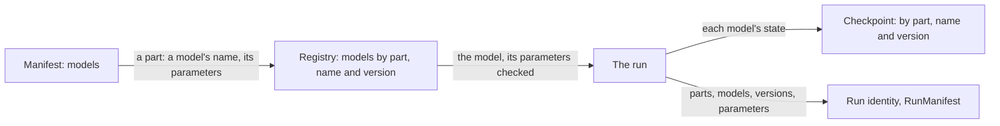

# P14: Models chosen by the manifest

**Status:** in progress: P14.1 to P14.3 are done; the rest is proposed. Its decision
([0054](../decisions/0054-models-are-chosen-by-the-manifest-from-a-registry.md))
is Accepted, its open questions settled (below). This is the project that the
[repository audit](../audits/2026-10-13-repository-audit.md) calls "P10",
"models chosen by the manifest": it was renamed because P10 became the
consumer interface. It closes `AUDIT.1` to `AUDIT.4`. Part of the
[simulator roadmap](README.md).

## Goal

A scenario's manifest says which model runs each part of a run, and holds
each model's parameters in a section of its own. A contributor adds a
model or a device by writing it against its part's contract and
registering it, without editing the run, the scene or the viewer. A run
records which model, and which version of it, ran each part. A checkpoint
keeps each model's state under that name, and a run made with other models
or versions is another run.

## Where it starts from

Decision 0035 made the run the one simulator, each part a ladder of models
from the simplest to the richest. Today the run chooses some parts by the
manifest and others by code:

- **Chosen by the manifest already**, as discriminated unions in
  `ScenarioConfig` (`scenarios/config.py`), each kind built by its own code:
  - the weather: `constant`, `synthetic`, `seasonal` or `recorded`;
  - the prescribed air field: `uniform`, `buoyancy`, `vortex` or
    `gradient`;
  - each row's crop model: `simple` or `organ`.
- **Chosen by code:**
  - the house's air: the whole house and the grid together, wired in
    `climate/day.py`;
  - sun and glazing;
  - each device kind, by `isinstance` in `climate/sources.py`,
    `climate/house.py` and `services/heat_log.py`;
  - the vents;
  - the controller, of whose loops only heating is allowed.
- **One part on two paths:**
  - **The crop:** the simple crop runs only in the engine's day
    (`core/engine.py`). In a run it means no living crop: the crop's
    services refuse it (`services/crop.py`).
  - **The sensors:** the engine has its own sensors
    (`sensors/generation.py`), beside the run's sampler (`sensors/air.py`).
- **Parameters at the top of every scenario:** the simple crop's and the
  engine's 21 settings are flat fields of `ScenarioConfig`, in its schema
  and its digest, though no packaged manifest writes them. Three of them,
  the crop walk's measurement noises (`ripe_mass_noise_pct`,
  `height_noise_cm`, `fruit_count_noise_probability`), act on the organ
  crop's run too (`services/crop_log.py`). `AUDIT.4` did not say so.
- **A device in ten files:** `docs/guides/add-a-device.md` lists them. A
  new kind needs:
  - its kind's enum value and its model;
  - its source terms;
  - the scene's kind, colour and schema version;
  - five viewer modules that switch on the kind;
  - the regenerated schemas.
- **No record of models:**
  - A run's id covers every parameter (`services/fields.py`), but no
    model's identity or version.
  - A checkpoint keeps the organ crop's plants and the house's air. It
    refuses a crop of another model by testing for the organ crop
    (`services/checkpoints.py`).
- **Contracts without a registry:**
  - The parts have protocols: `AirflowModel`, `WeatherSource`, `CropLight`,
    and the engine's `PlantModel`, `EnvironmentModel` and `SensorModel`.
  - Conformance tests hold some of them (`test_model_contracts.py`,
    `test_airflow.py`, `test_climate_contract.py`), and none hold
    `WeatherSource` or `CropLight`.
  - There is no registry: the unions and `PATTERNS` play its part.
  - Only the adapters load entry points (`greenhouse_data.commands`).

## Dependencies

- **Decisions:** 0035 (one simulator, the run, on a ladder of fidelity),
  0006 (models plug in through minimal protocols), 0005 (a model's state
  apart from the world), 0024 (plants take their environment a day at a
  time), 0031 and 0050 (one manifest format, the installation its house
  part) and 0040 (a run's identity, for consumers).
- **P13.2 comes first.** It changes `RunRequest` and the checkpoint's
  format, which P14.1 and P14.2 change next.
- **Devices wait for P13.3.** P14.5's devices come after P13.3, whose
  executor carries out actions on devices.
- **P12.4 builds on it:** its versioned crop parameter sets build on the
  models' sections.

## What stays stable

- **A packaged scenario's run:** its run id, replay digests and kept opening
  day, through every step that only moves where the manifest writes a
  choice (P14.1). A step that changes what a run is, such as a model's
  version entering its identity (P14.2), changes the packaged runs' ids once.
  The changelog says so, and consumers are told first (decision 0040).
- **One manifest file, one version:** a model's section is part of the
  manifest and is migrated with it (decisions 0031, 0050).
- **The consumer interface:** a consumer reads observations and events, not
  models (decisions 0036, 0040).

## Design

### Parts, models and the registry

- **A part** is what a run needs worked out. The parts are:
  - the house's air;
  - the air field drawn;
  - the weather;
  - sun and glazing;
  - the crop;
  - the crop walk's measurements;
  - the sensors;
  - each device's effect;
  - the controller.

  Each part has one contract, a Protocol as decision 0006 has them, and a
  conformance test that holds every model of it.
- **A model** implements its part's contract. It has:
  - a name, unique within its part (`organ`, `simple`);
  - a version;
  - a parameter model: pydantic, frozen, with bounds and a schema;
  - a state model, if it keeps state from one moment to the next.

  Its version changes whenever its numbers change for the same parameters.
- **The registry** holds each part's models by name, and the default: the
  model a manifest that says nothing about the part gets, which is today's
  choice.
  - The packaged models register themselves in the package.
  - A model from another package registers through an entry point
    (`greenhouse_sim.models`), loaded only when a manifest names it.
    Whether that comes in P14 is an open question.



### The manifest

Manifest format 5 adds `models`. For each part it names a model and gives
its parameters, in a section checked against that model's parameter model:

```json
"models": {
  "crop": {"model": "organ"},
  "crop_walk": {"model": "walk", "parameters": {"height_noise_cm": 1.5}}
}
```

- A part left out takes its default model with that model's default
  parameters. A manifest says only what it chooses.
- A migration from format 4 moves today's choices into the section:
  - the weather's kind and settings;
  - the air field's kind and settings;
  - the simple crop's and the engine's settings, to the `simple` crop's
    section;
  - the walk's three measurement noises, to the crop walk's section.

  Rows still name their crop, as decision 0050 has them. How the crop part
  meets rows is an open question.
- `ScenarioConfig`, the scenario resolved, keeps what the run reads. P14.1
  changes only where the manifest writes a choice, so the resolved scenario
  is unchanged, and so is every run id.
- Format 6 (P14.6) moves the house's air's settings, `climate` at the top,
  into the house air's section, as the `grid` model's parameters. The
  `whole_house` model takes the same settings but the grid's mixing.
- Format 7 (P14.6) moves the controller, `control` at the top, into the
  controller's section, as the `loops` model's parameters. A scenario
  without one names no controller, and runs the default, `none`: its
  devices run by its commands alone.

### Identity, state and checkpoints

- **Identity:** a run's identity covers each part's model, its version and
  its parameters. `RunManifest` (`/api/scenarios/{id}/manifest`) lists them,
  so that a reader sees which models ran. A run with another model, version
  or parameter is another run.
- **State:** a model that keeps state declares its state model. A checkpoint
  keeps `models`, each part's model, version and state. A checkpoint is
  restored only into a run of the same models and versions, and is refused
  otherwise, naming the part that differs. This replaces today's test for
  the organ crop's plants.

### Devices by capability

- **What a device is:** the run, the scene and the viewer know a device by
  what it can do and by its shape, not by its kind. What a device can do is
  its capabilities: move air, heat, take water out of the air, open. A
  device kind is a registered model with:
  - its capabilities, and the parameters each takes (a fan's flow, a
    heater's power);
  - its shape;
  - its colour.
- **Who reads capabilities:**
  - the climate's source terms sum each device's capabilities;
  - the scene draws a device by its shape and colour;
  - the viewer's panels list it by its capabilities;
  - an action (P13) names a device and one of its capabilities.

  Adding a device is then its module, its registration and a layout that
  places it.
- **The viewer:** for devices, the viewer's build-time unions of kinds
  (`SceneEntityKind`, the renderers' table) give way to drawing by shape and
  capability. A device the viewer was not built with is still drawn and
  listed.

### The pilot

Before the registry is generalised, one extension is made end to end, as
the audit asks: **the simple crop as a rung of the run.**

- **What it is:** it runs the crop part in the run, with the simple model's
  daily growth taking each plant's day (decision 0024). It has its own
  parameter section, its state in a checkpoint, a conformance test beside
  the organ crop's, and the viewer showing its plants and their numbers.
- **What it closes:** the engine's second path for the crop (decision
  0035), and the 21 flat settings at the top of every scenario (`AUDIT.4`).
- **What it records:** what the pilot needed of the registry, before the
  other parts move.

## Steps

| Step | What | Status |
| --- | --- | --- |
| P14.1 | **The registry and the manifest's `models`, format 5:** each part's model by name, with its parameters in its own section; today's choices written there by a migration; `RunManifest` lists the parts' models. Every run id, replay digest and kept opening day unchanged. | Done: the registry (`scenarios.registry`) of the weather's, the air field's, the crop's and the crop walk's models, each with its parameter model; manifest format 5's `models`, read into the configuration as it was, so that no run changes; the migration from format 4, the packaged manifests rewritten by it; `RunManifest.models`, shown in QA mode. The packaged manifests' versions change with their files, so the reference greenhouse's kept opening day and replay record its new one, their numbers the same |
| P14.2 | **Identity and state:** each model's version. The run id covers the parts' models and versions. A checkpoint keeps each stateful model's state by part, model and version, and refuses another model's, naming the part. The packaged runs' ids change once, announced. | Done: every registered model has a version, 1; a run's id covers each part's model and version, so every run id changed once; `RunManifest.models` names each part's model and version; checkpoint format 5 keeps each part's model and version, and the organ crop's plants as its state, a checkpoint of another model or version refused, naming the part; formats 2 to 4 read as it |
| P14.3 | **The pilot:** the simple crop as a rung of the run, with its section, its state, its conformance test and the viewer. Its settings and the walk's noises leave the top of the scenario. | Done: the crop model's parameters and the walk's are each a section of the scenario's configuration (`crop`, of the model its rows grow, and `crop_walk`), the organ crop's taking none, so that the run ids changed in the same release as P14.2's; the crop part's contract (`biology.crop_contract.CropRung`), kept by the organ crop and the simple crop, which a scenario of simple rows grows in its run, draws, keeps in a checkpoint and replays, its version 2, and the conformance test of both (`test_crop_rungs.py`); the viewer draws the simple crop as it stands at a run's moment, each plant's numbers in its inspector; and the crop log records the simple crop's walk and harvests as it records the organ crop's |
| P14.4 | **What the pilot showed:** the registry's needs, recorded in a decision. Models from another package through entry points, if the open question says so. | Proposed in [0055](../decisions/0055-a-model-is-registered-with-all-that-tells-it-apart.md): a model registered with all that tells it apart (its state's model and check, and what its part's services ask of it), so that no service branches on a model's name; one environment for every model of a part; the engine's settings gone with the engine; no entry point yet |
| P14.5 | **Devices by capability:** the climate's source terms, the scene and the viewer work by capability and shape. `add-a-device.md` becomes one module and a registration. After P13.3. | Done: the simulator acts on a device's capabilities, never its kind; the scene draws every device as one kind (`EQUIPMENT`) by its shape and what it does, and the viewer draws, names and lists it so; a kind of equipment is a class and its registration (`register_equipment`), a layout reading each piece by its kind; see "Settled in P14.5" |
| P14.6 | **The other parts registered:** first the crop's registration taking over the services' branches on its model (decision 0055); then the house's air (the whole house and the grid as rungs), sun and glazing, the sensors' sampler and the controller's loops. The engine's remaining models are re-homed or removed (decision 0035). | In progress: the crop's registration for the services (`services.crop_models`), which the crop's scene, the plants' light, checkpoints, the crop log and the replay ask in place of branching on its model; decision 0055 Accepted; the sunlight and the sensors, a model each (checkpoint format 6); the house's air, `grid` or `whole_house` (manifest format 6, checkpoint format 7); the controller, its `loops` or `none` (manifest format 7, checkpoint format 8). Left: the engine's day, which gives way to the run as [0059](../decisions/0059-the-engines-day-gives-way-to-the-run.md) decides, in four steps, all in 0.5.0: the viewer's live mode, the examples, evaluation on the run's truth (done: `greenhouse_sim.ground_truth` gives what a run's sensors and its crop walk truly measured, reading by reading, which the accuracy report and example 04 score a run's observations against), and the engine removed |
| P14.7 | **The recipes and the QA:** the guides (`add-a-plant-model`, `add-an-air-model`, `add-a-device`, `add-a-sensor-kind`) rewritten for the registry; the QA scenario below. | Proposed |

## Settled in P14.5

- **The capabilities** (`greenhouse_sim/greenhouse_sim/world/capabilities.py`):
  a device moves air (`MovesAir`: its flow, blown as a round jet from its
  outlet), heats (`Heats`: its power, the house's heating, blown from an
  outlet or given around its body) or dries (`Dries`: the water it takes
  out of the air around its body). The heat a device gives off as it works
  (`WasteHeat`) is not heating: no loop runs a device for it, and the heat
  log does not meter it. A fan moves air; a unit heater heats, blown from
  the middle of its front; a dehumidifier dries, and gives off heat.
- **One level a device:** its level scales all it does at once. An action
  names a device, not one of its capabilities (the open question on
  capabilities and actions), until a device's capabilities run apart.
- **What the climate knows of a device** (`Device`): its identifier, its
  body and its capabilities. The source terms take any device, so a device
  is added with no change to the climate as long as it does what the
  capabilities say.
- **Where a device stands and how a move places it** are its own
  (`anchor`, `displaced`), as a sensor's are: moves, copies and the
  builder's spacing ask the item.
- **The scene knows one kind of equipment** (`EQUIPMENT`, scene schema
  16): a device is drawn by its shape, in the colour of what it is for
  (`purpose`, its first capability other than its waste heat), with its
  kind (`device_kind`), what it is for (`does`) and each capability's
  rating under the capability's name, beside its own rated values.
- **A kind of equipment is registered** (`register_equipment`, decision
  0055): a class of `EquipmentPiece` (`Unit` for a box on the floor), named
  by its `kind`, in a module of its own, in this package or another. A
  layout reads each piece by the kind it names, among those registered when
  it is read, refused with the kind's own reasons; the published schemas
  list the kinds registered when they are written, the packaged ones. A
  radiant panel registered from a test module is placed by the climate
  box's layout, warms its house when it runs and is drawn by what it does.
- **The viewer draws and lists a device by what it does:** its category
  in the categories' view is what it is for (moving air, heating,
  drying), the inspector names its kind, the Equipment panel reads its
  rating by what it is for, and it is drawn by its shape, with the arrow
  of the air it moves on a cylinder that moves air. A device of a kind
  the viewer was not built with is drawn, named and listed the same way.

## Acceptance criteria

- **Manifests:**
  - A manifest chooses each part's model by name and gives its parameters
    in that model's section.
  - A manifest that says nothing of a part runs today's model.
  - No model's settings sit at the top of `ScenarioConfig`.
- **Packaged runs:** their run ids, replay digests and kept opening days
  are unchanged by P14.1, and changed once by P14.2, with the changelog
  saying so.
- **Records:**
  - A run's `RunManifest` names each part's model and version.
  - A checkpoint made with one model is refused by a run of another, naming
    the part.
- **The pilot:** the simple crop runs in the run, and the viewer draws and
  lists it.
- **Devices:** a device added in a test package, by one module and its
  registration, can be placed by a layout. It heats or moves air in a run,
  and a viewer built without it draws and lists it.

## QA scenario (proposed)

1. Open the reference greenhouse. Its manifest lists each part's model and
   version.
2. Run a copy of it with the simple crop:
   1. Its plants are drawn and its yield is shown.
   2. Upload a checkpoint of it into the organ crop's run. The upload is
      refused, naming the crop.
3. Add a test device, a fogger, from a package of its own:
   1. Place two of them in a layout and run it.
   2. The viewer draws and lists them, and the house's humidity rises while
      they run.

## Open questions

Settled with P14.1, as decision 0054 records: the simple crop is the pilot;
a model's version enters the run's identity with P14.2; models from other
packages wait until one asks (no entry point in P14); the crop's section
gives the parameters of the model the rows grow, P12.4's parameters for
each variety built on it; and capabilities and actions share one
vocabulary, decided with P13's executor step. The questions as they were
asked:

1. **The pilot.** The simple crop as a rung of the run is proposed, because
   it touches every piece the registry needs: parameters, state, a
   conformance test and the viewer. The alternatives:
   - **The weather:** the smallest, with no state, no viewer change and
     four kinds already.
   - **A new device:** tests the ten files directly, but needs P13.3 first.
2. **When a model's version enters the run id.** With P14.2, changing the
   packaged runs' ids once. Or together with P11.5, which changes the
   reference greenhouse's run anyway, so that consumers follow one change.
3. **Models from other packages.** Entry points in P14, or later, once a
   model from outside the repository asks for it. Such a model runs its
   code in the simulator's process, and its package and version are part
   of the run's identity.
4. **The crop part and rows.** Rows name their crop model and variety
   (decision 0050), and P12.5 runs rows of different crops. Should the crop
   part's section hold the model's parameters for each variety, as P12.4's
   versioned parameter sets would? P12.4 builds on the answer.
5. **Capabilities and actions.** P13 acts on a device by its kind's
   commands, while capabilities name what a device does. One vocabulary for
   both is proposed, decided with P13's executor step.
