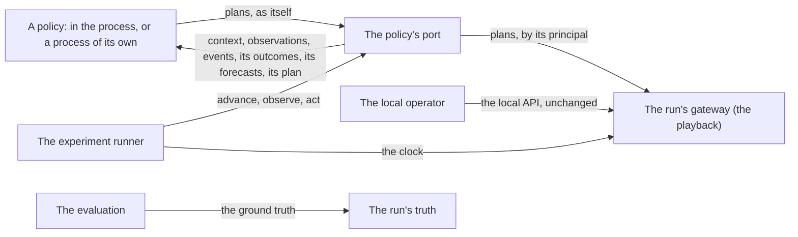

# P15: A policy's port, and an experiment that steps a run

**Status:** in progress: P15.1 done. Stage A of decision
[0061](../decisions/0061-greenhouse-decisions-are-benchmarked-through-interfaces-built-for-it.md).
Part of the [simulator roadmap](README.md).

## Goal

A control policy, in the simulator's process or in a process of its own,
reads what an observation process makes and what it may know of the
greenhouse, and gives plans as its own authenticated principal, and
nothing else. An experiment steps a simulated run by deterministic
barriers, so that two policies are compared on the same scenario, the same
information and the same budget.

Today, `examples/03_close_the_loop.py` closes a loop in the simulator's
process: trusted code, an injected clock it moves after polling the run,
its heater and sensor named by hand. Over HTTP, every write is the local
operator's (decision 0052), and the local API serves the simulated world's
truth beside its observations (decision 0036). The
[policy evaluation memo](../research/policy-evaluation-contract.md) lists
the rest of what is missing.

This project is stage A of decision 0061: the ports, the context, the
budget and the runner. Stage B, a first scenario with its measures frozen
and one conventional baseline, and the stages after it are projects of
their own.

## Dependencies

- **P10, the consumer interface** (decision 0040): runs, epochs, cursors
  and batches, nothing delivered before the clock reaches it. The port
  reuses its records and its cursor rules.
- **P13, the gateway** (decisions 0046 and 0052): plans and their
  revisions, receipts, grants and the plan in force. Its contract already
  says that the caller's principal is the one the channel authenticated,
  never one a document names.
- **The playback** (decision 0041): one clock for a run, injectable in the
  process.
- **The ground truth** (`greenhouse_sim.ground_truth`), which only
  `greenhouse_sim.evaluation` imports, as `tests/test_dependencies.py`
  holds.
- **P14.9, measurement models** (decision 0062): their outputs are
  observations, and reach a policy as the sensors' readings do. The port
  takes them as they come; they do not block it.

## Design

### Who reads what



- **A policy** reads only through its port, and acts only through it.
- **The local operator** keeps the local API, which serves people the
  simulated world, on this machine (decisions 0009, 0036, 0052). No policy
  reads it.
- **The evaluation** alone reads the truth, in the process, as today. An
  evaluator over the network is not part of this project.

### The port

A contract in the protocol, `PolicyPort`, beside the gateway's
(`greenhouse_protocol.contracts.policy`):

| Call | Gives |
| --- | --- |
| `run()` | the `RunDescriptor`: run id, epoch, clock |
| `context()` | the `CapabilityContext` below |
| `budget()` | the `InformationBudget` below |
| `observations(after, limit)` | an `ObservationBatch` of what the allowlist lets through |
| `events(after, limit)` | an `EventBatch`, likewise |
| `outcomes(after, limit)` | an `OutcomeBatch` of the actions of plans this principal owns |
| `forecasts(after, limit)` | a `ForecastBatch` from the providers in its budget |
| `plan(plan_id)` | the `PlanState` of a plan it owns, or none |
| `submit(plan)` | the gateway's `Receipt` |
| `cancel_plan(plan_id)`, `cancel(keys)` | the gateway's receipts |

- **No call names a principal.** A port is opened for one: in the process
  by whoever opens it, over the network by the credential its requests
  carry. Every plan goes to the gateway as that principal, and the
  gateway's grants decide the rest: a plan naming another proposer is
  refused unless granted on its behalf.
- **Its own cursors:** a port's cursors are its own, kept apart from the
  consumer interface's shared store, with the consumer interface's rules:
  counted in one epoch of one log, an earlier epoch's answered empty.
- **One contract, two transports:** a conformance function,
  `check_policy_port`, runs against an in-memory reference, the
  simulator's port in the process and the HTTP client. One test gives the
  same plan by either and holds the receipts equal.

### What a policy may read

An explicit allowlist, in the protocol, which a test holds every record the
port gives to, field by field:

| What | From | Fields |
| --- | --- | --- |
| Observations | the observation log as delivered: noisy, late, clipped | every `Observation` field; the types of the run's sensors and measurement models, as the context lists them |
| Events | the crop work's and the crew's, on plants | `Event`'s fields; of `parameters`, per type: `HARVEST` `harvested_mass_g`, `harvested_fruit_count`, `action`; `LOWERING` `amount_cm`, `action`; `PRUNING` `leaf_id`, `action`; `MANUAL_INSPECTION` `reason`, `action` |
| Outcomes | the outcome log, of plans this principal owns | every `ActionOutcome` field |
| Forecasts | its budget's providers | every `Forecast` field |
| Its plans | the gateway | `PlanState`, of plans it owns |
| The context | the run | every `CapabilityContext` field |

- **Never:** the clean observation log, the fields, the scene, the crop's
  and each plant's state, the house's true air, each process's state, the
  timeline, the weather series (the future's truth), the manifest's model
  internals, the ground truth, or another principal's plans and outcomes.
- **A parameter the allowlist does not name is dropped.** A test fails
  when the simulator writes one, so that letting a new one through is a
  decision, made in the allowlist.
- **A crop grown by area** is observed on its scope, not on a plant
  (decision 0062): its harvest, for one, is a measurement model's
  observation, a weighing of the scope, not a plant's `HARVEST` event. Such
  an observation names its scope and no plant, by the optional scope id the
  protocol gains with P14.9's measurement outputs.
- **The dependency test** keeps the port's modules from importing the
  ground truth, the fields, the crop's state or the local API.

### The capability and goal context

`CapabilityContext`, a versioned record in the protocol: what a policy may
read and do, and nothing of how the simulated world works. It is built by
the simulator from the run's installation, its scenario and its
authorisation, once for each epoch.

- **The run:** its id, epoch and greenhouse, and the principal the context
  is for.
- **Observation sources:** each sensor and each measurement model, with
  its id, its observation types, their units, its cadence and where it is:
  a compartment, a zone, a plant, or a crop's scope (a row, as
  `world.scopes` names it). Not its noise, drift or faults, which are the
  simulated world's.
- **Devices:** each device's id and kind, the actions that set it, and
  their ranges and units (a level from 0 to 1, or `auto`; an opening).
- **Targets:** each target's name, range and unit. The target in force is
  observed, as its setpoint observation type, not given here.
- **The crop:** each crop instance, whether it is grown by plant or by
  area, and its scopes, each with its id, kind and areas (cultivated and
  floor, in m²). The plants, as `GreenhouseDescription` lists them, only
  for a crop grown by plant.
- **Crop work:** the crop actions as each crop's model declares them
  (`CropActions`, decision 0062), and when they are carried out (at a
  day's start); none for a model that declares none, as neither published
  model does.
- **The gateway's limits:** `GatewayLimits`.
- **This principal's grants:** the action kinds and targets it may act on,
  and on whose behalf.
- **Goals and constraints:** an experiment's, each named, with its unit
  and bound. Empty until stage B fixes a scenario's.

Example 03 then reads its heater and sensor from the context, and names
neither by hand.

### Who a caller is

- **In the process:** the runner, or a test, opens a port for a principal.
  The policy is trusted code, held to the contract by the conformance
  tests and the dependency test. These are not a sandbox: nothing promises
  that code in the same interpreter cannot reach the truth.
- **Over the network:** the port is served by a server of its own, apart
  from the local API, on loopback unless told otherwise. Each request
  carries a bearer token. The tokens come from a credentials file given to
  the server, as the authorisation file is given (decision 0052): for each,
  its principal, its role and the token's SHA-256, never the token itself.
  A request without a known token is refused.
- **Three roles, told apart:**
  - a policy reads its port and gives plans as itself;
  - the operator keeps the local API, unchanged;
  - an evaluator reads the evaluation's outputs, in the process.

  Tests hold each to what it may read and do. The port's server has no
  route of the local API's, and a test asks it for each and is refused.
- **A policy that is not trusted** runs in a process of its own, given
  only the port's address and its token. The local API authenticates no
  one, and anything on the machine that reaches loopback reaches it. So a
  benchmark's runner serves the port alone, and does not start the local
  API. Running the policy where loopback does not reach, such as a
  container, is the deployment's choice, and the documentation says so.

### The information budget

`InformationBudget`, a record in the protocol, declared for each episode:
- the observations and the clock, always;
- forecasts, from named providers: each with its version, the quantities
  it forecasts, how often it issues, its horizon and its uncertainty;
- prediction models and calibrations, each a versioned asset given
  explicitly, with its digest.

`Forecast`, a record in the protocol: its provider and version, the moment
it was issued, the moment or period it is for, the quantity (an
`ObservationType`), the value, and its uncertainty. The port delivers a
forecast no earlier than its issue time, as it delivers an observation no
earlier than its delivery.

- **None is the simulator's future truth.** A budget that gives the full
  state, or a forecast with no error, is labelled an oracle, and an
  experiment compares only budgets alike.
- **The first provider:** persistence, which forecasts the outside air and
  radiation of the next day from what was observed on the last. It uses
  observations alone, so a policy given it has nothing a matched baseline
  could not have.
- **`FORECAST_RADIATION_SUM_TODAY_J_CM2`** stays an observation type, for
  recorded data that carries a forecast as a reading (AGC4). A simulated
  forecast is a `Forecast`.

### The lifecycle

As decision 0061 has it:
- **The runner owns** the port's cursors and the epoch, the plan's id and
  its revisions, the receipts, retries, timeouts and stopping:
  - a revision refused as stale is retried once, after reading the plan
    in force;
  - a decision past its compute budget is skipped, and the skip
    recorded.
- **The policy owns its memory,** started and reset with each episode:

  ```python
  class Policy(Protocol):
      def start(self, context: CapabilityContext, budget: InformationBudget) -> None: ...
      def decide(self, at: Instant, delivered: Delivery) -> Decision: ...
      def stop(self) -> None: ...
  ```

  - `Delivery` holds what reached the port since the last decision:
    observations, events, outcomes and forecasts.
  - `Decision` is the actions of its plan's next revision, or keeping the
    plan in force, or cancelling it. The runner makes the revision.
- **Freshness** is as each record's delivery says; a late reading comes in
  the batch it arrives in. An action's deadline is its timing's (`Asap`'s
  deadline, a lateness).
- **A policy decides at its own cadence,** which it declares
  (`decide_every_s`).

Over the network, a policy uses the port's contract directly: it gives
plans with their revisions, as the gateway's contract has them, against a
run that plays on the wall clock.

### The experiment runner

Simulation only, in the process, apart from the port's contract
(`greenhouse_sim.experiment`):
- **An episode:** a scenario, a policy and its principal, a budget, its
  decision cadence, its end and its seed.
- **Barriers, at each decision moment `t`:**
  1. advance: the run worked out to `t` and its clock moved to `t`, in the
     caller's thread, with no sleeping and no polling. A held playback
     with an injected clock gains a call that does both (`step_to`);
  2. observe: the port's batches up to `t`;
  3. act: the policy's decision, given to the gateway, its receipt
     recorded.
- **Deterministic:** the same scenario, policy and seed give the same
  receipts, outcomes and observations, and a test holds their digest. A
  deterministic replay is a property tested for a given policy, not
  promised for every one (decision 0061).
- **Example 03** moves onto it: no sleeping, its ids from the context.
- **What it returns:** an episode's summary: its scenario, run id and
  epoch, the policy's identity, its budget, and its receipts and outcomes.
  Everything that names an episode, the experiment record, is stage C's.
- **Remote stepping,** a policy in a process of its own held at the
  runner's barriers, is a design of its own (decision 0061). Until then, a
  remote policy steers a run that plays on the wall clock.

### What does not change

The local API, the consumer interface (for people and dashboards), the
gateway's contract and the ground truth's readers. No run id, replay
digest or kept opening day moves.

## Steps

| Step | Scope | Pull request | Status |
| --- | --- | --- | --- |
| P15.1 | The protocol's records and contracts: `PolicyPort`, `CapabilityContext`, `InformationBudget`, `Forecast`, `Policy`, `Delivery`, `Decision`, the allowlist, and `check_policy_port`, with an in-memory reference; the published JSON Schemas. | `feat(protocol): a policy's port, its context and its budget` | Done: the records (`context`, `budget`, `forecast`), the context saying when the run carries each kind of action out (`cadences`: crop work at a day's start, a target on the minute); the port's contract, its routes and its allowlist (`contracts.policy`), and the forecasts as a fourth log with the consumer interface's rules; `check_policy_port`, which finds a port that gives another's plans or outcomes, an unobserved reading, an unnamed parameter or an unbudgeted forecast; the in-memory reference (`contracts.memory_policy`); four published schemas. The port gained `budget()`, so that a policy outside reads its budget as it reads its context |
| P15.2 | A run's capability and goal context, built from its installation, scenario and authorisation. | `feat(sim): a run's capability and goal context` | Planned |
| P15.3 | The policy's port in the process: bound to a principal, its own cursors, the allowlist applied, its outcomes and plans only; the conformance tests and the dependency test. | `feat(sim): a policy's port in the process` | Planned |
| P15.4 | The experiment runner: `step_to`, the barriers, the lifecycle, the determinism test; example 03 on it. | `feat(sim): an experiment that steps a run` | Planned |
| P15.5 | The port over the network: its own server and command, the credentials file, the roles, a client in the protocol; the same receipt by either transport. | `feat(api): a policy's port over the network` | Planned |
| P15.6 | The information budget: forecasts on the port, persistence as the first provider, the oracle label. | `feat(sim): forecasts in a policy's budget` | Planned |
| P15.7 | The QA scenario below, run and recorded. | `test: a policy in its own process steers a run` | Planned |

## Acceptance criteria

- A policy given only the port's address and its token, in a process of
  its own, steers a playing run. Every record it reads is in the
  allowlist. The port's server refuses every route of the local API, and
  the local API is not served.
- The same plan gives the same receipt in the process and over the
  network.
- A port opened for a policy cannot give a plan as the operator or as
  another policy unless the authorisation grants it; a test holds each
  role to what it may read and do.
- The context lists every observation source, device, target, crop scope
  and limit the run has, and example 03 names nothing by hand.
- Two runner episodes with the same scenario, policy and seed give the
  same receipts, outcomes and observations.
- A forecast reaches a policy no earlier than its issue time; a budget
  with perfect information is labelled an oracle.
- No run id, replay digest or kept opening day changes.

## Final QA scenario

On the reference greenhouse:
1. The port's server is started for a held run, with a credentials file
   naming one policy.
2. Example 03's policy runs in a process of its own, given the address and
   its token. It reads its context and steers the heater for a day.
3. A request with an unknown token, and one for a local API route, are
   both refused.
4. A revision given twice is refused as stale. The policy reads the plan
   in force and gives the next revision.
5. The same policy runs through the runner, in the process, on the same
   scenario and seed. Its receipts and outcomes are recorded beside the
   remote run's, and the differences the wall clock makes are explained.

## Open questions

1. **The client:** in the protocol package, using the standard library
   alone, so that a policy outside depends on the protocol only
   (proposed), or in `greenhouse_adapters`.
2. **The credentials:** a file of hashed bearer tokens given to the
   server (proposed), or mutual TLS from the start.
3. **The first forecast provider:** persistence alone (proposed), or also
   a forecast made from the scenario's weather with a declared error
   model, labelled as derived from the future's truth.
