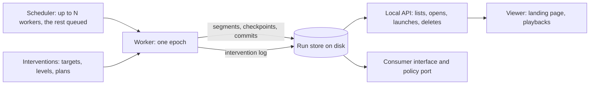

# P17: Runs kept in a store, playbacks as positions, and a place to choose

**Status:** proposed: the design below, with decision
[0065](../decisions/0065-a-run-is-a-scenario-at-a-seed-kept-in-a-store-and-played-from-it.md),
which this document's pull request proposes. Part of the
[simulator roadmap](README.md).

## Goal

A person chooses a scenario from a searchable list, sees the runs it has,
launches another at a seed, or opens one that has run, finished or still
running, and moves through any part of it that has been computed. Runs are
computed by workers into a store on disk, many at once, and an interrupted
one resumes. The viewer and a consumer read the same stored epoch.

## Where it stands before P17

- **Playback:** `services/playback.py` is one scenario's run, its worker, its
  clock, its gateway and its epoch (decision 0041). `Playbacks` holds one for
  each scenario; starting it over with another layout replaces it.
- **Records:** a day's observations and events are gzip bytes in memory
  (`_Log`). The epoch number alone is a file (`Epochs`, `playback-epochs`).
- **State to resume from:** `kept_states` and `checkpoints` hold a run's
  state at a day's start, in memory, bounded.
- **The seed:** `ScenarioConfig.random_seed`; `RunRequest` has none.
- **The viewer:** `main.tsx` picks a page by `location.pathname`: the QA
  pages, the builder, and otherwise `App`, whose scenario list
  (`ScenarioList`, `SourceChooser`) filters by name, identifier and
  description.
- **Builder drafts** run as scenarios registered with the simulator
  (`services/drafts.py`, decision 0048).

## Dependencies

- **P10, the consumer interface** (decision 0040): runs, epochs and cursors
  stay as they are.
- **P13 and P15:** the gateway, the policy port and the experiment runner.
  The port's `PlayedRun` interface and `Playback.step_to` are the seam.
- **P09.5, checkpoints and branches:** a fork is a branch from a stored
  state.
- **P16, the crop at its model's step, and decision 0062's crops grown by
  area:** what a day keeps of the crop is the model's own state: plants for a
  crop grown by plant, and for one grown by area its scopes with a course for
  each step before the day (`AreaCropState`, no plant identifiers). The store
  treats a model's state as opaque, and a checkpoint's scopes come from its
  own layout.
- **P12, the setup builder:** a draft's installation is named by digest.

## Design

### Words

| Term | Is | Identity |
| --- | --- | --- |
| Scenario | everything that is run: installation, layout, weather source, site, period, crop models, a default seed | its identifier |
| Run | a scenario at a seed, a layout and a weather | `run_id`, the digest it has today; the seed enters it only when not the scenario's own |
| Epoch | one execution of a run from its start, with results of its own | the run's, and its number |
| Stored run | a run's epoch, as a person's list shows it: seed, epoch, status, progress | `(run_id, epoch)` |
| Playback | a position over one epoch | none; it holds nothing the epoch does not |

### Identities

| What | Is | Held by |
| --- | --- | --- |
| Initial inputs | the run request, seed, installation digest, models' and code's versions; immutable | `run_id` |
| Epoch | one execution of a run; for a fork, its parent | run, number, parent |
| Intervention log | ordered changes given to the epoch: sequence number, instant they take effect, who, what | the epoch's log |
| Realized trajectory | a digest over records, states and the log up to the frontier | each commit |

Two epochs of one run with different logs have different trajectories. A
fork keeps its parent epoch, the exact instant, the inherited state (the
parent's checkpoint and trajectory digest), the inherited interventions and
the inputs it changes.

### The store

Under the user's state folder (`XDG_STATE_HOME`, or `~/.local/state`, as the
epochs are kept today), a folder for each run and a subfolder for each epoch.
Its logical parts, whatever their physical form (P17.1):

- **The manifest:** the initial inputs, the store mode, the status.
- **Segments:** the epoch's records (observations, events, outcomes) for a
  span of simulated time.
- **Checkpoints:** the models' states at an instant, each as its model
  declares it (plants for a crop grown by plant; for one grown by area its
  scopes with a course for each step before the instant, `AreaCropState`, no
  plant identifiers). The store treats a state as opaque, and a checkpoint's
  scopes come from its own layout.
- **The intervention log.**
- **Commits.**

Segments and checkpoints are by simulated instant. Their lengths are
settings, a day by default. A checkpoint falls on a step boundary of every
model the run has (decisions 0062 and 0064), so that an action within a day
or a restart at an instant restores the nearest checkpoint before it and
works forward.

A `present` store keeps only the latest checkpoint and segment and the log.

### Commits and recovery

One commit advances the frontier. It names the segment, the checkpoint if
any, the position reached in the intervention log and the trajectory digest
so far; a reader sees what the last commit names, and anything after it is
ignored and written again. An intervention is logged with its sequence
number before it is acted on, and is applied once a commit names it. After a
crash, entries past the last commit are applied again by sequence number,
none lost and none twice (the gateway refuses a repeated identity). A test
kills a worker between the log and the commit, and again between the commit
and the next segment, and holds the resumed epoch's trajectory digest equal
to an uninterrupted one's.

### Status and resuming

`queued → running → finished | failed`. A worker that dies leaves `running`
behind; at startup an epoch in `running` with no live worker is
`interrupted`. Resuming restores the last committed checkpoint and applies
the log from there.

### Workers and the scheduler

A worker is `execute(epoch, store, driver)`, one function over three drivers:
*free*, *paced* and *stepped* (`step_to`). A scheduler runs up to a configured
number of workers and queues the rest. Whether a worker is a thread or a
process is decided from P17.1's measurement of what threads cost the viewer
(open question 3); the store is the only channel between a worker and the
API, so either serves. The API reads the store and holds no run's
computation.

### Playback as a position

A playback has a position at or before an epoch's frontier, a pace and a
state (playing, paused, following the frontier). Seeking is reading the
store at a moment; the scene at that moment is drawn on demand from the
stored state of its day, as the viewer's services draw one today. Many
playbacks read one epoch. A position in the past offers **fork**, not edit.

### Interventions and forks

A change given to a running epoch is recorded in its log at its instant, and
acts from there (decision 0043). A fork is a new epoch lineage, not a fresh
run: it records the parent, the instant, the inherited state and
interventions and what it changes, and does not compute what lies before the
instant. It is what a rearranged layout (decision 0049) becomes. The parent
is not removed and the fork is listed beside it.

### The pages

| Page | Address | Does |
| --- | --- | --- |
| Landing | `/` | a scenario picker, a dropdown with search; opening a scenario shows its stored runs (seed, epoch, status, progress, mode, created) and *New run* (seed, store mode, pace), with *Build a scenario* beside it |
| Builder | its own address, as today | draft and edit an installation |
| Run | one that names the run and the epoch | the viewer over a playback of that epoch |

The viewer gains an address for each, and a server (the API's static
serving, the dev server) answers each with the viewer's page.

### What does not change

Run ids and replay digests of a scenario's own seed, the consumer interface's
records and rules, the gateway's contract, the policy port, the kept opening
days, and a run's records for a given seed.

## Steps

| Step | Scope | Pull request | Status |
| --- | --- | --- | --- |
| P17.1 | Measurements on the reference scenario, and on a crop grown by area once one is registered: a segment's records, a checkpoint's states, time to seek, time to restore, and what threads cost a playing viewer. The physical commit and format, the default segment length and the worker technology fixed from them, in this document. | `docs(roadmap): the run store's format, from measurements` | Planned |
| P17.2 | The seed on `RunRequest` and in the identity, without moving an id: a test holds every kept run id and digest. | `feat(sim): a run's seed is its input` | Planned |
| P17.3 | The run store: manifest, segments, checkpoints, commits, status, reading, the trajectory digest; the playback writes through it; the epoch file moves into it. No behaviour a client sees. | `feat(sim): a run store on disk` | Planned |
| P17.4 | Workers and the scheduler: `execute` over the three drivers, threads and processes, a limit, a queue. | `feat(sim): workers that run epochs into the store` | Planned |
| P17.5 | Resuming: interrupted detection, restore from a checkpoint and the intervention log; the kill-and-resume tests, with a crash between the log and the commit. | `feat(sim): an interrupted run resumes` | Planned |
| P17.6 | Playback as a position: seek, follow, many over one epoch; the API's run routes; the consumer interface and port read the store. | `feat(api): runs are listed, opened and played from the store` | Planned |
| P17.7 | Interventions in the log; forks with their parent, instant and inheritance; a layout rearranged as a fork that leaves its run served. | `feat(sim): a change is the epoch's own and a fork is a new run` | Planned |
| P17.8 | The viewer's addresses; the landing page, the scenario picker with search, the run dialog. | `feat(viewer): a place to choose a scenario and a run` | Planned |
| P17.9 | Replay: a timeline bounded by the frontier, day navigation, following the frontier, `present` stores. | `feat(viewer): move through a run that has been computed` | Planned |
| P17.10 | The QA scenario below, run and recorded. | `test: runs kept, resumed and replayed` | Planned |

## Acceptance criteria

- Two runs of one scenario at different seeds exist at once, each listed with
  its seed, and differ in their records.
- A run at the scenario's own seed has the `run_id`, replay digest and
  records it has before P17.
- A viewer can seek anywhere up to the frontier of a run that is still
  running, and a consumer reading it is not moved by the seek.
- The API restarted, finished runs are listed and replayable; a run that was
  running is `interrupted` and resumes to the digests of an uninterrupted
  one.
- An epoch is resumed at a checkpoint inside a day, and an intervention
  logged before a crash is applied exactly once.
- Two epochs of one run with different interventions have different
  trajectory digests; a fork names its parent and instant.
- N runs asked for with a limit of M execute M at a time and queue the rest.
- The viewer opens on a page from which a scenario is chosen, a run
  launched, a stored run opened, or the builder entered.
- A policy port and an experiment runner give the receipts and digests they
  gave before.

## Final QA scenario

On the reference greenhouse:
1. Open the landing page, search for the scenario, open it: no stored runs.
2. Launch a run at seed 1 and another at seed 2, both `full`. Both are
   listed with their progress.
3. Replay seed 1 from its first day while both still compute: seek to day 3,
   then back to day 1, then follow the frontier.
4. Stop the API while seed 2 runs. Start it: seed 2 is `interrupted`; resume
   it; it finishes.
5. Compare seed 2's digests to a run of the same seed that was not
   interrupted: equal.
6. Launch a run in `present` mode: its present can be followed, its past is
   not offered.
7. Set a target while a run plays, then replay that run from the start: the
   change is shown at its moment.
8. From a position in the past, fork: a new run, listed beside the first.

## Open questions

1. **A repeated launch.** Launching a run whose seed and inputs match a
   stored one with no interventions is a new epoch (as a restart is today)
   or opens the stored one (proposed, with *New epoch* offered).
2. **The default store mode:** `full` (proposed) or `present`.
3. **Processes or threads** for the API's workers: decided by P17.1's
   measurement of what a thread costs a viewer.
4. **Retention.** What removes a stored run: deletion by a person only
   (proposed), or also a size limit.
5. **Where the store lives** and whether it is configurable: the state
   folder, with a setting (proposed).
6. **Drafts.** How a run of a draft is opened after the draft changes: by its
   digest kept in the manifest (proposed) or by keeping the installation in
   the store.
7. **Addresses:** a path for each page (proposed), or the hash.
8. **The default segment and checkpoint length:** a day (proposed), or a
   multiple of the shortest model step.
9. **The physical commit:** files renamed into place (proposed) or an
   embedded database, after P17.1.
