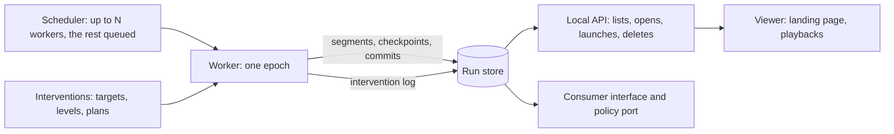

# P17: Runs kept in a store, playbacks as positions, and a place to choose

**Status:** accepted: the design below, with decision
[0065](../decisions/0065-a-run-is-a-scenario-at-a-seed-kept-in-a-store-and-played-from-it.md),
which this document's pull request records. Part of the
[simulator roadmap](README.md).

## Goal

A person chooses a scenario from a searchable list, sees the runs it has,
launches another at a seed, or opens one that has run, finished or still
running, and moves through any part of it that has been computed. Runs are
computed by workers into a store on disk, many at once, and an interrupted
one resumes. The viewer and a consumer read the same stored epoch.

## Where it stands before P17

- **Playback:** `services/playback.py` is one scenario's run, its worker, its
  clock, its gateway and its epoch (decision 0041). `Playbacks` holds one for
  each scenario; starting it over with another layout replaces it.
- **Records:** a day's observations and events are gzip bytes in memory
  (`_Log`). The epoch number alone is a file (`Epochs`, `playback-epochs`).
- **State to resume from:** `kept_states` and `checkpoints` hold a run's
  state at a day's start, in memory, bounded.
- **The seed:** `ScenarioConfig.random_seed`; `RunRequest` has none.
- **The viewer:** `main.tsx` picks a page by `location.pathname`: the QA
  pages, the builder, and otherwise `App`, whose scenario list
  (`ScenarioList`, `SourceChooser`) filters by name, identifier and
  description.
- **Builder drafts** run as scenarios registered with the simulator
  (`services/drafts.py`, decision 0048).

## Dependencies

- **P10, the consumer interface** (decision 0040): runs, epochs and cursors
  stay as they are.
- **P13 and P15:** the gateway, the policy port and the experiment runner.
  The port's `PlayedRun` interface and `Playback.step_to` are the seam.
- **P09.5, checkpoints and branches:** a fork is a branch from a stored
  state.
- **P16, the crop at its model's step, and decision 0062's crops grown by
  area:** what a day keeps of the crop is the model's own state: plants for a
  crop grown by plant, and for one grown by area its scopes with a course for
  each step before the day (`AreaCropState`, no plant identifiers). The store
  treats a model's state as opaque, and a checkpoint's scopes come from its
  own layout.
- **P12, the setup builder:** a draft's installation is named by digest, and
  its file (decision 0050) is what the scenario file extends.
- **DuckDB** (decision 0066), a runtime dependency added by P17.3, to read and
  write the records' Parquet files.

## Design

### Words

| Term | Is | Identity |
| --- | --- | --- |
| Scenario | everything that is run: installation, layout, weather source, site, period, crop models, a default seed | its identifier |
| Run | a scenario at a seed, a layout and a weather | `run_id`, the digest it has today; the seed enters it only when not the scenario's own |
| Epoch | one execution of a run from its start, with results of its own | the run's, and its number |
| Stored run | a run's epoch, as a person's list shows it: seed, epoch, status, progress | `(run_id, epoch)` |
| Playback | a position over one epoch | none; it holds nothing the epoch does not |

### Identities

| What | Is | Held by |
| --- | --- | --- |
| Initial inputs | the run request, seed, installation digest, models' and code's versions; immutable | `run_id` |
| Epoch | one execution of a run; for a fork, its parent | run, number, parent |
| Intervention log | ordered changes given to the epoch: sequence number, instant they take effect, who, what | the epoch's log |
| Realized trajectory | a digest over records, states and the log up to the frontier | each commit |

Two epochs of one run with different logs have different trajectories. A
fork keeps its parent epoch, the exact instant, the inherited state (the
parent's checkpoint and trajectory digest), the inherited interventions and
the inputs it changes.

### The store



The store is an interface over named objects (put one whole, get, list,
delete). Its first backend is a folder under the user's state folder
(`XDG_STATE_HOME`, or `~/.local/state`, where the epochs are kept today), so
that every checkout and worktree on the machine shares it; a backend over an
S3-compatible object store is a later backend (see the measurements), and the
same format serves both. A commit is then an object written after the objects it names
(an object store has no rename). Its logical parts:

- **The manifest:** the initial inputs, the store mode, the status.
- **Segments:** the epoch's records (observations, events, outcomes) for a
  span of simulated time, each log a zstd Parquet file written once, read and
  written with DuckDB (decision 0066).
- **Checkpoints:** the models' states at an instant, each as its model
  declares it (plants for a crop grown by plant; for one grown by area its
  scopes with a course for each step before the instant, `AreaCropState`, no
  plant identifiers). The store treats a state as opaque, and a checkpoint's
  scopes come from its own layout. A checkpoint is an object with a content
  type: JSON with zstd by default, a columnar or array format a model that
  keeps a large population declares.
- **The intervention log:** JSON Lines.
- **Commits:** small JSON, written last.

```
store/runs/{run_id}/epochs/{n}/
  manifest.json            inputs, seed, versions, store mode, status
  commits/{seq}.json       frontier, the segment and checkpoint named, log position, trajectory digest
  segments/{t0}-{t1}/
    observations.parquet
    events.parquet
    outcomes.parquet
  checkpoints/{t}.<ext>    a model's state, opaque, with a content type
  interventions.jsonl      ordered: sequence number, instant, who, what
```

Segments and checkpoints are by simulated instant. Their lengths are
settings, 24 hours of simulated time by default (not the light period).
Seeking to an instant restores the nearest checkpoint at or before it and
works forward.

**The checkpoint contract.** At a requested instant a model exports a state
sufficient to restart it, its solver's or internal state included, or
declares the instants it cannot be checkpointed at and why. Models do not
share step boundaries, and a checkpoint's cadence never sets a model's
integration cadence (decisions 0062 and 0064).

A `present` store promises a window of `W` simulated time (a setting, one day
by default) behind its frontier `F`, and resuming. Its invariant: every instant
in `[F - W, F]` is reconstructible, so it keeps the newest checkpoint at or
before `F - W`, every segment and every log entry from that checkpoint's
instant to `F`, and anything a model needs from the run's drivers over that
span. As the frontier advances, a checkpoint and the segments before it are
dropped only when a kept checkpoint at or before the new `F - W` remains.
Resuming needs a checkpoint at or before `F` and the log after it, which the
invariant holds. What is kept is a policy that follows from the guarantee, not
a number of objects.

### Commits and recovery

Specified now, delivered in P17.9; the earlier steps write the same commits.

One commit advances the frontier. It names the segment, the checkpoint if
any, the position reached in the intervention log and the trajectory digest
so far; a reader sees what the last commit names, and anything after it is
ignored and written again. An intervention is logged with its sequence
number before it is acted on, and is applied once a commit names it. After a
crash, entries past the last commit are applied again by sequence number,
none lost and none twice (the gateway refuses a repeated identity). A test
kills a worker between the log and the commit, and again between the commit
and the next segment, and holds the resumed epoch's trajectory digest equal
to an uninterrupted one's.

### Status and resuming

`queued → running → finished | failed`. A worker that dies leaves `running`
behind; at startup an epoch in `running` with no live worker is
`interrupted`. Resuming restores the last committed checkpoint and applies
the log from there.

### Workers and the scheduler

A worker is `execute(epoch, store, driver)`, one function over three drivers:
*free*, *paced* and *stepped* (`step_to`). A scheduler runs up to a configured
number of workers and queues the rest. Whether a worker is a thread or a
process is decided by the measurements: processes for the API's workers,
threads where a caller steps the run itself; the store is the only channel between a worker and the
API, so either serves. The API reads the store and holds no run's
computation.

### Playback as a position

A playback has a position at or before an epoch's frontier, a pace and a
state (playing, paused, following the frontier). Seeking is reading the
store at a moment; the scene at that moment is drawn on demand from the
stored state of its day, as the viewer's services draw one today. Many
playbacks read one epoch. A position in the past offers **fork**, not edit.

### Interventions and forks

A change given to a running epoch is recorded in its log at its instant, and
acts from there (decision 0043). A fork is a new epoch lineage, not a fresh
run: it records the parent, the instant, the inherited state and
interventions and what it changes, and does not compute what lies before the
instant. It is what a rearranged layout (decision 0049) becomes. The parent
is not removed and the fork is listed beside it.

### The pages

| Page | Address | Does |
| --- | --- | --- |
| Landing | `/` | a scenario picker, a dropdown with search; opening a scenario shows its stored runs (seed, epoch, status, progress, mode, created) and *New run* (seed, store mode, pace); beside the picker, *Open the builder* and *Upload a scenario file*; in the header, *Contribute*, a link to the project's repository that opens in a new tab |
| Builder | its own address, as today | draft and edit an installation; it ends in *Download scenario file* and two actions, *save and start a run* (the new run's dialog) and *save and go back* (the landing page) |
| Run | one that names the run and the epoch | the viewer over a playback of that epoch |

The viewer gains an address for each, and a server (the API's static
serving, the dev server) answers each with the viewer's page.

### The scenario file

A scenario is an installation (the house part, decision 0050) and what a run
adds to it: the period, site, seed, weather and the models' settings, which
a scenario's manifest holds (decision 0031). Today the builder's file is the
installation alone (`builder.portable`, with *Export* and a start from a
file), and a draft takes its run settings (`DraftRun`) only when it is run,
so a file sent to a colleague carries the house and not what makes it a
scenario.

The **scenario file** is a scenario's manifest written out the way an
installation's file is: its layout written rather than named, the manifests'
one format version and migrations (`manifest_files.SCHEMA_VERSION`), a
published JSON Schema, a size limit, a refusal that names the field at fault,
and no code (a crop is named by its model; a recorded weather is data, carried
in the file). Nothing new is invented: the file
is the manifest in a portable form, so a packaged scenario can be written
out, edited and read back.

- **Download** from the builder writes it from the draft and its run
  settings; the builder keeps those settings with the draft's revision, so
  that downloading, closing and reopening loses nothing.
- **Upload** from the landing page validates the file, registers it as a
  scenario as a draft's run is (decision 0048), and opens it in the setup
  builder, never straight into a run: the builder shows the house and the run
  settings, and ends in *save and start a run* or *save and go back*. An
  installation file, which has no settings, opens there to be given them. A
  scenario whose identifier is a packaged scenario's, or another's
  registered, is refused.
- **A recorded weather is carried or named, as the sender chooses.** A scenario
  that runs under a recorded weather (a CSV, identified by its content) is
  downloaded with a tick, *Include the recorded weather*, on by default. Ticked,
  the file carries the CSV with its digest, so that the colleague needs nothing
  else: on upload it is kept beside the scenario file and offered with the
  packaged ones under its digest, so that a run under it has the identity of
  the original's (`RecordedWeather.identity`). Unticked, for a recording its
  owner does not want sent on, the file names the weather and its digest only:
  on upload the builder opens with a finding that the weather is missing, and
  the scenario cannot be run until its CSV is added there (a file whose
  content has that digest) or another weather is chosen. A weather whose name
  is a packaged weather's with other content is kept under a name that
  includes its digest, and a file whose digest does not match its content is
  refused.
- **Identity and durability.** A run's manifest keeps the scenario file's
  digest (decision 0065), so that a stored run of an uploaded scenario opens
  after a restart, and uploading the same file again is the same scenario.
  The file is kept beside the store, so that the scenario survives the
  simulator closing.
- **Sharing** is the file, between colleagues who do not touch the code, or
  a reviewed pull request that adds it as a packaged scenario (P12).

### What does not change

Run ids and replay digests of a scenario's own seed, the consumer interface's
records and rules, the gateway's contract, the policy port, the kept opening
days, and a run's records for a given seed.

## Steps

| Step | Scope | Pull request | Status |
| --- | --- | --- | --- |
| P17.1 | Measurements on the reference greenhouse and on a crop grown by area: a segment's records, a checkpoint's states, time to seek and restore, and what a worker costs a process that is working. The physical commit, the store's first backend, the default interval, the `present` mode's retention and the worker technology fixed from them (below). | `docs(roadmap): the run store's format, from measurements` | Done: measured on one machine; see the measurements |
| P17.2 | The seed on `RunRequest` and in the identity, without moving an id: a test holds every kept run id and digest. | `feat(sim): a run's seed is its input` | Done: `RunRequest.seed`, and `&seed=` on the run routes. The seed rides the run's weather name (`default#7`, `SEED_MARK`), the variation channel the cloud and wind overrides use, so each part that honours the weather honours the seed and the run's identity changes with it; a seed equal to the scenario's own is dropped from the name (`RunRequest.weather_name`), so that run keeps its identity. It reaches the weather, the sensors' noise and the crop's walk; the simulator's whole suite passes, no id, digest or golden file moved |
| P17.3 | (a) Completed runs persisted: the store interface and its folder backend, the manifest, segments as Parquet (adding DuckDB, decision 0066), checkpoints under the checkpoint contract, commits and the trajectory digest, validated as the acceptance criteria say; an epoch executed in the process is written to it; the epoch file moves into it. Several runs of a scenario, at different seeds. | `feat(sim): finished runs are kept in a store` | Done, in two pull requests: the store (`services.run_store`: the object interface and its folder backend, the epoch's manifest, Parquet segments, checkpoints, the log, commits with their running digest, a cursor across segments, `verify`), and the playback writing through it. A playback given epochs writes each day the clock has passed (a day not yet reached may still be worked again under a change of the plan) as a segment with the outcomes its gateway held by then and a checkpoint of the run at its end, one commit a day, and tells its epoch `running`, `finished`, `failed` or `interrupted` (a restart, or the producer stopping). `Epochs` now counts a run's epochs from the store's manifests, counting on from the files that kept them before; a playback takes a seed (`start(seed=)`), and a stored run is listed with its seed, status and progress (`stored_runs`) and read after a cursor. No run id, replay digest or golden file moved; the playback without epochs is as it was. The measurements below are its figures |
| P17.4 | (b) Playback as a position: seek over a stored epoch, many over one, the API's run routes, the consumer interface and port reading the store. | `feat(api): runs are listed, opened and played from the store` | Done, but for the consumer interface and the policy port reading a stored epoch: `services.stored_playback` (`StoredEpoch`, `Position`, `Positions`): a position at or before an epoch's frontier that plays at a pace, pauses, seeks, or follows the frontier; many over one epoch, none changing it; the records it reads are those the epoch delivered by its moment, counted in the logs as a consumer counts them; a seek gives the simulator's kept states the nearest stored checkpoint. `services.runs_kept` and `api.routes.stored` (interface only) list a scenario's stored runs (seed, layout, status, frontier, progress, when started, size), open an epoch, read its records after a cursor by a moment, and open, move, play, pause, follow, set the pace of and close a position; `Simulator(runs=...)` names the store the API reads (`FolderStore()` for the server). The existing playback routes stand until the viewer moves (P17.5, P17.6). The runs of a store are found by their folders. The consumer interface and the policy port still read the live playbacks: reading a stored epoch, for a run no longer played, is not a small change to them and waits for the workers (P17.7), which end the live playback. The manifest does not yet say a store mode (every epoch is kept whole) or the changes given to an epoch (P17.8); a position's scene is its run's own |
| P17.5 | The viewer's addresses; the landing page, the scenario picker with search, the run dialog, deletion, the *Contribute* link, the builder's two ending actions (the upload entry is wired by P17.11). | `feat(viewer): a place to choose a scenario and a run` | Done: the bare address is the landing page, the viewer is at `/view` and an address with a query still opens it. Its scenario picker is a searchable combobox (name, identifier, description; each shows its run count), with the builder, the latest runs and a *Contribute* link to the repository. A scenario chosen opens a dialog of its stored runs (seed, epoch, status in words, days computed, size, *Follow* for one computing, delete after a confirmation) and a *New run* form (seed, seconds a simulated day). `GET /api/runs` lists every stored run; `POST /api/runs/{run}/epochs/{n}/delete` removes one that is not being computed and leaves its number unused; starting a playback takes `&seed=`, and one started over the API is kept in the run store. The builder, once its scenario is registered, links to *Start a run of it* (the new-run form) and *Back to the start*. A run is followed from the page only while its scenario's playback is playing that run and epoch, in the layout the run has. An empty seed asks for the scenario's own (`&seed=default`; none keeps the playback's); starting the run already playing only resumes it, which the dialog says, offering a restart as a new epoch; the deletion guard refuses an epoch the store calls queued or running, whoever works on it, and one a replaced producer is still writing (a run left running by a producer that is gone stays so, and stays listed, until the resuming work marks it interrupted, P17.9). Not yet: the store mode (every epoch is kept whole), *Upload a scenario file* (P17.11), the replay of a finished run (P17.6), and several runs of a scenario at once: starting one replaces the run now playing for that scenario, which stays in the list (P17.7) |
| P17.6 | Replay: a timeline over the stored epoch, day navigation, `present` stores. | `feat(viewer): move through a run that has been computed` | Planned |
| P17.7 | (c) Workers and the scheduler: `execute` over the three drivers, a limit, a queue; a frontier that a playback follows while the run computes. | `feat(sim): workers that run epochs into the store` | Done, in two pull requests. **The worker** (`services.workers`): `queued` starts an epoch in the store, and `execute(simulator, epoch, driver)` works it out into it, one commit a day, under a `Free`, `Paced` or `Stepped` driver, and says how it ended (`finished`, `failed`, or `interrupted` when told to stop or when a stepped driver's barriers end before the run does). A playback can be given an epoch that was started (`Playback(epoch=)`), so the worker is the playback's own work and the three drivers write the same records and checkpoints (a test holds it); an epoch that has begun is refused, since resuming is P17.9. A commit's digest names its objects by path, and the path holds the epoch's number, so two epochs of one run never share a digest even when their records are equal; the tests compare records and checkpoints, and P17.9's resumed epoch has the path of the epoch it resumes. **The scheduler** (`services.scheduler`): a run asked for (`POST /api/scenarios/{id}/runs?seed=&layout=&seconds_per_day=`) is an epoch started `queued`; up to `Simulator(workers=)` (2 by default) are executed at once, each in a process of its own (started, not forked) that builds its own simulator and writes only to the store, and the rest wait in the order asked for. An epoch can be stopped (`POST /api/runs/{run}/epochs/{n}/stop`), and closing the simulator ends its workers; both tell the epoch `interrupted` with what it had committed. A worker that dies (a test kills one) leaves its epoch `interrupted` at its last commit, whole and readable, and gives its place to the next; one that cannot begin leaves its epoch `failed`. Several runs of a scenario at different seeds run at once. A position follows a running epoch's frontier through the routes P17.4 made, with nothing but the store between them (a test). Not yet: a worker knows the packaged scenarios (`made_by` names how it builds a simulator), so a scenario built in the builder is not run by it; the stepped driver runs in the caller's process; the consumer interface and the policy port still read the live playbacks; an epoch left `queued` or `running` by a producer that is gone is found by P17.9 |
| P17.8 | (d) Interventions in the log; forks with their parent, instant and inheritance; a layout rearranged as a fork that leaves its run served. | `feat(sim): a change is the epoch's own and a fork is a new run` | Planned |
| P17.9 | (e) Resuming an interrupted epoch: detection, restore from a checkpoint, the log applied again; the kill-and-resume tests, with a crash between the log and the commit. Scheduled when P17.1's costs justify it. | `feat(sim): an interrupted run resumes` | Planned |
| P17.10 | The QA scenario below, for what is delivered, run and recorded. | `test: runs kept, played and replayed` | Planned |
| P17.11 | The scenario file: a manifest in portable form with its schema and migrations; the builder keeps a draft's run settings and downloads the file; the landing page uploads it, registers the scenario, and keeps the file beside the store. A packaged scenario written out and read back is the same scenario (the same run id). | `feat(sim): a scenario is a file that can be downloaded and uploaded` | In progress, in three parts. Done: the file (`scenarios.scenario_files`: `export_scenario_file` and `import_scenario_file`, the manifest with its layout written out and the manifests' format version and migrations; a recorded weather named by file and digest and carried or not at the sender's choice; refusals that name the field; the 8 MB limit; every packaged scenario written out and read back is the same configuration, and two of them give the same run id), and the recordings a file brings (`weather.recorded.checked_recording`: carried by the `RecordedWeather` of the scenario that registers them, as text outside its written form and so outside every run's identity, and not offered by name; under a name with its digest when a packaged recording of other content has the name). Also done: the service and routes (`services.scenario_files`; `GET /api/scenarios/{id}/file`, with `?recording=0` leaving the weather's CSV out, and `POST /api/scenarios/upload`). An upload validates the file, registers its scenario as a draft's run is, keeps the file beside the run store under its digest (`scenarios/`), and answers the house and the run settings for the builder to open. The same file again is the scenario already registered, a packaged scenario's identifier or another's registered is a conflict, and a simulator started on the store registers the kept files again, with the recordings they carry. A file whose recorded weather is neither carried nor offered is read but not registered or kept: the answer names the missing weather. Not yet: the builder keeping a draft's run settings, its download and the landing page's upload button (they wait for P17.5); the file's JSON Schema, which also needs the viewer's contract test told it is not read. The settings answered hold the scenario's period, site and seed, and its weather as `default`, its own; a model other than the weather, such as a controller's loops, is in the registered scenario and not in the builder's draft |

## Measurements (P17.1)

**Method.** One machine (Apple M2, 8 cores, 8 GB, Python 3.14.7, the default
build), one seed each, the scenarios' own. Each figure is from
`Playback.work_day` (records), `checkpoints.save_checkpoint` and
`upload_checkpoint` (states), run in a fresh `Simulator` with the scenarios'
opening days kept, as the API's server keeps them. The checkpoint's size is its
JSON as downloaded and that JSON compressed with gzip, as a day's records
are. Sizes are exact; times are one run each, but for the worker comparison,
which is four. Not measured: the viewer's own drawing of a scene (the air
field), a crop other than the two below, other machines.

**Records.** A day's observations, events and outcomes at the consumer's
cadence:

| Scenario | Compressed a day | Time to compute a day | Read back |
| --- | --- | --- | --- |
| Reference greenhouse (crop by plant, 32 plants) | 49.2 to 49.4 kB (4 days) | 5.6 s, 7.6 s the first | 34 ms for the first 5,000 |
| `tomgro_house` (crop by area) | 47.9 to 48.1 kB (4 days) | 4.5 s | 38 ms |

A day's records are flat in size, so a run of 120 days keeps about 5.9 MB
(5.8 MB for `tomgro_house`) of records. No crop action was given, so events
are 22 bytes a day.

**Checkpoints** (a run's whole state at the start of a day):

| Day | Reference: JSON | Reference: gzip | `tomgro_house`: JSON | `tomgro_house`: gzip |
| --- | --- | --- | --- | --- |
| 1 | 157 kB | 27.1 kB | 10.0 kB | 1.4 kB |
| 6 | 213 kB | 33.8 kB | 51.6 kB | 4.6 kB |
| 30 | 458 kB | 63.9 kB | 252 kB | 18.8 kB |
| 60 | 884 kB | 127 kB | 507 kB | 39.0 kB |
| 120 | 2.09 MB | 321 kB | 1.02 MB | 87.0 kB |

A checkpoint grows with the day: it keeps what each plant, or each scope,
lived through. A crop grown by area grows in step with the day (about 8.5 kB
of JSON a day, no plants). A crop grown by plant grows faster than the day
(organs accumulate): from 60 to 120 days its checkpoint is 2.4 times larger.
A checkpoint every day for a 120-day run therefore totals about 17.7 MB
compressed for the reference greenhouse and 5.0 MB for `tomgro_house`
(trapezoid over the measured days; an estimate), beside the records' 5.9 MB.

**Seek and restore.**

| | Reference | `tomgro_house` |
| --- | --- | --- |
| Reading a checkpoint into a fresh simulator (day 1 to 60) | 9 to 26 ms | 22 to 64 ms |
| Working one day on from a checkpoint (day 1, 30, 60) | 1.17 s, 1.35 s, 1.49 s | 1.02 s, 1.27 s, 1.38 s |
| Working the days from the start (no checkpoint) | 36 s to day 30; 1.2 s a day | 33 s to day 30; 1.1 s a day |

A seek to a moment is the nearest earlier checkpoint, read in tens of
milliseconds, and the days between worked on, about 1.0 to 1.5 s of state work
for each. With a checkpoint a day, a seek is at most one day's work; with none,
a seek to day 60 is the 77 s of working 60 days out. These are the models'
state; drawing a scene at the moment is the viewer's cost on top, unmeasured here.

**A worker beside a process that is working.** A state step (one
`save_checkpoint` at day 2) takes 2.27 to 2.28 s alone (four runs). With a
worker computing days in a thread of the same interpreter it takes 3.31 to
3.35 s, 46% longer. With the worker in a process of its own it takes 2.29 to
2.38 s, within 5% of alone. A thread costs the foreground work half again as
much; a process costs it almost nothing, on this 8-core machine.

**The records' format.** The same day of 3,888 observations (1.53 MB as JSON):

| Form | Size | Select one type |
| --- | --- | --- |
| gzip JSON (kept today) | 49.2 kB | 57 ms (parse the day) |
| Parquet, zstd (DuckDB) | 24.8 kB | 1.2 ms |
| Parquet, zstd, sorted by type, sensor, time | 25.6 kB | |
| Parquet, gzip / snappy | 30.9 kB / 56.0 kB | |

A DuckDB database file held for writing by one process cannot be opened by
another, read-only included (`Could not set lock on file`), so a viewer could
not follow an epoch that a worker is computing. DuckDB 2.0.0 installed on
Python 3.14 (macOS arm64) as a 16.8 MiB wheel.

**Scale: more plants.** The reference greenhouse with 32, 128 and 512 plants
(rows of the same crop in a larger house, registered in memory; day 1 and 3;
one run each):

| Plants | Checkpoint day 1: JSON / gzip | A day's observations, gzip | Compute a day's records | State work a day (day 1 to 3) |
| --- | --- | --- | --- | --- |
| 32 | 157 kB / 27 kB | 49 kB | 4.5 s | 0.53 s |
| 128 | 591 kB / 103 kB | 52 kB | 21 s | 2.3 s |
| 512 | 2.34 MB / 403 kB | 64 kB | 186 s | 18.4 s |

- **Storage is linear in plants.** A checkpoint is about 4.6 kB of JSON a
  plant at day 1 (0.79 kB gzip) and, from the reference run, 65 kB of JSON (10
  kB gzip) by day 120. For 10,000 plants that is about 46 MB of JSON at day 1
  and about 650 MB of JSON (about 100 MB gzip) by day 120; a checkpoint every
  day of a 120-day run totals about 5.5 GB gzip. A day's observations grow
  about 30 bytes a plant (about 360 kB a day at 10,000, an extrapolation).
- **Compute is superlinear.** The cost of a plant a day roughly doubles from
  128 to 512 plants (records: 0.16 s, then 0.38 s). Extended at the 128 to 512
  slope, 10,000 plants take about 1.2 hours of records for each simulated
  day; a fit with a square term gives far more. Three points do not support
  either; they show that the current plant-level implementation scales poorly,
  not that it cannot be made to scale.

**What these figures are.** Baselines of the checkpoint code that exists,
before the store does. They do not test that a state round-trips exactly, nor
a resumed trajectory, nor the Parquet files, the commits and the disk: P17.3
validates those (below), and its figures replace these as the store's.

**End to end, on disk (P17.3).** The reference greenhouse cut to four days, played
with a clock a test moves, its store on the same machine's disk, then read as
a producer started again reads it:

| What | Figure |
| --- | --- |
| Writing a day the clock has passed (segment, checkpoint, commit) | 55 to 63 ms, after the day's state is made (0 to 0.16 s, already worked); all four days 0.58 s |
| A day on disk | 24.8 to 25.9 kB of observations, 28.7 to 33.7 kB of checkpoint; 21 objects, 230 kB for four days |
| Listing a scenario's stored runs | 2 ms |
| A first page of 5,000 observations | 59 ms |
| A page of 100 observations in any day | 31 to 61 ms (the day's file is read and checked each time) |
| Checking every commit's digest, four days | 2 ms |
| A seek: reading a checkpoint | 2 to 3 ms |
| A seek: restoring it in a simulator with none | 32 ms |
| A seek: working on one day from it | 1.31 to 1.32 s |

Inserting a day's rows into DuckDB one by one took 1.0 s a day; handing them over as
lines of JSON it reads in bulk took 0.07 s, and is what the store does. The
baselines above (checkpoint save, upload) stand: a seek is the checkpoint read
and restored in tens of milliseconds, and the days worked on from it.

### Workers, measured in P17.7

On the machine of the measurements above (an Apple M2, 8 cores), two days of the climate box, one free epoch each, from a warm process: 4.4 s executed in the calling process; 4.9 s from the request to `finished` in one worker process (its start-up, which imports the simulator and builds it, included); 5.2 s for two asked for at once, each in a process of its own; 10.4 s for four asked for with a limit of two. One run of each, not repeated: the figures say that a process costs about half a second to start and that two workers on separate cores did not slow each other by more than a few tenths of a second here, not how many workers a machine carries, what a longer or larger run costs, or what the store's writes cost when several workers write at once.

### What the measurements settle

1. **Workers.** The API's workers start as processes: beside a thread a
   CPU-bound state step took 46% longer, beside a process 5% at most, on this
   machine. That is a default to start from, not a general result: viewer
   rendering, the throughput of several workers, start-up and message costs and
   memory were not measured. A thread worker stays where a caller steps the run
   itself (the experiment runner, tests), since nothing else then waits.
2. **The physical commit.** Objects are written whole, in order, the commit
   last (a folder backend writes each through a temporary name and renames it;
   an object store puts it). No database file is the store. A 120-day `full`
   run is about 600 objects (up to 360 Parquet files, 120 checkpoints, 120
   commits, a manifest and the log; a log with nothing in it need not be
   written). The largest measured for the reference and
   `tomgro_house` is a day-120 checkpoint of 321 kB compressed, so one put holds
   it; a crop of thousands of plants has checkpoints of hundreds of
   megabytes, which need a columnar format and a multipart put.
3. **The first backend** is the folder under the state folder. An object-store
   backend meets no obstacle in these sizes (about 600 objects a run, none over
   a few hundred kilobytes; the object count is the cost to watch there), and is a later step, taken when a shared
   deployment needs it.
4. **The default interval** stays 24 hours. A seek then costs at most about
   1.5 s of state work and a `full` run of 120 days about 24 MB
   (reference) or 11 MB (`tomgro_house`). The interval is a setting: every
   10 days a reference run's checkpoints total about 1.8 MB, and a seek costs
   up to about 13 s.
5. **`present` keeps** what its invariant needs (above): with a window of one
   day and daily checkpoints, one checkpoint and about two days of segments
   and the log, at day 120 about 0.18 MB (`tomgro_house`) to 0.42 MB
   (reference), against about 24 MB and 11 MB for `full`. A batch of runs for training keeps `present`, or a long
   interval, unless its records are the product.
6. **Formats** (decision 0066): records are Parquet with zstd, read and
   written with DuckDB, half the size and a type selected in 1.2 ms instead of
   57; a checkpoint is an object its model serializes, with a content type;
   the manifest, commits and log are small JSON.
7. **A crop of thousands of plants** is, with the plant-level models as they
   are, practical as a crop grown by area (decision 0062), whose checkpoint
   depends on its scopes and steps, not its plants. That is the present
   envelope of the models, not a rule: an optimized plant-level model may
   change it.
8. **To watch:** the reference crop's checkpoint grows faster than the day.
   If a longer run or a larger crop makes `full` too large, a checkpoint
   that keeps its history compacted is the remedy (decision 0065's
   revisit clause).

## Acceptance criteria

- (P17.3) A state written to the store and restored is exact, sub-day and
  adaptive-step model state included: the run worked on from it gives the
  trajectory digest of the run worked straight through. The Parquet files keep
  their schema and order, and a consumer's cursor over them is the cursor it
  has over the records today. Writing a segment and a checkpoint, reading them
  back and seeking are measured end to end, on disk, and those figures are the
  store's.
- Two runs of one scenario at different seeds exist at once, each listed with
  its seed, and differ in their records.
- A run at the scenario's own seed has the `run_id`, replay digest and
  records it has before P17.
- A viewer can seek anywhere in a finished run (P17.4), and in a run that is
  still running up to its frontier (P17.7), without moving what a consumer
  reading it is given.
- The API restarted, finished runs are listed and replayable.
- (P17.8) Two epochs of one run with different interventions have different
  trajectory digests; a fork names its parent and instant.
- (P17.9) A run that was running is `interrupted` and resumes, at a
  checkpoint that may lie inside a day, to the digests of an uninterrupted
  one; an intervention logged before a crash is applied exactly once.
- (P17.7) N runs asked for with a limit of M execute M at a time and queue
  the rest.
- (P17.11) A scenario downloaded from the builder, with its recorded weather
  ticked in, and uploaded on a clean store is listed, opens in the builder,
  runs, and gives the run id of the original; a packaged
  scenario written out and read back is unchanged; a file with an unknown
  field, a wrong version, or a packaged scenario's identifier is refused,
  naming why. With the weather ticked out, the upload opens with the weather
  reported missing and does not run until it is supplied or replaced.
- The viewer opens on a page from which a scenario is chosen, a run
  launched, a stored run opened, or the builder entered.
- A policy port and an experiment runner give the receipts and digests they
  gave before.

## Final QA scenario

On the reference greenhouse (steps 4 and 5 once P17.9 is delivered, 7 and 8
once P17.8 is):
1. Open the landing page, search for the scenario, open it: no stored runs.
2. Launch a run at seed 1 and another at seed 2, both `full`. Both are
   listed with their progress.
3. Replay seed 1 from its first day while both still compute: seek to day 3,
   then back to day 1, then follow the frontier.
4. Stop the API while seed 2 runs. Start it: seed 2 is `interrupted`; resume
   it; it finishes.
5. Compare seed 2's digests to a run of the same seed that was not
   interrupted: equal.
6. Launch a run in `present` mode: its present can be followed, its past is
   not offered.
7. Set a target while a run plays, then replay that run from the start: the
   change is shown at its moment.
8. From a position in the past, fork: a new run, listed beside the first.
9. (Once P17.11 is delivered.) In the builder, download the scenario; on a
   clean store upload it from the landing page: it is listed, a run of it
   gives the run id of the original's.

## Settled in review

1. **A repeated launch** opens the stored run and offers a new epoch.
2. **The default store mode** is `full`; P17.1 measured what that costs.
3. **Retention:** a stored run is removed by a person, through the
   interface. The scenario picker warns when stored runs take a set share of
   the free space.
4. **Where the store lives:** under the state folder, shared by every
   checkout, behind an interface that admits an object-store backend.
5. **Drafts:** a run of a draft names its installation by digest, kept in the
   manifest.
6. **Addresses:** a path for each page.
7. **Segment length:** 24 hours of simulated time by default.

## Open questions

One: the columnar format a plant-level model declares for a large
population's checkpoint, taken when a model needs one. Otherwise none open
from the design. The first backend, the commit, the interval, the
`present` mode and the workers are settled by the measurements above; an
object-store backend and a compacted checkpoint are later steps, taken when a
deployment or a longer run needs them.

One more comes with the scenario file (P17.11); the question whether it
needs a decision record of its own was answered in review: it does not, being
the manifest in portable form:

1. **The size of an embedded weather.** *Answered by measurement.* The
   importer refuses a file over 8 MB (`MAX_IMPORT_BYTES`). The file is the
   scenario's 13 kB plus the CSV, written as one JSON string (a few percent
   over the CSV): the packaged recorded day, 7 kB, gives a 20 kB file; a year
   of hourly rows (365 kB of CSV) a 386 kB file; a year at ten minutes (2.2 MB)
   a 2.3 MB file, read and checked in 0.12 s on the measuring machine (synthetic
   rows, five quantities). The limit holds about three and a half years at ten
   minutes, so the CSV is not compressed; a longer recording is the
   packaged-scenario route (P12), or a reason to raise the limit.
